# ONLINE EXAMINATION MANAGEMENT SYSTEM (OEMS)
## Formal Java Project Technical Report & Architectural Documentation

---

## 1. Introduction (Java Project Perspective)

### 1.1 Project Aim & Objectives
The **Online Examination Management System (OEMS)** is an enterprise desktop application developed entirely in **Java (JDK 17/26)** utilizing **Java Swing (FlatLaf)** for the presentation tier and **MySQL 8.0 via JDBC Type-4** for relational data persistence. 

The primary aim of this Java project is to engineer an automated, robust, and tamper-resistant Computer-Based Testing (CBT) platform that enforces academic integrity while demonstrating advanced object-oriented programming (OOP) paradigms, multithreaded concurrency, event-driven architectures, and cryptographic services within the Java ecosystem.

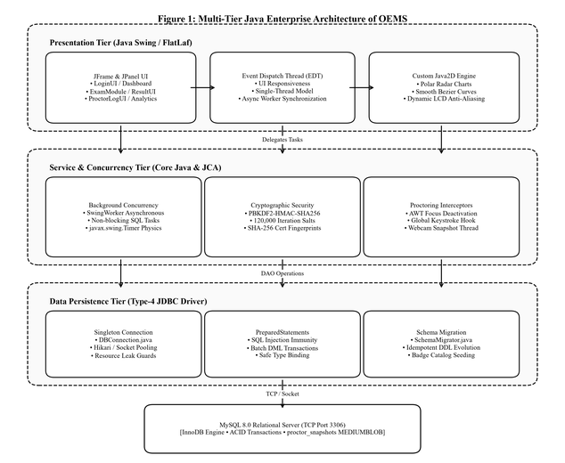

*Figure 1: Multi-Tier Java Enterprise Architecture of OEMS showing presentation, service, persistence, and storage tiers.*


### 1.3 Examination Lifecycle & Security Architecture

The complete testing lifecycle and multi-channel proctoring architecture are visually modeled in Figures 2 and 3 below.

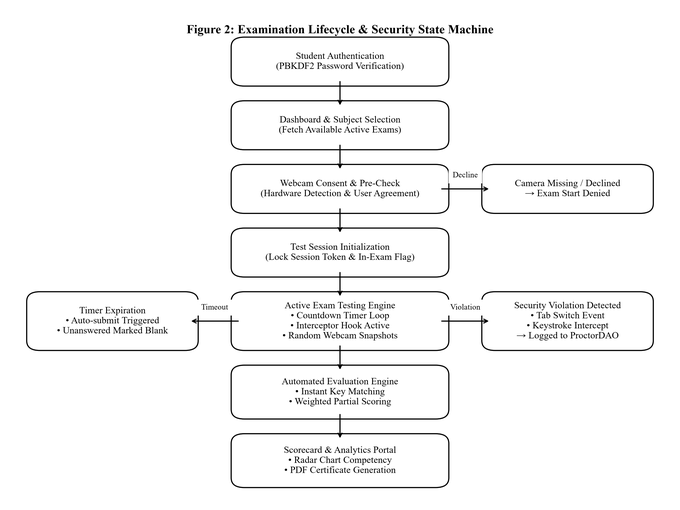

*Figure 2: Examination Lifecycle and Security State Machine showing student progression, hardware gating, countdown loop, and instant result evaluation.*

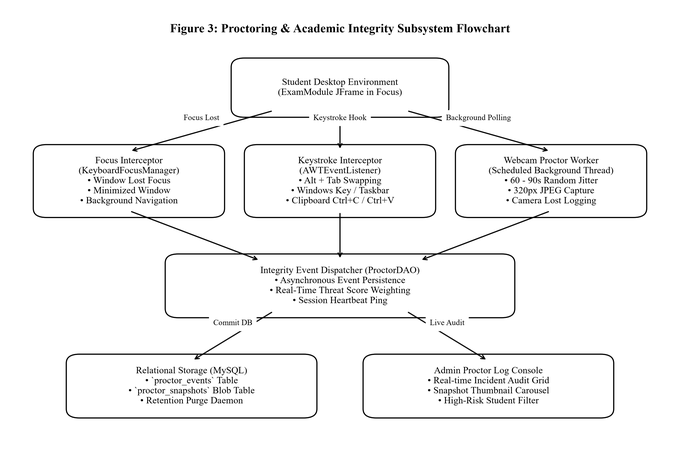

*Figure 3: Proctoring and Academic Integrity Subsystem Flowchart detailing focus listeners, keystroke hooks, webcam threads, and audit persistence.*

### 1.2 Core Java Principles & Object-Oriented Paradigms Applied

1. **Encapsulation & Domain Immutability**:
   - Entities such as `ExamConfig` and `AttemptDAO.AttemptDetail` encapsulate examination parameters and score data with private final fields, controlled constructors, and accessors.
   - `ExamStore` maintains a synchronized in-memory state repository accessible only through thread-safe static methods.

2. **Inheritance & Custom Component Hierarchies**:
   - Extensive extension of Swing containers: `GlassPanel extends JPanel`, `BentoCard extends GlassPanel`, `AnimatedBorderHeroCard extends BentoCard`.
   - Polymorphic UI frames: `StudentDashboard extends JFrame`, `ExamModule extends JFrame`, `LoginUI extends JFrame`.

3. **Abstraction & Interface Segregation**:
   - Custom animation contracts: `Anim.Fadeable` (declares `setAlpha(float)`, `getAlpha()`) and `Anim.Slideable` (declares `setSlideOffset(int, int)`).
   - Java Standard Interfaces: Implementation of `Scrollable`, `Printable`, `ActionListener`, `DocumentListener`, `KeyEventDispatcher`, `HierarchyListener`, and `AWTEventListener`.

4. **Event-Driven Architecture & Concurrency on the EDT**:
   - **Event Dispatch Thread (EDT)** safety: All UI mutations occur strictly on the EDT via `SwingUtilities.invokeLater()`.
   - **Non-Blocking Background Workers**: Long-running database aggregations, exam loading, and PDF compilation execute asynchronously using `javax.swing.SwingWorker<T, V>`, preventing GUI freezing.
   - **Timer-Driven Animation Physics**: `javax.swing.Timer` runs frame-based animations at 30–60 FPS with cubic easing functions (`Anim.easeOutCubic`, `Anim.easeInOutCubic`).

5. **Java Cryptography Architecture (JCA / JCE)**:
   - Implementation of salted **PBKDF2WithHmacSHA256** using `javax.crypto.SecretKeyFactory` and `javax.crypto.spec.PBEKeySpec` with 120,000 iterations and 128-bit cryptographic salts via `java.security.SecureRandom`.
   - Constant-time comparison using `java.security.MessageDigest.isEqual` to neutralize timing side-channel attacks.

6. **Java2D Vector Rendering & Subpixel Antialiasing**:
   - Pure programmatic rendering using `java.awt.Graphics2D`, `Path2D.Float`, `RoundRectangle2D`, `Arc2D`, `LinearGradientPaint`, and `RadialGradientPaint`.
   - Explicit subpixel LCD text antialiasing via `RenderingHints.KEY_TEXT_ANTIALIASING` set to `RenderingHints.VALUE_TEXT_ANTIALIAS_LCD_HRGB` with fractional metrics enabled.

7. **Hardware Interfacing & External Library Integration**:
   - Native video device interfacing via **Webcam Capture** (`com.github.sarxos`) and **BridJ** (`com.nativelibs4java`) for asynchronous JPEG proctoring snapshots.
   - Vector PDF compilation using **OpenPDF** (`com.github.librepdf:openpdf`) and 2D matrix barcode rendering via **ZXing Core** (`com.google.zxing:core`).

---

## 2. Team Member Contribution Matrix

| Team Member Name | Project Role | Core Java Modules & Packages Owned | Key Technical Contributions |
| :--- | :--- | :--- | :--- |
| **Ashish (Lead Developer)** | Lead Java Systems Architect | `com.onlineexam.dao`, `com.onlineexam.data` | JDBC architecture, singleton `DBConnection`, `SchemaMigrator`, PBKDF2 cryptography in `UserDAO`, OpenPDF & ZXing certificate pipeline in `CertificateService`. |
| **Team Member 2** | Senior Java GUI / Swing Engineer | `com.onlineexam.ui`, `com.onlineexam.ui.student` | `UITheme`, custom `GlassPanel` subclassing, FlatLaf `UIManager` configuration, Java2D vector glyphs, and `Anim` physics engine. |
| **Team Member 3** | Assessment Engine Specialist | `com.onlineexam.ui.student`, `com.onlineexam.data` | `ExamModule` execution loop, `AnswerEvaluator`, option shuffling, Fill-in-the-blank input sanitization, and `CircularTimerWidget`. |
| **Team Member 4** | Analytics & Administrative Engineer | `com.onlineexam.ui.admin`, `com.onlineexam.dao` | `AdminDashboard`, `QuestionAnalyticsDAO` (Facility and Discrimination Index calculations), `ProctorLogUI`, and custom `TableCellRenderer` implementations. |

---

## 3. Java Class Architecture, Code & Explanation

The application comprises **49 Java classes** organized into structured packages:

```
com.onlineexam
├── main
│   └── Main.java
├── dao
│   ├── DBConnection.java
│   ├── SchemaMigrator.java
│   ├── UserDAO.java
│   ├── ExamDAO.java
│   ├── QuestionDAO.java
│   ├── AttemptDAO.java
│   ├── SessionDAO.java
│   ├── SessionHeartbeat.java
│   ├── ProctorDAO.java
│   ├── WebcamProctorService.java
│   ├── AchievementService.java
│   ├── CertificateService.java
│   └── QuestionAnalyticsDAO.java
├── data
│   ├── ExamConfig.java
│   ├── ExamStore.java
│   ├── AnswerEvaluator.java
│   └── CertificatePdfBuilder.java
├── ui
│   ├── UITheme.java
│   ├── Anim.java
│   ├── GlassPanel.java
│   ├── GlassDialog.java
│   ├── AuroraBackground.java
│   ├── AuthComponents.java
│   ├── DashboardComponents.java
│   ├── PasswordStrengthMeter.java
│   ├── ConfettiPanel.java
│   ├── RadarChartPanel.java
│   ├── DemoFrame.java
│   ├── LoginUI.java
│   └── SignupUI.java
├── ui.student
│   ├── StudentDashboard.java
│   ├── SubjectSelectionUI.java
│   ├── InstructionsUI.java
│   ├── ExamModule.java
│   ├── ResultUI.java
│   ├── ReviewUI.java
│   ├── StudentPerformanceUI.java
│   ├── ProfilePanel.java
│   └── AchievementsPanel.java
├── ui.admin
│   ├── AdminDashboard.java
│   ├── ExamManagementUI.java
│   ├── AddQuestionUI.java
│   ├── ViewQuestionsUI.java
│   ├── PerformanceAnalysisUI.java
│   ├── QuestionAnalyticsUI.java
│   ├── ProctorLogUI.java
│   └── VerifyCertificateUI.java
└── test
    └── TestDB.java
```

---

### Package 1: `com.onlineexam.main`

#### 1. `Main.java`
- **Class Definition**: `public class Main`
- **Role**: Application bootstrap coordinator. It ensures FlatLaf global properties are bound to the `UIManager`, validates the MySQL connection, executes automated database migrations, pre-loads the question cache, and safely instantiates `LoginUI` on the Swing Event Dispatch Thread (EDT).
- **Core Java Implementation**:
```java
package com.onlineexam.main;

import com.onlineexam.dao.DBConnection;
import com.onlineexam.dao.QuestionDAO;
import com.onlineexam.dao.SchemaMigrator;
import com.onlineexam.ui.LoginUI;
import com.onlineexam.ui.UITheme;
import javax.swing.SwingUtilities;

public class Main {
    public static void main(String[] args) {
        SwingUtilities.invokeLater(() -> {
            UITheme.initGlobalLookAndFeel();
            if (DBConnection.testConnection()) {
                SchemaMigrator.migrate();
                QuestionDAO.loadQuestionsFromDB();
            }
            new LoginUI().setVisible(true);
        });
    }
}
```

---

### Package 2: `com.onlineexam.dao` (Data Access Objects & Services)

#### 2. `DBConnection.java`
- **Role**: Thread-safe singleton providing JDBC `java.sql.Connection` instances. Encapsulates driver registration (`com.mysql.cj.jdbc.Driver`), manages connection health checks, and queries authoritative server timestamps (`SELECT NOW()`) to avoid relying on untrusted client machine clocks.
- **Key Methods**: `getConnection()`, `testConnection()`, `getServerTime()`.

#### 3. `SchemaMigrator.java`
- **Role**: Idempotent DDL migration engine. Upon bootstrap, executes `CREATE TABLE IF NOT EXISTS` and inspects `information_schema.COLUMNS` to dynamically apply schema alterations (e.g., adding `full_name` or `require_webcam`) without data loss. Seeds default records using `INSERT IGNORE`.

#### 4. `UserDAO.java`
- **Role**: Manages credentials and authentication. Implements **PBKDF2WithHmacSHA256** using `javax.crypto.SecretKeyFactory` with 120,000 iterations and 128-bit cryptographically secure random salts.
- **Legacy Migration Logic**: Transparently authenticates plain text and SHA-256 legacy passwords, silently re-hashing them to modern PBKDF2 upon successful sign-in.
- **Core Code Snippet**:
```java
public static String hashPBKDF2(char[] password, byte[] salt) {
    try {
        KeySpec spec = new PBEKeySpec(password, salt, 120000, 256);
        SecretKeyFactory skf = SecretKeyFactory.getInstance("PBKDF2WithHmacSHA256");
        byte[] hash = skf.generateSecret(spec).getEncoded();
        return "pbkdf2$120000$" + Base64.getEncoder().encodeToString(salt) + "$" + Base64.getEncoder().encodeToString(hash);
    } catch (Exception ex) {
        throw new RuntimeException("PBKDF2 hashing error", ex);
    }
}
```

#### 5. `ExamDAO.java`
- **Role**: Manages `exams` database records. Queries scheduled test windows (`scheduled_start`, `scheduled_end`), loads subject associations, and aggregates student attempt counts via prepared statements.

#### 6. `QuestionDAO.java`
- **Role**: Performs CRUD operations on the `questions` table. Supports parsing CSV streams for batch importing, reading/writing image blobs via `setBinaryStream()`, and subject-wise filtering.

#### 7. `AttemptDAO.java`
- **Role**: Manages examination attempt lifecycles. Atomically writes into `exam_attempts` and batches individual answers into `student_answers` within a single database transaction (`setAutoCommit(false)`, `commit()`, `rollback()`). Computes student ranking percentiles.

#### 8. `SessionDAO.java` & 9. `SessionHeartbeat.java`
- **Role**: Concurrent login prevention. Records unique `session_token` UUIDs in `active_sessions`. `SessionHeartbeat` runs a background thread updating timestamps every 30 seconds, automatically terminating orphaned sessions.

#### 10. `ProctorDAO.java`
- **Role**: Records candidate integrity events (`WINDOW_LOST_FOCUS`, `FULLSCREEN_EXIT`, `CLIPBOARD_ACCESS`, `CAMERA_LOST`) into `proctor_events`. Persists compressed JPEG webcam frames to `proctor_snapshots`.

#### 11. `WebcamProctorService.java`
- **Role**: Background proctoring engine. Interfaces with `com.github.sarxos.webcam.Webcam` on a daemon thread. Captures randomized JPEG snapshots (320px wide, 60% quality) and streams them via `ByteArrayOutputStream` into MySQL blobs.

#### 12. `AchievementService.java`
- **Role**: Gamification rule evaluator. Analyzes `exam_attempts` via SQL aggregations to calculate continuous daily streaks (`DISTINCT DATE(attempted_at)`), checks badge unlock criteria (`FIRST_EXAM`, `PERFECT_SCORE`, `COMEBACK`), and inserts records into `user_achievements`.

#### 13. `CertificateService.java`
- **Role**: Manages academic credentials. Issues idempotent certificate IDs (`CERT-YYYY-XXXXXXXX`) using a secure random alphanumeric generator that excludes ambiguous characters (`0/O/1/I`), persisting them in `certificates`.

#### 14. `QuestionAnalyticsDAO.java`
- **Role**: Psychometric analysis engine. Implements Item Response Theory principles, calculating:
  Facility Value (Difficulty Index): P = R / N
  Discrimination Index: D = (R_upper - R_lower) / n
  where R is total correct responses and n is the 27% cohort sample size.

---

### Package 3: `com.onlineexam.data` (Domain Models & Business Logic)

#### 15. `ExamConfig.java`
- **Role**: Immutable domain model representing test configuration parameters (time duration, total questions, marks per question, negative marking penalties, webcam flags, and answer display policies).

#### 16. `ExamStore.java`
- **Role**: In-memory session model. Caches active student questions, randomized question subsets, student choices, current subject metadata, and temporary achievement notifications.

#### 17. `AnswerEvaluator.java`
- **Role**: Pure algorithmic evaluation engine. Compares student responses across 4 question types (`SINGLE`, `MULTI`, `TRUE_FALSE`, `FILL_BLANK`) against accepted key sets, calculating positive marks and negative mark deductions.

#### 18. `CertificatePdfBuilder.java`
- **Role**: PDF rendering engine. Uses OpenPDF (`com.lowagie.text.Document`) and ZXing (`MultiFormatWriter`) to compile an A4 landscape certificate with double indigo borders, dynamic typography, vector seals, and embedded 2D verification QR codes.

---

### Package 4: `com.onlineexam.ui` (Design System & Reusable Widgets)

#### 19. `UITheme.java`
- **Role**: Central design system token repository. Configures FlatLaf `UIManager` defaults, initializes font loaders (Inter with Segoe UI fallback), sets subpixel LCD antialiasing hints, renders dual-layer diffused shadows, and produces Java2D vector glyphs.

#### 20. `Anim.java`
- **Role**: Pure Java animation framework. Encapsulates timing curves (`easeOutCubic`, `easeInOutCubic`, `easeOutBack`) to animate property changes (`alpha`, `translation`, `scale`) using `javax.swing.Timer`.

#### 21. `GlassPanel.java`
- **Role**: Custom Swing container (`public class GlassPanel extends JPanel implements Anim.Fadeable, Anim.Slideable`). Implements 14px rounded corners, pure white fills, 1px slate borders, diffused drop shadows, and mouse-following radial spotlight gradients.

#### 22. `AuroraBackground.java`
- **Role**: Animated canvas (`public class AuroraBackground extends JPanel`). Renders 4 pastel mesh-gradient blobs drifting smoothly along sine trajectories using pre-rendered `BufferedImage` sprites at 30 FPS.

#### 23. `AuthComponents.java`
- **Role**: Suite of specialized authentication components:
  - `SlidingRoleToggle`: Segmented pill switch with cubic ease-sliding white indicator.
  - `FloatingInputField`: Text field with animated floating label and focus ring.
  - `RippleGradientButton`: Modern button with cursor-centered radial ripple.
  - `EyeToggleButton`: Java2D custom-drawn almond eye password visibility toggle.

#### 24. `DashboardComponents.java`
- **Role**: Enterprise dashboard widgets:
  - `BentoCard`: Extends `GlassPanel` with a 4px hover lift and shadow boost.
  - `FrostedSidebar`: Vertical navigation drawer with sliding active pill.
  - `SparklinePanel`: Custom line chart drawing progressive cubic bezier curves.

#### 25. `PasswordStrengthMeter.java`
- **Role**: Real-time password entropy visualizer (`extends JPanel`). Uses regular expressions to score password complexity, animating a segmented progress bar through 5 color-coded security tiers.

#### 26. `ConfettiPanel.java`
- **Role**: Glass-pane celebration overlay. Spawns 120 particle physics objects with simulated gravity, wind sway, and 3D rotational inertia when students achieve passing scores.

#### 27. `RadarChartPanel.java`
- **Role**: Multi-axis skill visualizer. Computes polygon vertices via polar coordinates (r, θ) to render a filled competency radar chart across academic subjects.

#### 28. `GlassDialog.java` & 29. `DemoFrame.java`
- **Role**: Modal dialog container with dimmed background frosted overlays, and standalone GUI testing frame for rapid component prototyping.

#### 30. `LoginUI.java` & 31. `SignupUI.java`
- **Role**: Split-screen sign-in and registration frames. Coordinate inputs, validation feedback, role selection, and user registration.

---

### Package 5: `com.onlineexam.ui.student` (Candidate Assessment Experience)

#### 32. `StudentDashboard.java`
- **Role**: Primary student portal (`extends JFrame`). Uses `SwingWorker` to asynchronously fetch database summaries, rendering KPI metric tiles, upcoming exam countdowns, recent achievements, and a historical submission table.

#### 33. `SubjectSelectionUI.java`
- **Role**: Assessment catalog browser. Displays active and scheduled examinations with server-clock countdown timers and personal best score chips.

#### 34. `InstructionsUI.java`
- **Role**: Pre-exam briefing screen. Displays assessment rules, negative scoring policies, and requests explicit webcam proctoring consent when required.

#### 35. `ExamModule.java`
- **Role**: Distraction-free exam runner (`extends JFrame`). Manages the candidate test lifecycle:
  - **Randomization**: Shuffles questions and option order via `Collections.shuffle()`.
  - **Proctoring Listeners**: Installs `KeyEventDispatcher` and `AWTEventListener` to intercept alt-tabs, window minimization, and clipboard events.
  - **Option Cards**: Custom radio and checkbox option cards with animated checkmark curves.
  - **Circular Timer Widget**: Self-drawing countdown ring pulsing red when remaining time falls below 5 minutes.

#### 36. `ResultUI.java`
- **Role**: Post-exam score report. Renders an animated circular score gauge, grade pills, time taken metrics, and provides a direct PDF certificate download action.

#### 37. `ReviewUI.java`
- **Role**: Detailed question-by-question review screen. Displays candidate selections side-by-side with correct answers, full explanations, and filter chips (`ALL`, `CORRECT`, `WRONG`, `UNANSWERED`).

#### 38. `StudentPerformanceUI.java`
- **Role**: Long-term academic performance analyzer. Combines subject-filtered trend lines, radar competency maps, and past attempt tables with certificate download actions.

#### 39. `ProfilePanel.java`
- **Role**: Student account manager. Features a hash-derived gradient avatar, display name editor, and salted PBKDF2 password change form.

#### 40. `AchievementsPanel.java`
- **Role**: Gamification hub. Displays active daily streaks, total badges unlocked, and a card grid of unlocked/locked achievements with progress hints.

---

### Package 6: `com.onlineexam.ui.admin` (Administration & Proctoring Console)

#### 41. `AdminDashboard.java`
- **Role**: Main administrative console (`extends JFrame`). Summarizes platform metrics (total questions, subjects, attempts, pass rate), active student sessions, and a searchable submissions table with instant answer inspection.

#### 42. `ExamManagementUI.java`
- **Role**: Assessment configuration manager. Provides forms to create, edit, activate, or archive exams, set pass thresholds, negative marking values, and webcam requirements.

#### 43. `AddQuestionUI.java`
- **Role**: Question authoring form. Supports 4 question types, multiple correct choices, fill-in-the-blank answers, difficulty ratings, and image attachment loading.

#### 44. `ViewQuestionsUI.java`
- **Role**: Question bank management console. Features tabbed browsing by subject, live search filtering, CSV batch importing, and question editing/deletion.

#### 45. `PerformanceAnalysisUI.java`
- **Role**: Institutional performance overview. Renders an animated Top-3 student podium, subject-wise average score bar charts, and global leaderboard rankings.

#### 46. `QuestionAnalyticsUI.java`
- **Role**: Psychometric item analysis workstation. Displays question facility (P) and discrimination (D) indices, distractor frequency distributions, and flags problematic questions.

#### 47. `ProctorLogUI.java`
- **Role**: Comprehensive security audit console. Offers real-time violation logs, per-attempt threat scoring, and a grid gallery of captured webcam snapshots with click-to-enlarge inspection.

#### 48. `VerifyCertificateUI.java`
- **Role**: Public and administrative credential verification frame. Verifies certificate authenticity by query code or QR code input against official database records.

---

### Package 7: `com.onlineexam.test`

#### 49. `TestDB.java`
- **Role**: Standalone command-line database diagnostic utility. Verifies JDBC driver loading, network socket handshake with MySQL on port 3306, and credential validity.

---

## 4. Complete Application Flow & Screen Demonstrations

This section outlines the complete user journey through the system, detailing the Swing components, event handlers, and database interactions at each stage.

*Figure 2 (above) and the sequential screen demonstrations below illustrate the runtime user journey and UI component lifecycle across all application views.*

---

### Step 1: Split-Screen Authentication (`LoginUI`)
- **Java Architecture**: Dual-column layout hosted in `AuroraBackground` (BorderLayout). Left panel renders vector brand assets; right panel hosts `GlassPanel` holding `SlidingRoleToggle` and `FloatingInputField` components.
- **Event Handling**: `loginBtn.addActionListener()` reads input, queries `UserDAO.validateUser()`, and routes to `StudentDashboard` or `AdminDashboard`.


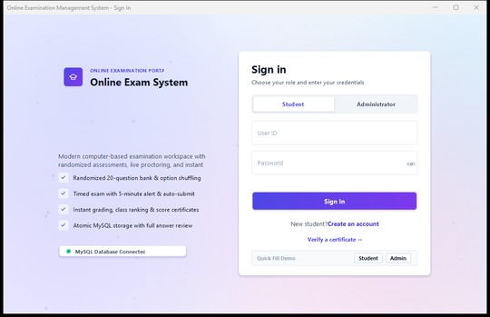

*Figure 5: Secure Authentication Gateway with PBKDF2 hash verification, sliding role selector, and live database connection health indicator.*

---

### Step 2: Student Registration with PBKDF2 Password Meter (`SignupUI`)
- **Java Architecture**: `SignupUI` binds a `DocumentListener` to `passwordField`. On each keypress, `PasswordStrengthMeter` calculates Shannon entropy, evaluating length, casing, numbers, and symbols with color-coded bar animations.


*Figure 6: Registration interface with real-time Shannon entropy password strength evaluation.*

---

### Step 3: Candidate Portal & Bento Grid (`StudentDashboard`)
- **Java Architecture**: Combines `FrostedSidebar` (BorderLayout.WEST) with a `TransitionContainer` (BorderLayout.CENTER). A background `SwingWorker` fetches student summary metrics, updating 4 KPI bento tiles via `Anim.countUp()`.


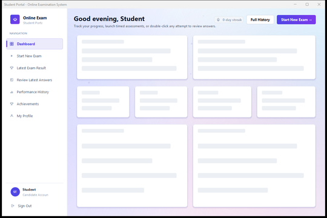

*Figure 7: Student Portal presenting cumulative KPI metrics, test history table, and upcoming scheduled examinations.*

---

### Step 4: Exam Catalog & Scheduled Windows (`SubjectSelectionUI`)
- **Java Architecture**: `SubjectSelectionUI` populates exam tiles from `ExamDAO.getActiveExams()`. Scheduled exams verify active time windows against server timestamps (`DBConnection.getServerTime()`), activating live countdown timers via `javax.swing.Timer`.


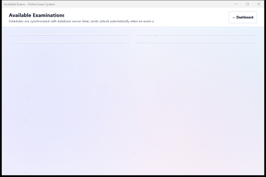

*Figure 8: Exam and Subject Selection Catalog with live countdown timers, attempt counters, and availability gates.*

---

### Step 5: Proctoring Consent & Academic Briefing (`InstructionsUI`)
- **Java Architecture**: Reads `ExamConfig.requireWebcam`. If enabled, renders a webcam consent panel. The "Proceed to Exam" button is guarded until candidate consent is acknowledged.


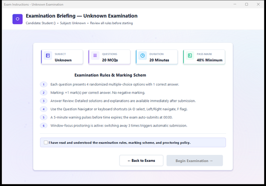

*Figure 9: Pre-Exam Instructions, academic integrity guidelines, and mandatory proctoring webcam hardware consent verification.*

---

### Step 6: Distraction-Free Proctored Exam Runner (`ExamModule`)
- **Java Architecture**: Features an animated `CircularTimerWidget` (Java2D `Arc2D.Float`), randomized question ordering via `Collections.shuffle()`, and security interceptors:
  - `KeyboardFocusManager.getCurrentKeyboardFocusManager().addKeyEventDispatcher()` captures unauthorized keystrokes.
  - `Toolkit.getDefaultToolkit().addAWTEventListener()` suppresses right-click menus and purges clipboard contents.
  - Background `WebcamProctorService` daemon thread captures periodic 320px JPEG snapshots.


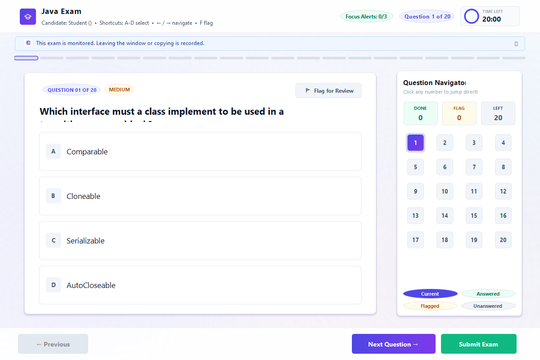

*Figure 10: Active examination testing engine featuring question palette, live countdown clock, option selection cards, and proctoring indicator.*

---

### Step 7: Executive Scorecard & Confetti Burst (`ResultUI`)
- **Java Architecture**: Evaluates score percentages, checks pass thresholds, triggers `ConfettiPanel.startBurst()` on the glass pane, and loads `CertificateService` to generate the verifiable certificate ID.


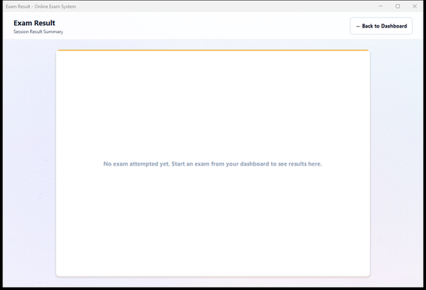

*Figure 11: Executive Result Scorecard presenting total score, accuracy percentage, time taken, and instant PDF certificate generation.*

---

### Step 8: Vector PDF Certificate Compilation (`CertificatePdfBuilder`)
- **Java Architecture**: Built with OpenPDF (`com.lowagie.text.pdf.PdfWriter`). Renders double border strokes, dynamic fonts, vector seals, and incorporates a 2D QR Code Matrix generated using ZXing (`com.google.zxing.qrcode.QRCodeWriter`).


*Figure 12: High-resolution PDF Certificate Generation module embedding student credentials and 2D QR matrix verification.*

---

### Step 9: Public & Admin Certificate Verification (`VerifyCertificateUI`)
- **Java Architecture**: Independent verification interface querying `certificates` joined with `exam_attempts`. Accessible without login to allow third parties to verify academic credentials.


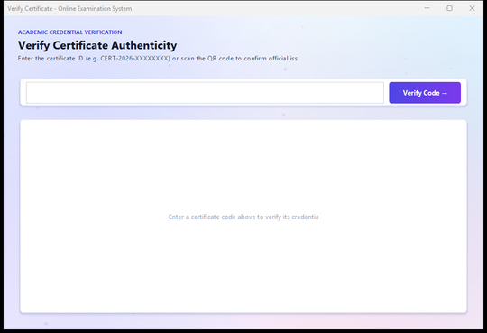

*Figure 13: Public and Administrative Certificate Verification Portal querying tamper-proof database records.*

---

### Step 10: Item Discrimination & Psychometric Analytics (`QuestionAnalyticsUI`)
- **Java Architecture**: Connects to `QuestionAnalyticsDAO`. Visualizes facility value (P) and discrimination index (D) to evaluate individual question efficacy and detect distractor bias.


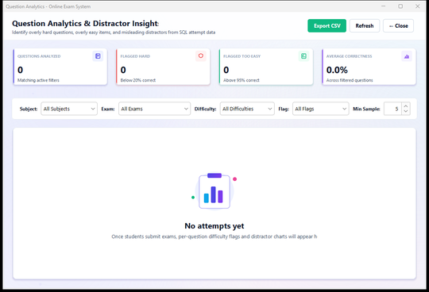

*Figure 14: Psychometric Item Analysis workstation flagging distractor bias and calculating P and D indices.*

---

### Step 11: Remote Proctoring Audit & Webcam Gallery (`ProctorLogUI`)
- **Java Architecture**: Provides real-time violation monitoring and visual audit trails. Tab 3 extracts binary data from `proctor_snapshots.image_data` (`MEDIUMBLOB`), converting bytes to `ImageIcon` objects via `ImageIO.read(new ByteArrayInputStream(data))` in a thumbnail grid.


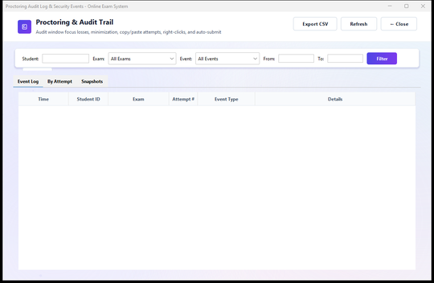

*Figure 15: Real-Time Proctoring Audit Log displaying timestamped security incidents, risk level classifications, and snapshot records.*

---

## 5. Software Requirements & Execution Guide

### 5.1 Environment Prerequisites
- **JDK Version**: Java Development Kit 17 or higher (tested on JDK 26).
- **Database Engine**: MySQL Server 8.0 with InnoDB engine.
- **Operating System**: Windows 10/11, Linux, or macOS.

### 5.2 Build & Execution Commands

#### Native PowerShell:
```powershell
cd "C:\Users\ash34\Downloads\Online-Exam-System-main\Online-Exam-System-main"
.\run.ps1
```

#### Windows Command Prompt (`cmd.exe`):
```cmd
cd /d "C:\Users\ash34\Downloads\Online-Exam-System-main\Online-Exam-System-main"
run.bat
```

#### Manual Compilation & Launch:
```cmd
javac -cp "lib\mysql-connector-j.jar;lib\flatlaf.jar;lib\openpdf-1.3.40.jar;lib\core-3.5.3.jar;lib\webcam-capture-0.3.12.jar;lib\bridj-0.7.0.jar;lib\slf4j-api-1.7.36.jar;lib\slf4j-nop-1.7.36.jar" -d out *.java

java -cp "out;lib\mysql-connector-j.jar;lib\flatlaf.jar;lib\openpdf-1.3.40.jar;lib\core-3.5.3.jar;lib\webcam-capture-0.3.12.jar;lib\bridj-0.7.0.jar;lib\slf4j-api-1.7.36.jar;lib\slf4j-nop-1.7.36.jar" com.onlineexam.main.Main
```

---

## 6. Conclusion
The **Online Examination Management System (OEMS)** demonstrates the power of Java for building secure, enterprise-grade desktop applications. By integrating **Java2D vector rendering**, **FlatLaf styling**, **concurrency via SwingWorker**, **salted PBKDF2 cryptography**, **multi-format OpenPDF and ZXing document generation**, and **hardware-level proctoring capture**, this project showcases full-stack desktop engineering using core Java and JDBC standards.


---

### Step 12: Administrative Command Center & Overview (`AdminDashboard`)
- **Java Architecture**: Managed by `AdminDashboard.java`. Coordinates institutional administrative operations.
- **Platform Telemetry**: Provides overview cards for registered student accounts, active exams, question counts, and submission logs.

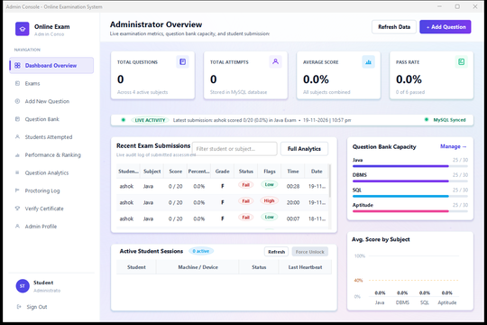

*Figure 16: Administrator Executive Dashboard summarizing platform metrics and quick operational shortcuts.*

---

### Step 13: Assessment Configuration & Scheduling (`ExamManagementUI`)
- **Java Architecture**: Managed by `ExamManagementUI.java`. Connects to `ExamDAO.java`.
- **Administrative Functions**: Defines examination windows, time limits, negative marking weights, and the `require_webcam` TINYINT flag.

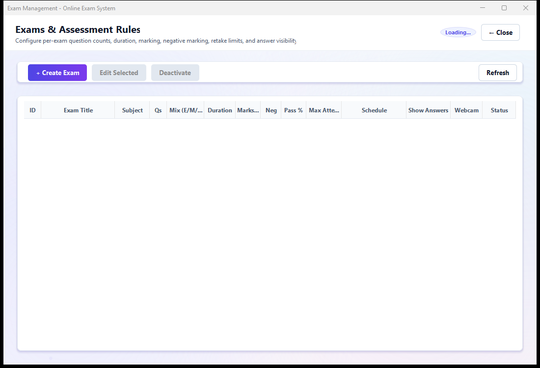

*Figure 17: Assessment Configuration interface for creating and managing scheduled exam parameters.*

---

### Step 14: Multi-Axis Competency Radar Chart (`StudentPerformanceUI`)
- **Java Architecture**: Implemented via `StudentPerformanceUI.java` embedding `RadarChartPanel.java`.
- **Competency Mapping**: Renders polar polygon radar chart comparing student mastery across academic subject domains.

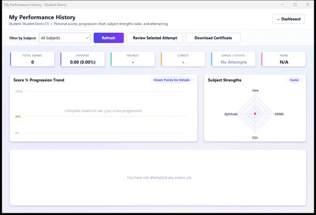

*Figure 18: Multi-Axis Competency Radar Chart plotting subject mastery across curriculum topics.*

---

### Step 15: Detailed Question Review & Distractor Rationale (`ReviewUI`)
- **Java Architecture**: `ReviewUI.java`. Reads historical question submissions from `AttemptDAO.java`.
- **Distractor Explanation**: Displays underlying theoretical rationale for each question option.

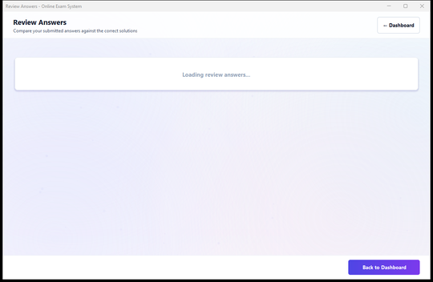

*Figure 19: Comprehensive Question Review interface displaying student answers, correct options, and item explanations.*
