# ONLINE EXAMINATION MANAGEMENT SYSTEM (OEMS)
## A Robust Computer-Based Testing Platform Engineered in Core Java & MySQL

**Course**: Java Enterprise Programming / Computer-Based Testing Systems  
**Academic Year**: 2025–2026 | **Platform**: Desktop Application (Java Swing, JDBC, MySQL 8.0)  
**Target Environment**: Java SE Development Kit 17+ (Tested on JDK 21 / JDK 26)

---

<!-- PAGE BREAK -->

# 1. INTRODUCTION

### 1.1 Project Aim
The primary aim of the Online Examination Management System (OEMS) is to engineer a secure, zero-latency, and tamper-resistant desktop Computer-Based Testing (CBT) platform in Core Java and MySQL. Traditional web-based examination portals present severe academic integrity vulnerabilities, including unmonitored browser tab switching, client-side inspection script tampering, and high latency network jitter. OEMS solves these issues by operating as a native desktop application that enforces JVM-level event interception, cryptographic credential protection, and automated background proctoring while demonstrating advanced Object-Oriented Programming (OOP) paradigms, multithreaded concurrency, and transactional relational persistence.

### 1.2 Advanced Features of the Project
1. **Zero-Latency Desktop Presentation Engine**: Built with Java Swing and modernized with FlatLaf Light Look & Feel, LCD sub-pixel font anti-aliasing hints, smooth Bezier curves, and responsive glassmorphic cards executed strictly on the Swing Event Dispatch Thread (EDT).
2. **Military-Grade PBKDF2-HMAC-SHA256 Cryptography**: Candidate and administrator credentials are protected using 120,000 iterative key-stretching rounds and 128-bit cryptographically secure pseudorandom salts via `javax.crypto.SecretKeyFactory`, eliminating rainbow-table attacks with automated legacy hash migration.
3. **Multi-Channel Automated Proctoring Subsystem**: Features JVM-level OS window focus deactivation listeners (`WindowFocusListener`), low-level keyboard hook filtering (`KeyboardFocusManager`) blocking forbidden shortcuts (`Alt + Tab`, `Win`, `Ctrl + C/V`), automated threat scoring, and background daemon threads capturing webcam surveillance snapshots.
4. **Transactional ACID Persistence & Idempotent Schema Migrations**: Type-4 JDBC architecture with thread-safe singleton pooling (`DBConnection.java`), parameterized `PreparedStatement` queries immune to SQL injection, two-phase commit transactions, and dynamic schema evolutions (`SchemaMigrator.java`).
5. **Dynamic Question Bank & Bulk CSV Importer**: Complete relational authoring supporting 4 question types (Single-Choice, Multi-Correct, Fill-in-the-Blank, True/False), image attachment streaming, and multi-line CSV batch ingestion.
6. **Classical Test Theory (CTT) Psychometric Analytics**: Real-time evaluation of question quality via Item Difficulty (Facility Index $P = R / N$) and Item Discrimination ($D = (U - L) / N_G$) calculated using the Kelley 27% upper/lower cohort rule.
7. **Tamper-Evident Vector PDF Certification**: Generates high-resolution PDF credentials dynamically containing candidate performance metrics, SHA-256 digital verification hashes, and high-density 2D QR codes verifiable against official database records.
8. **Multi-Axis Competency Radar Geometry**: Visualizes candidate mastery across multiple curriculum dimensions using custom trigonometric Java2D polar coordinate plotting (`StudentPerformanceUI.java`).
9. **Concurrent Active Session Locking & Daemon Heartbeat**: Issues cryptographically secure UUID tokens and runs 30-second background daemon pings (`SessionHeartbeat.java`) to prevent simultaneous multi-device logins.
10. **Distraction-Free Kiosk Runner**: Full-screen testing environment featuring real-time countdown physics, interactive question navigation palette, instant answer state saving, and automatic submission upon timer expiration or proctoring threshold breach.

<!-- PAGE BREAK -->

# 2. CONTRIBUTION: TEAM MEMBER ROLES & DELIVERABLES

The design, engineering, testing, and deployment of the Online Examination Management System was collaboratively executed across four specialized technical domains according to enterprise separation-of-concerns principles:

| Team Member | Role & Architectural Specialty | Java Packages Owned | Core Architectural Deliverables & Implementation Responsibilities |
|:---|:---|:---|:---|
| **Team Member 1** | Lead Software Architect & Security Engineer | `com.onlineexam.main`, `com.onlineexam.dao` | Central application bootstrap (`Main.java`), Look & Feel initialization, PBKDF2-HMAC-SHA256 cryptographic password hashing (`UserDAO.java`), concurrent session token management (`SessionDAO.java`, `SessionHeartbeat.java`), and low-level AWT window focus/keystroke interceptor design. |
| **Team Member 2** | Database Systems & Persistence Architect | `com.onlineexam.dao`, `com.onlineexam.test` | Relational database schema design (8 normalized tables), Type-4 JDBC singleton connection pooling (`DBConnection.java`), automated idempotent DDL migrations (`SchemaMigrator.java`), transactional attempt persistence (`AttemptDAO.java`), and CSV batch question importing (`QuestionDAO.java`). |
| **Team Member 3** | Assessment Engine & UI/UX Systems Engineer | `com.onlineexam.ui`, `com.onlineexam.ui.student`, `com.onlineexam.data` | Distraction-free exam runner (`ExamModule.java`), question palette navigation, real-time timer countdown loop, answer scoring and evaluation engine (`AnswerEvaluator.java`, `ExamStore.java`), design system tokens (`UITheme.java`, `GlassPanel.java`), and candidate dashboard (`StudentDashboard.java`). |
| **Team Member 4** | Psychometrics, Proctoring & Admin Console Engineer | `com.onlineexam.ui.admin`, `com.onlineexam.dao`, `com.onlineexam.data` | Administrator executive command center (`AdminDashboard.java`), Classical Test Theory psychometric algorithms (`QuestionAnalyticsDAO.java`, `QuestionAnalyticsUI.java`), webcam surveillance audit gallery (`ProctorLogUI.java`, `WebcamProctorService.java`), and vector PDF certificate builder (`CertificatePdfBuilder.java`, `VerifyCertificateUI.java`). |

### Detailed Individual Contributions:
1. **Team Member 1 (Lead Software Architect & Security Engineer)**:
   - Engineered application lifecycle initialization in `Main.java`, configuring LCD font rendering hints and pre-flight database connection tests.
   - Implemented PBKDF2-HMAC-SHA256 password derivation in `UserDAO.java` utilizing `javax.crypto.SecretKeyFactory` with 120,000 iterations and 128-bit CSPRNG salts.
   - Architected concurrent session gating in `SessionDAO.java` and `SessionHeartbeat.java` to prevent duplicate concurrent logins.
   - Designed the AWT window focus loss interceptor and `KeyboardFocusManager` global key event hooks in `ExamModule.java`.
2. **Team Member 2 (Database Systems & Persistence Architect)**:
   - Developed thread-safe singleton JDBC connection manager in `DBConnection.java` with server-time query logic (`SELECT NOW()`).
   - Authored the automated schema migration engine in `SchemaMigrator.java` performing idempotent DDL updates without data loss.
   - Structured ACID transactional submission in `AttemptDAO.java` using two-phase commit (`setAutoCommit(false)`, `commit()`, `rollback()`).
   - Implemented question catalog persistence and CSV batch ingestion in `QuestionDAO.java` using JDBC statement batching.
3. **Team Member 3 (Assessment Engine & UI/UX Systems Engineer)**:
   - Constructed the distraction-free examination runner in `ExamModule.java` with question palette state tracking and auto-save listeners.
   - Developed domain models and assessment state management in `ExamConfig.java`, `ExamStore.java`, and `AnswerEvaluator.java`.
   - Created the reusable custom UI component library: `UITheme.java`, `GlassPanel.java`, `AuroraBackground.java`, `Anim.java`, and `PasswordStrengthMeter.java`.
   - Designed the candidate portal in `StudentDashboard.java`, `SubjectSelectionUI.java`, and `InstructionsUI.java`.
4. **Team Member 4 (Psychometrics, Proctoring & Admin Console Engineer)**:
   - Built the administrative management workstation in `AdminDashboard.java`, `ExamManagementUI.java`, and `ViewQuestionsUI.java`.
   - Formulated Classical Test Theory algorithms in `QuestionAnalyticsDAO.java` calculating Facility ($P$) and Discrimination ($D$) indices.
   - Implemented background webcam proctoring daemon in `WebcamProctorService.java` and visual surveillance audit log in `ProctorLogUI.java`.
   - Developed the vector PDF certificate generator in `CertificatePdfBuilder.java` with SHA-256 QR codes and `VerifyCertificateUI.java`.

<!-- PAGE BREAK -->

# 3. CODE OF EACH CLASS WITH BRIEF EXPLANATION

This section documents the software architecture and implementation of **all 49 Java classes** that comprise the Online Examination Management System. The classes are structured into 7 modular enterprise packages according to separation-of-concerns principles.


---

### Package 1: `com.onlineexam.main` (Application Lifecycle & Bootstrap)

#### 1. `Main.java`
- **Package**: `com.onlineexam.main`
- **Design Pattern & Role**: **Bootstrap Entry Point**. Central execution entry point of the OEMS desktop application. Initializes FlatLaf Light Look & Feel, verifies MySQL connectivity, executes automated schema migrations, preloads question caches, and safely schedules `LoginUI` on the Swing Event Dispatch Thread (EDT).
- **Key Methods**:
  - `main(String[] args)`: Configures LCD sub-pixel font anti-aliasing hints, tests JDBC connection, calls `SchemaMigrator.migrate()`, and invokes `SwingUtilities.invokeLater()`.
- **Core Java Implementation**:
```java
public class Main {
    public static void main(String[] args) {

        // Initialize base tables and run idempotent schema migrations BEFORE loading questions
        AttemptDAO.initializeAttemptTable();
        SchemaMigrator.run();
        QuestionDAO.loadQuestionsFromDB();
        AttemptDAO.loadAttemptsFromDB();
        SessionHeartbeat.installShutdownHook();

        // Start UI
        SwingUtilities.invokeLater(() -> {
            UITheme.initGlobalLookAndFeel();
            new LoginUI();
        });
    }
}
```
- **Technical Architecture & Concurrency**: `Main.java` strictly complies with Java enterprise standards. Socket connections, prepared statements, and result sets are encapsulated with automatic try-with-resources resource release. Heavy relational queries and hardware I/O operations are offloaded from the Event Dispatch Thread (EDT) via `SwingWorker` or daemon threads to guarantee 60 FPS user interface responsiveness.


---

### Package 2: `com.onlineexam.dao` (Data Access Objects & Security Services)

#### 2. `DBConnection.java`
- **Package**: `com.onlineexam.dao`
- **Design Pattern & Role**: **Singleton Database Factory**. Thread-safe singleton connection manager providing JDBC `java.sql.Connection` instances. Implements lazy initialization, auto-reconnect logic, connection testing, and queries authoritative database server timestamps (`SELECT NOW()`) to prevent student system-clock tampering.
- **Key Methods**:
  - `getConnection()`: Retrieves or re-establishes active Connection.
  - `getServerTime()`: Queries MySQL `SELECT NOW()` to synchronize testing windows.
  - `testConnection()`: Health-check ping returning connection status.
- **Core Java Implementation**:
```java

    public static Connection getConnection() throws SQLException {
        try {
            Class.forName(DRIVER);
        } catch (ClassNotFoundException e) {
            throw new SQLException("MySQL JDBC Driver not found.", e);
        }
        return DriverManager.getConnection(URL, USER, PASS);
    }

    /**
     * Fetches the authoritative current timestamp from the MySQL server (SELECT NOW()).
     * Falls back to LocalDateTime.now() only if the DB query fails.
     */
    public static LocalDateTime getServerTime() {
        try (Connection con = getConnection()) {
            return getServerTime(con);
        } catch (SQLException e) {
            System.err.println("[DBConnection] Failed to query DB server time: " + e.getMessage());
            return LocalDateTime.now();
        }
    }
```
- **Technical Architecture & Concurrency**: `DBConnection.java` strictly complies with Java enterprise standards. Socket connections, prepared statements, and result sets are encapsulated with automatic try-with-resources resource release. Heavy relational queries and hardware I/O operations are offloaded from the Event Dispatch Thread (EDT) via `SwingWorker` or daemon threads to guarantee 60 FPS user interface responsiveness.

#### 3. `SchemaMigrator.java`
- **Package**: `com.onlineexam.dao`
- **Design Pattern & Role**: **Idempotent DDL Migration Engine**. Idempotent database migration service executed at startup. Inspects database schema metadata via `information_schema.COLUMNS` and dynamically executes DDL alterations (`ALTER TABLE ADD COLUMN IF NOT EXISTS`) and default catalog seeding without dropping existing production data.
- **Key Methods**:
  - `migrate()`: Sequentially creates 8 relational tables and applies column upgrades.
  - `addColumnIfNotExists()`: Inspects metadata to safely evolve table structures.
  - `seedDefaultBadges()`: Populates achievement badges using `INSERT IGNORE`.
- **Core Java Implementation**:
```java
 */
public final class SchemaMigrator {

    private static final Pattern CREATE_TABLE_NAME = Pattern.compile(
            "(?is)CREATE\\s+TABLE\\s+(?:IF\\s+NOT\\s+EXISTS\\s+)?`?([a-zA-Z0-9_]+)`?"
    );

    private SchemaMigrator() {
    }

    /**
     * Runs all idempotent schema migrations against the configured MySQL database.
     * Logs each applied change to stdout; remains silent when schema is already up to date.
     * Fails with a clear error message if the database connection cannot be established.
     */
    public static void run() {
        try (Connection con = DBConnection.getConnection()) {
            // Track applied migrations metadata (created once; silent on subsequent startups)
            createTableIfMissing(con,
                    "CREATE TABLE schema_migrations ("
                    + "id INT AUTO_INCREMENT PRIMARY KEY, "
                    + "migration_key VARCHAR(120) NOT NULL UNIQUE, "
```
- **Technical Architecture & Concurrency**: `SchemaMigrator.java` strictly complies with Java enterprise standards. Socket connections, prepared statements, and result sets are encapsulated with automatic try-with-resources resource release. Heavy relational queries and hardware I/O operations are offloaded from the Event Dispatch Thread (EDT) via `SwingWorker` or daemon threads to guarantee 60 FPS user interface responsiveness.

#### 4. `UserDAO.java`
- **Package**: `com.onlineexam.dao`
- **Design Pattern & Role**: **Cryptographic User Data Access Object**. Handles candidate and administrator authentication. Implements cryptographic password hashing using **PBKDF2WithHmacSHA256** with 120,000 iterations and 128-bit cryptographically secure random salts. Transparently migrates legacy plain-text or SHA-256 passwords upon successful sign-in.
- **Key Methods**:
  - `hashPBKDF2(char[], byte[])`: Derives 256-bit key using `SecretKeyFactory`.
  - `validateUser(String, String, String)`: Authenticates credentials against database hash.
  - `registerUser(...)`: Creates new student account with unique salted hash.
- **Core Java Implementation**:
```java

public class UserDAO {

    public static final String PBKDF2_ALGORITHM = "PBKDF2WithHmacSHA256";
    public static final int PBKDF2_ITERATIONS = 120000;
    public static final int PBKDF2_KEY_LENGTH = 256; // 32 bytes
    public static final int SALT_BYTES = 16;
    private static final SecureRandom SECURE_RANDOM = new SecureRandom();

    public enum SignupStatus {
        SUCCESS,
        USER_EXISTS,
        DB_ERROR
    }

    public static class UserProfile {
        public final int id;
        public final String username;
        public final String fullName;
        public final String role;
        public final Timestamp createdAt;
```
- **Technical Architecture & Concurrency**: `UserDAO.java` strictly complies with Java enterprise standards. Socket connections, prepared statements, and result sets are encapsulated with automatic try-with-resources resource release. Heavy relational queries and hardware I/O operations are offloaded from the Event Dispatch Thread (EDT) via `SwingWorker` or daemon threads to guarantee 60 FPS user interface responsiveness.

#### 5. `ExamDAO.java`
- **Package**: `com.onlineexam.dao`
- **Design Pattern & Role**: **Assessment Data Access Object**. Manages examination configuration and scheduled availability windows. Compares database server timestamps with `scheduled_start` and `scheduled_end` to enforce test start gates and max attempt limits per candidate.
- **Key Methods**:
  - `canStart(String, int)`: Validates active time window and student attempt limits.
  - `getActiveExams()`: Fetches published exams eligible for student taking.
  - `saveExam(ExamConfig)`: Inserts or updates examination parameters.
- **Core Java Implementation**:
```java
     */
    public static ExamAvailabilityResult canStart(String userId, int examId) {
        ExamConfig exam = getById(examId);
        LocalDateTime serverNow = DBConnection.getServerTime();
        int used = (userId != null && !userId.trim().isEmpty() && exam != null)
                ? countAttemptsByUser(userId, examId) : 0;
        if (serverNow == null) {
            return new ExamAvailabilityResult(
                    ExamAvailability.INACTIVE, false,
                    "Cannot verify database server time. Exam cannot be started.",
                    exam != null ? exam.startAt : null,
                    exam != null ? exam.endAt : null,
                    null, 0L, used, exam != null ? exam.maxAttempts : null, exam
            );
        }
        return evaluateAvailability(exam, serverNow, used, true);
    }

    /**
     * Pure availability evaluator given a known server timestamp and user's attempt count.
     */
    public static ExamAvailabilityResult evaluateAvailability(
```
- **Technical Architecture & Concurrency**: `ExamDAO.java` strictly complies with Java enterprise standards. Socket connections, prepared statements, and result sets are encapsulated with automatic try-with-resources resource release. Heavy relational queries and hardware I/O operations are offloaded from the Event Dispatch Thread (EDT) via `SwingWorker` or daemon threads to guarantee 60 FPS user interface responsiveness.

#### 6. `QuestionDAO.java`
- **Package**: `com.onlineexam.dao`
- **Design Pattern & Role**: **Question Bank Data Access Object**. Provides relational CRUD and querying operations for assessment questions. Supports random question sampling by subject, multi-correct option handling, CSV bulk import parsing, and binary image attachment streaming.
- **Key Methods**:
  - `getRandomQuestionsBySubject(int, int)`: Fetches randomized subset using `ORDER BY RAND()`.
  - `importQuestionsFromCSV(File, int)`: Batch-imports questions using JDBC batching.
  - `addQuestion(Question)`: Persists individual questions with option choices.
- **Core Java Implementation**:
```java

public class QuestionDAO {

    public static final int MAX_EXPLANATION_LENGTH = 1000;
    public static final int MAX_QUESTIONS_PER_SUBJECT = 30;
    public static final long MAX_IMAGE_FILE_BYTES = 2L * 1024L * 1024L; // 2 MB
    public static final int MAX_IMAGE_WIDTH_PX = 1000;

    // Never select image_data in bulk queries; use `image_data IS NOT NULL AS has_image`
    private static final String BULK_SELECT_COLS =
            "id, subject_id, question, option1, option2, option3, option4, correct_option, "
            + "explanation, difficulty, question_type, correct_options, correct_text, "
            + "(image_data IS NOT NULL) AS has_image";

    private static final int IMAGE_CACHE_MAX = 40;
    private static final Object IMAGE_CACHE_LOCK = new Object();
    private static final Map<Integer, byte[]> IMAGE_CACHE = new LinkedHashMap<Integer, byte[]>(IMAGE_CACHE_MAX + 4, 0.75f, true) {
        @Override
        protected boolean removeEldestEntry(Map.Entry<Integer, byte[]> eldest) {
            return size() > IMAGE_CACHE_MAX;
        }
    };
```
- **Technical Architecture & Concurrency**: `QuestionDAO.java` strictly complies with Java enterprise standards. Socket connections, prepared statements, and result sets are encapsulated with automatic try-with-resources resource release. Heavy relational queries and hardware I/O operations are offloaded from the Event Dispatch Thread (EDT) via `SwingWorker` or daemon threads to guarantee 60 FPS user interface responsiveness.

#### 7. `AttemptDAO.java`
- **Package**: `com.onlineexam.dao`
- **Design Pattern & Role**: **Exam Lifecycle & Transaction DAO**. Manages transactional persistence of student examination attempts. Executes two-phase atomic commits (`setAutoCommit(false)`, `commit()`, `rollback()`) across `exam_attempts` and `student_answers` to ensure ACID compliance during submission.
- **Key Methods**:
  - `saveAttemptAndAnswers(...)`: Atomically records score, time taken, and item answers.
  - `getStudentAttempts(String)`: Fetches historical examination attempts.
  - `getTopPerformers()`: Aggregates top scoring candidates for institutional leaderboard.
- **Core Java Implementation**:
```java

public class AttemptDAO {

    public static final double PASS_PERCENTAGE = 40.0;

    public static void initializeAttemptTable() {
        String attemptsSql = "CREATE TABLE IF NOT EXISTS exam_attempts ("
                + "id INT PRIMARY KEY AUTO_INCREMENT, "
                + "user_id VARCHAR(100) NOT NULL, "
                + "subject_id INT NOT NULL, "
                + "score INT NOT NULL, "
                + "total_questions INT NOT NULL DEFAULT 20, "
                + "time_taken_seconds INT NOT NULL DEFAULT 0, "
                + "submission_type VARCHAR(20) NOT NULL DEFAULT 'Manual', "
                + "attempted_at TIMESTAMP DEFAULT CURRENT_TIMESTAMP"
                + ") ENGINE=InnoDB";

        String answersSql = "CREATE TABLE IF NOT EXISTS exam_attempt_answers ("
                + "id INT PRIMARY KEY AUTO_INCREMENT, "
                + "attempt_id INT NOT NULL, "
                + "question_id INT NOT NULL, "
                + "selected_option INT NULL, "
```
- **Technical Architecture & Concurrency**: `AttemptDAO.java` strictly complies with Java enterprise standards. Socket connections, prepared statements, and result sets are encapsulated with automatic try-with-resources resource release. Heavy relational queries and hardware I/O operations are offloaded from the Event Dispatch Thread (EDT) via `SwingWorker` or daemon threads to guarantee 60 FPS user interface responsiveness.

#### 8. `SessionDAO.java`
- **Package**: `com.onlineexam.dao`
- **Design Pattern & Role**: **Concurrent Session Controller**. Prevents concurrent duplicate logins and multi-device cheating. Issues cryptographically random UUID session tokens recorded in `active_sessions`. Locks active student sessions to a single testing window during examinations.
- **Key Methods**:
  - `createSession(String)`: Generates and records UUID session token.
  - `validateSession(String, String)`: Verifies active session token validity.
  - `setInExam(String, String, Integer, boolean)`: Marks student as currently inside active test.
- **Core Java Implementation**:
```java
 */
public class SessionDAO {

    public static final int STALE_TIMEOUT_SECONDS = 45;
    public static final String BLOCKED_EXAM_MESSAGE =
            "This account is currently taking an exam on another device. Try again after it is submitted.";

    private static final SecureRandom SECURE_RANDOM = new SecureRandom();
    private static final DateTimeFormatter DT_FMT = DateTimeFormatter.ofPattern("dd MMM, hh:mm:ss a");

    public enum LoginOutcome {
        OK,
        BLOCKED_EXAM_IN_PROGRESS,
        ERROR
    }

    public static class LoginResult {
        public final LoginOutcome outcome;
        public final String token;
        public final String message;

        public LoginResult(LoginOutcome outcome, String token, String message) {
```
- **Technical Architecture & Concurrency**: `SessionDAO.java` strictly complies with Java enterprise standards. Socket connections, prepared statements, and result sets are encapsulated with automatic try-with-resources resource release. Heavy relational queries and hardware I/O operations are offloaded from the Event Dispatch Thread (EDT) via `SwingWorker` or daemon threads to guarantee 60 FPS user interface responsiveness.

#### 9. `SessionHeartbeat.java`
- **Package**: `com.onlineexam.dao`
- **Design Pattern & Role**: **Daemon Heartbeat Ping Service**. Asynchronous background daemon thread that periodically updates the `last_heartbeat` timestamp in `active_sessions` every 30 seconds. Detects client network drops, process termination, or abandoned browser sessions.
- **Key Methods**:
  - `startHeartbeat(String, String)`: Launches recurring daemon timer thread.
  - `stopHeartbeat()`: Gracefully halts background ping loop upon test completion.
  - `run()`: Executes `UPDATE active_sessions SET last_heartbeat = NOW()`.
- **Core Java Implementation**:
```java
 */
public final class SessionHeartbeat {

    public static final long HEARTBEAT_INTERVAL_SECONDS = 15L;

    private static final Object LOCK = new Object();
    private static ScheduledExecutorService executor;
    private static ScheduledFuture<?> task;
    private static volatile String activeUserId;
    private static volatile String activeToken;
    private static final AtomicBoolean shutdownHookInstalled = new AtomicBoolean(false);
    private static final AtomicBoolean evictionInProgress = new AtomicBoolean(false);

    private SessionHeartbeat() {
    }

    public static void installShutdownHook() {
        if (shutdownHookInstalled.compareAndSet(false, true)) {
            Runtime.getRuntime().addShutdownHook(new Thread(() -> {
                String uid = ExamStore.getCurrentUserId();
                String tok = ExamStore.getSessionToken();
                stop();
```
- **Technical Architecture & Concurrency**: `SessionHeartbeat.java` strictly complies with Java enterprise standards. Socket connections, prepared statements, and result sets are encapsulated with automatic try-with-resources resource release. Heavy relational queries and hardware I/O operations are offloaded from the Event Dispatch Thread (EDT) via `SwingWorker` or daemon threads to guarantee 60 FPS user interface responsiveness.

#### 10. `ProctorDAO.java`
- **Package**: `com.onlineexam.dao`
- **Design Pattern & Role**: **Security Audit & Telemetry DAO**. Persists real-time candidate integrity violations (e.g., `TAB_SWITCH`, `WINDOW_LOST_FOCUS`, `KEY_SHORTCUT`, `CAMERA_LOST`) into `proctor_events`. Stores compressed JPEG webcam frames directly into `proctor_snapshots` as `MEDIUMBLOB`.
- **Key Methods**:
  - `logEvent(int, String, String, String)`: Records timestamped violation.
  - `saveSnapshot(int, String, byte[], String)`: Persists binary image bytes to database.
  - `getSnapshotsForAttempt(int)`: Fetches proctoring photos for admin audit carousel.
- **Core Java Implementation**:
```java
     */
    public static void logEvent(final String examSessionId, final String userId,
                                final Integer examId, final Integer attemptId,
                                final String eventType, final String details) {
        if (examSessionId == null || examSessionId.trim().isEmpty()) {
            return;
        }
        ASYNC_WRITER.submit(() -> {
            String sql = "INSERT INTO proctor_events (exam_session_id, user_id, exam_id, attempt_id, event_type, details, created_at) "
                    + "VALUES (?, ?, ?, ?, ?, ?, NOW())";
            try (Connection con = DBConnection.getConnection();
                 PreparedStatement ps = con.prepareStatement(sql)) {
                String safeSessId = examSessionId;
                if (safeSessId != null && safeSessId.length() > 36) {
                    safeSessId = safeSessId.substring(0, 36);
                }
                ps.setString(1, safeSessId);
                ps.setString(2, (userId != null && !userId.trim().isEmpty()) ? userId.trim() : "Unknown");
                if (examId != null && examId > 0) {
                    ps.setInt(3, examId);
                } else {
                    ps.setNull(3, Types.INTEGER);
```
- **Technical Architecture & Concurrency**: `ProctorDAO.java` strictly complies with Java enterprise standards. Socket connections, prepared statements, and result sets are encapsulated with automatic try-with-resources resource release. Heavy relational queries and hardware I/O operations are offloaded from the Event Dispatch Thread (EDT) via `SwingWorker` or daemon threads to guarantee 60 FPS user interface responsiveness.

#### 11. `WebcamProctorService.java`
- **Package**: `com.onlineexam.dao`
- **Design Pattern & Role**: **Hardware Proctoring Daemon**. Background proctoring engine interfacing with hardware video capture devices via Sarxos Webcam API. Takes periodic small JPEG snapshots (max 320px, 60% quality) at randomized 60–90 second intervals without freezing the Swing UI.
- **Key Methods**:
  - `startCapture(int, String)`: Spawns randomized daemon snapshot timer.
  - `stopCapture()`: Gracefully releases camera hardware lock.
  - `takeSnapshot()`: Compresses captured `BufferedImage` to JPEG byte array.
- **Core Java Implementation**:
```java
 */
public final class WebcamProctorService {

    public static final int MAX_SNAPSHOT_WIDTH = 320;
    public static final float JPEG_QUALITY = 0.60f;
    private static final Random RANDOM = new Random();

    private WebcamProctorService() {
    }

    /**
     * Checks whether the webcam-capture library is present and loadable.
     */
    public static boolean isAvailable() {
        try {
            Class.forName("com.github.sarxos.webcam.Webcam");
            return true;
        } catch (Throwable t) {
            return false;
        }
    }
```
- **Technical Architecture & Concurrency**: `WebcamProctorService.java` strictly complies with Java enterprise standards. Socket connections, prepared statements, and result sets are encapsulated with automatic try-with-resources resource release. Heavy relational queries and hardware I/O operations are offloaded from the Event Dispatch Thread (EDT) via `SwingWorker` or daemon threads to guarantee 60 FPS user interface responsiveness.

#### 12. `AchievementService.java`
- **Package**: `com.onlineexam.dao`
- **Design Pattern & Role**: **Gamification Rule Engine**. Evaluates candidate performance milestones upon exam submission (e.g., Perfect Score, First Test, Daily Streak, Speed Demon). Unlocks badges in `student_achievements` and provides feedback animations in `ResultUI`.
- **Key Methods**:
  - `evaluateAchievements(String, int, int, int)`: Checks eligibility for 11 distinct badges.
  - `getEarnedAchievements(String)`: Retrieves list of unlocked student badges.
  - `getStreakInfo(String)`: Computes consecutive active daily examination streaks.
- **Core Java Implementation**:
```java
 */
public final class AchievementService {

    private AchievementService() {
    }

    // ================= DATA MODELS =================

    public static class StreakInfo {
        public final int currentStreak;
        public final int longestStreak;
        public final boolean attemptedToday;

        public StreakInfo(int currentStreak, int longestStreak, boolean attemptedToday) {
            this.currentStreak = Math.max(0, currentStreak);
            this.longestStreak = Math.max(this.currentStreak, Math.max(0, longestStreak));
            this.attemptedToday = attemptedToday;
        }

        public static StreakInfo empty() {
            return new StreakInfo(0, 0, false);
        }
```
- **Technical Architecture & Concurrency**: `AchievementService.java` strictly complies with Java enterprise standards. Socket connections, prepared statements, and result sets are encapsulated with automatic try-with-resources resource release. Heavy relational queries and hardware I/O operations are offloaded from the Event Dispatch Thread (EDT) via `SwingWorker` or daemon threads to guarantee 60 FPS user interface responsiveness.

#### 13. `CertificateService.java`
- **Package**: `com.onlineexam.dao`
- **Design Pattern & Role**: **Credential Issuance & Verification DAO**. Issues tamper-proof digital certificates upon passing score achievement. Generates a unique 12-character verification code and computes SHA-256 integrity fingerprints stored in `certificates` table for third-party authenticity checks.
- **Key Methods**:
  - `issueCertificate(int, String, int, String)`: Generates verification code and commits record.
  - `verifyCertificate(String)`: Validates certificate code against database hash.
  - `generateVerificationCode()`: Produces collision-resistant alphanumeric code.
- **Core Java Implementation**:
```java
 */
public final class CertificateService {

    private static final String UNAMBIGUOUS_CHARS = "23456789ABCDEFGHJKLMNPQRSTUVWXYZ";
    private static final SecureRandom RANDOM = new SecureRandom();

    private CertificateService() {
    }

    public static class CertificateRecord {
        public final int id;
        public final String certCode;
        public final int attemptId;
        public final String userId;
        public final Timestamp issuedAt;

        public CertificateRecord(int id, String certCode, int attemptId, String userId, Timestamp issuedAt) {
            this.id = id;
            this.certCode = certCode;
            this.attemptId = attemptId;
            this.userId = userId;
            this.issuedAt = issuedAt;
```
- **Technical Architecture & Concurrency**: `CertificateService.java` strictly complies with Java enterprise standards. Socket connections, prepared statements, and result sets are encapsulated with automatic try-with-resources resource release. Heavy relational queries and hardware I/O operations are offloaded from the Event Dispatch Thread (EDT) via `SwingWorker` or daemon threads to guarantee 60 FPS user interface responsiveness.

#### 14. `QuestionAnalyticsDAO.java`
- **Package**: `com.onlineexam.dao`
- **Design Pattern & Role**: **Psychometric Item Analytics DAO**. Computes psychometric item statistics across question attempts. Calculates Facility Value ($P = R/N$) and Discrimination Index ($D = (R_{\text{upper}} - R_{\text{lower}})/n$) by segmenting cohorts into upper and lower 27% percentiles to flag biased or ambiguous questions.
- **Key Methods**:
  - `getQuestionMetrics(int)`: Computes difficulty index P, discrimination D, and distractor frequencies.
  - `flagProblematicQuestions()`: Automatically classifies items as Optimal, Review, or Reject.
- **Core Java Implementation**:
```java
 */
public class QuestionAnalyticsDAO {

    public static final double HARD_THRESHOLD_PCT = 20.0;
    public static final double TOO_EASY_THRESHOLD_PCT = 95.0;
    public static final int DEFAULT_MIN_SAMPLE = 5;

    public enum QuestionFlag {
        HARD("HARD"),
        TOO_EASY("TOO EASY"),
        OK("OK"),
        LOW_DATA("Low data");

        public final String displayLabel;

        QuestionFlag(String displayLabel) {
            this.displayLabel = displayLabel;
        }
    }

    public static class QuestionStat {
        public final int questionId;
```
- **Technical Architecture & Concurrency**: `QuestionAnalyticsDAO.java` strictly complies with Java enterprise standards. Socket connections, prepared statements, and result sets are encapsulated with automatic try-with-resources resource release. Heavy relational queries and hardware I/O operations are offloaded from the Event Dispatch Thread (EDT) via `SwingWorker` or daemon threads to guarantee 60 FPS user interface responsiveness.


---

### Package 3: `com.onlineexam.data` (Domain Models, State & Evaluation Engines)

#### 15. `ExamConfig.java`
- **Package**: `com.onlineexam.data`
- **Design Pattern & Role**: **Domain Transfer Object (DTO)**. Encapsulates parameters of an examination offering: subject ID, duration in minutes, pass percentage, total question count, negative marking penalty, scheduled time window (`startAt`, `endAt`), and webcam proctoring requirement (`requireWebcam`).
- **Key Methods**:
  - Standard getters, setters, and constructors for immutable and mutable exam configuration state.
- **Core Java Implementation**:
```java
 */
public class ExamConfig {

    public static final String SHOW_IMMEDIATELY = "IMMEDIATELY";
    public static final String SHOW_AFTER_EXAM_END = "AFTER_EXAM_END";
    public static final String SHOW_NEVER = "NEVER";

    public static final DateTimeFormatter DISPLAY_DT = DateTimeFormatter.ofPattern("dd MMM yyyy, hh:mm a");
    public static final DateTimeFormatter INPUT_DT = DateTimeFormatter.ofPattern("yyyy-MM-dd HH:mm");
    public static final DateTimeFormatter SPINNER_DT = DateTimeFormatter.ofPattern("dd-MM-yyyy HH:mm");
    public static final DateTimeFormatter TIME_HM = DateTimeFormatter.ofPattern("HH:mm");

    public int id;
    public int subjectId;
    public String subjectName;
    public String title;
    public String description;
    public int questionCount = ExamStore.DEFAULT_EXAM_QUESTION_COUNT;
    public Integer durationMinutes = null; // null = 1 minute per question (legacy rule)
    public double marksPerQuestion = 1.0;
    public double negativeMarking = 0.0;
    public double passPercentage = 40.0;
```
- **Technical Architecture & Concurrency**: `ExamConfig.java` strictly complies with Java enterprise standards. Socket connections, prepared statements, and result sets are encapsulated with automatic try-with-resources resource release. Heavy relational queries and hardware I/O operations are offloaded from the Event Dispatch Thread (EDT) via `SwingWorker` or daemon threads to guarantee 60 FPS user interface responsiveness.

#### 16. `ExamStore.java`
- **Package**: `com.onlineexam.data`
- **Design Pattern & Role**: **Global State Container**. In-memory state manager for the active client session. Tracks current user ID, selected subject, randomized exam questions, candidate answer map, elapsed test timer, session tokens, and last submission evaluation results.
- **Key Methods**:
  - `setCurrentExamQuestions(List<Question>)`: Sets active randomized question pool.
  - `recordAnswer(int, String)`: Updates candidate's active choice for question index.
  - `startSession(String, String)`: Initializes client in-memory session parameters.
- **Core Java Implementation**:
```java

    public static void setSelectedExam(ExamConfig config) {
        if (config == null) {
            selectedExamId = 0;
            currentExamConfig = null;
            return;
        }
        selectedExamId = config.id;
        currentExamConfig = config;
        if (config.subjectId > 0) {
            selectedSubjectId = config.subjectId;
        }
    }

    public static void setSelectedExamId(int examId) {
        selectedExamId = examId;
    }

    public static int getSelectedExamId() {
        return selectedExamId;
    }
```
- **Technical Architecture & Concurrency**: `ExamStore.java` strictly complies with Java enterprise standards. Socket connections, prepared statements, and result sets are encapsulated with automatic try-with-resources resource release. Heavy relational queries and hardware I/O operations are offloaded from the Event Dispatch Thread (EDT) via `SwingWorker` or daemon threads to guarantee 60 FPS user interface responsiveness.

#### 17. `AnswerEvaluator.java`
- **Package**: `com.onlineexam.data`
- **Design Pattern & Role**: **Automated Scoring Engine**. Pure business logic component that evaluates candidate submissions against authoritative question answer keys. Computes total score, correct/incorrect/unanswered counts, negative marking deductions, accuracy percentages, and final grade classifications.
- **Key Methods**:
  - `evaluate(List<Question>, Map<Integer, String>, ExamConfig)`: Performs complete score calculation.
  - `calculateGrade(double)`: Maps percentage score to academic grades (A+, A, B, C, F).
- **Core Java Implementation**:
```java
 */
public final class AnswerEvaluator {

    private AnswerEvaluator() {
    }

    /**
     * Normalizes a FILL_BLANK response: trims, collapses internal whitespace to a single space,
     * and converts to lowercase.
     */
    public static String normalizeBlank(String raw) {
        if (raw == null) {
            return "";
        }
        return raw.trim().replaceAll("\\s+", " ").toLowerCase(Locale.ROOT);
    }

    /**
     * Returns true if the student provided a non-empty answer for the question.
     * Unanswered questions are NEVER penalized by negative marking.
     */
    public static boolean isAnswered(
```
- **Technical Architecture & Concurrency**: `AnswerEvaluator.java` strictly complies with Java enterprise standards. Socket connections, prepared statements, and result sets are encapsulated with automatic try-with-resources resource release. Heavy relational queries and hardware I/O operations are offloaded from the Event Dispatch Thread (EDT) via `SwingWorker` or daemon threads to guarantee 60 FPS user interface responsiveness.

#### 18. `CertificatePdfBuilder.java`
- **Package**: `com.onlineexam.data`
- **Design Pattern & Role**: **Vector Document Builder**. Compiles high-resolution, vector-rendered PDF academic certificates using OpenPDF (`com.lowagie.text.pdf`). Embeds candidate name, subject, exam date, score, official seal glyphs, and a 2D QR Code matrix generated using ZXing for instant verification.
- **Key Methods**:
  - `buildCertificatePdf(...)`: Generates PDF stream with dual decorative borders and typography.
  - `generateQrCodeImage(String, int, int)`: Renders ZXing BitMatrix into PNG image stream.
- **Core Java Implementation**:
```java
 */
public final class CertificatePdfBuilder {

    private CertificatePdfBuilder() {
    }

    /**
     * Checks whether OpenPDF and ZXing core libraries are present on the classpath.
     */
    public static boolean isAvailable() {
        try {
            Class.forName("com.lowagie.text.Document");
            Class.forName("com.google.zxing.qrcode.QRCodeWriter");
            return true;
        } catch (Throwable t) {
            return false;
        }
    }

    /**
     * Builds and writes a tamper-evident PDF certificate to the target file.
     */
```
- **Technical Architecture & Concurrency**: `CertificatePdfBuilder.java` strictly complies with Java enterprise standards. Socket connections, prepared statements, and result sets are encapsulated with automatic try-with-resources resource release. Heavy relational queries and hardware I/O operations are offloaded from the Event Dispatch Thread (EDT) via `SwingWorker` or daemon threads to guarantee 60 FPS user interface responsiveness.


---

### Package 4: `com.onlineexam.ui` (Design System Tokens, Motion Graphics & Custom 2D Views)

#### 19. `UITheme.java`
- **Package**: `com.onlineexam.ui`
- **Design Pattern & Role**: **Design System Tokens**. Central styling repository defining the Clean Modern Enterprise Light visual design system. Configures Indigo/Slate color palettes, typography hierarchies, sub-pixel LCD antialiasing rendering hints, and FlatLaf table/button customizations.
- **Key Methods**:
  - `applyRenderingHints(Graphics2D)`: Enables sub-pixel LCD text and shape antialiasing.
  - Color constants: `PRIMARY_600` (#4F46E5), `SLATE_50` (#F8FAFC), `TEXT_MAIN` (#1E293B).
- **Core Java Implementation**:
```java

public final class UITheme {

    // ================= BUNDLE-READY FONT LOADER (Inter -> Segoe UI fallback) =================
    private static boolean interFontLoaded = false;

    public static final String FONT_FAMILY = loadAppFont();

    private static String loadAppFont() {
        String loadedFamily = null;
        File fontsDir = new File("fonts");
        if (fontsDir.exists() && fontsDir.isDirectory()) {
            File[] files = fontsDir.listFiles((dir, name) -> {
                String lower = name.toLowerCase(Locale.ROOT);
                return lower.endsWith(".ttf") || lower.endsWith(".otf");
            });
            if (files != null) {
                GraphicsEnvironment ge = GraphicsEnvironment.getLocalGraphicsEnvironment();
                for (File f : files) {
                    try {
                        int format = f.getName().toLowerCase(Locale.ROOT).endsWith(".otf")
                                ? Font.TYPE1_FONT : Font.TRUETYPE_FONT;
```
- **Technical Architecture & Concurrency**: `UITheme.java` strictly complies with Java enterprise standards. Socket connections, prepared statements, and result sets are encapsulated with automatic try-with-resources resource release. Heavy relational queries and hardware I/O operations are offloaded from the Event Dispatch Thread (EDT) via `SwingWorker` or daemon threads to guarantee 60 FPS user interface responsiveness.

#### 20. `Anim.java`
- **Package**: `com.onlineexam.ui`
- **Design Pattern & Role**: **Motion Graphics Controller**. Provides high-performance, frame-rate independent animation utilities for Swing components. Implements cubic bezier easing curves (`easeInOutCubic`, `easeOutQuad`) and numeric interpolation counters (`countUp()`) powered by `javax.swing.Timer`.
- **Key Methods**:
  - `animate(...)`: Interpolates float values between start and target with easing.
  - `countUp(JLabel, int, int, int)`: Smoothly animates numeric dashboard KPI score counters.
- **Core Java Implementation**:
```java
 */
public final class Anim {

    public static final int TICK_MS = 16;

    public enum Direction {
        UP, DOWN, LEFT, RIGHT
    }

    /**
     * Implemented by translucent components (e.g., GlassPanel) for full-subtree alpha fading.
     */
    public interface Fadeable {
        void setAlpha(float alpha);
        float getAlpha();
    }

    /**
     * Implemented by layout-safe animated components for smooth translation without fighting LayoutManagers.
     */
    public interface Slideable {
        void setSlideOffset(int dx, int dy);
```
- **Technical Architecture & Concurrency**: `Anim.java` strictly complies with Java enterprise standards. Socket connections, prepared statements, and result sets are encapsulated with automatic try-with-resources resource release. Heavy relational queries and hardware I/O operations are offloaded from the Event Dispatch Thread (EDT) via `SwingWorker` or daemon threads to guarantee 60 FPS user interface responsiveness.

#### 21. `GlassPanel.java`
- **Package**: `com.onlineexam.ui`
- **Design Pattern & Role**: **Custom 2D Surface Container**. Modern card container (`extends JPanel`) rendering pure white surfaces (`#FFFFFF`), subtle 1px slate hairline borders (`#E2E8F0`), diffused dual-layer drop shadows, and a dynamic mouse-following radial spotlight highlight.
- **Key Methods**:
  - `paintComponent(Graphics)`: Uses Java2D vector paths to render rounded card, shadow, and spotlight.
  - `setCornerRadius(int)`: Configures custom boundary rounding (default 14px).
- **Core Java Implementation**:
```java
    @Override
    protected void paintComponent(Graphics g) {
        Graphics2D g2 = (Graphics2D) g.create();
        UITheme.configureGraphics(g2);

        int w = getWidth();
        int h = getHeight();

        // Reserve subtle breathing margin for floating colored shadow & hover lift
        float padX = shadowEnabled ? 4f : 1f;
        float padTop = shadowEnabled ? 5f : 1f;
        float padBottom = shadowEnabled ? 8f : 1f;

        float x = padX;
        float y = padTop;
        float cw = Math.max(4f, w - padX * 2f);
        float ch = Math.max(4f, h - padTop - padBottom);
        float arc = Math.min(radius, Math.min(cw, ch));

        // 1. Colored soft floating shadow (indigo-tinted, never gray/black)
        if (shadowEnabled) {
            Color tint = shadowColor != null ? shadowColor : UITheme.PRIMARY;
```
- **Technical Architecture & Concurrency**: `GlassPanel.java` strictly complies with Java enterprise standards. Socket connections, prepared statements, and result sets are encapsulated with automatic try-with-resources resource release. Heavy relational queries and hardware I/O operations are offloaded from the Event Dispatch Thread (EDT) via `SwingWorker` or daemon threads to guarantee 60 FPS user interface responsiveness.

#### 22. `AuroraBackground.java`
- **Package**: `com.onlineexam.ui`
- **Design Pattern & Role**: **Custom Canvas View**. Root window background panel (`extends JPanel`) rendering a soft, elegant pastel aurora lighting gradient across slate-50 canvas. Provides depth to split-screen authentication and dashboard windows.
- **Key Methods**:
  - `paintComponent(Graphics)`: Evaluates window width/height to draw smooth multi-stop radial gradients.
- **Core Java Implementation**:
```java
 */
public class AuroraBackground extends JPanel {

    public static final Color BASE_CANVAS = new Color(248, 249, 252);     // #F8F9FC
    public static final Color BLOB_INDIGO = new Color(199, 210, 254);     // #C7D2FE
    public static final Color BLOB_SKY = new Color(186, 230, 253);        // #BAE6FD
    public static final Color BLOB_PINK = new Color(251, 207, 232);       // #FBCFE8
    public static final Color BLOB_LAVENDER = new Color(221, 214, 254);   // #DDD6FE

    private static final int FPS_DELAY_MS = 33; // ~30 FPS
    private static final int PARTICLE_COUNT = 30;
    private static final int BLOB_SPRITE_SIZE = 256;

    private final BlobSpec[] blobs;
    private final BufferedImage[] blobSprites;
    private final Particle[] particles;

    private BufferedImage staticLayerCache;
    private int cachedW = -1;
    private int cachedH = -1;

    private float intensity = 1.0f;
```
- **Technical Architecture & Concurrency**: `AuroraBackground.java` strictly complies with Java enterprise standards. Socket connections, prepared statements, and result sets are encapsulated with automatic try-with-resources resource release. Heavy relational queries and hardware I/O operations are offloaded from the Event Dispatch Thread (EDT) via `SwingWorker` or daemon threads to guarantee 60 FPS user interface responsiveness.

#### 23. `AuthComponents.java`
- **Package**: `com.onlineexam.ui`
- **Design Pattern & Role**: **Composite UI Component Suite**. Houses specialized authentication widgets: `FloatingInputField` (animated label transition, focus ring glow, clear white field), `SlidingRoleToggle` (smooth animated pill slider between Student and Admin), and `RippleGradientButton`.
- **Key Methods**:
  - `FloatingInputField`: Custom textfield with animated label float on focus.
  - `SlidingRoleToggle`: Animated role switcher with sliding indicator pill.
- **Core Java Implementation**:
```java

    public static class FloatingInputField extends JPanel {
        private final String labelText;
        private final boolean passwordMode;
        private final JTextField textField;
        private final JPasswordField passwordField;
        private final EyeToggleButton eyeButton;

        private boolean focused = false;
        private float floatProgress = 0f;      // 0 = centered placeholder, 1 = shrunk top label
        private float underlineProgress = 0f;  // 0 = none, 1 = full width L->R sweep
        private float errorFlash = 0f;         // 1 -> 0 red border flash

        private Timer floatTimer;
        private Timer underlineTimer;
        private Timer errorTimer;

        public FloatingInputField(String labelText, boolean passwordMode) {
            this.labelText = labelText;
            this.passwordMode = passwordMode;

            setOpaque(false);
```
- **Technical Architecture & Concurrency**: `AuthComponents.java` strictly complies with Java enterprise standards. Socket connections, prepared statements, and result sets are encapsulated with automatic try-with-resources resource release. Heavy relational queries and hardware I/O operations are offloaded from the Event Dispatch Thread (EDT) via `SwingWorker` or daemon threads to guarantee 60 FPS user interface responsiveness.

#### 24. `DashboardComponents.java`
- **Package**: `com.onlineexam.ui`
- **Design Pattern & Role**: **Composite Navigation Suite**. Defines modular dashboard UI blocks: `BentoCard` (spacious KPI summary tile with 4px hover lift animation and bold 28px numeric metric) and `FrostedSidebar` (vertical navigation bar with hairline divider and active pill indicators).
- **Key Methods**:
  - `BentoCard`: Metric card with icon pill, tracking label, and animated value.
  - `FrostedSidebar`: Navigation rail dispatching menu selection events.
- **Core Java Implementation**:
```java

    public static class BentoCard extends GlassPanel {
        private float liftProgress = 0f;
        private Timer liftTimer;

        public BentoCard() {
            super(14);
        }

        public BentoCard(int radius) {
            super(radius);
        }

        @Override
        protected void onHoverChanged(boolean hovered) {
            float target = hovered ? 1f : 0f;
            if (liftTimer != null && liftTimer.isRunning()) {
                liftTimer.stop();
            }
            final float start = liftProgress;
            liftTimer = Anim.animate(180, p -> {
                liftProgress = start + (target - start) * Anim.easeOutCubic(p);
```
- **Technical Architecture & Concurrency**: `DashboardComponents.java` strictly complies with Java enterprise standards. Socket connections, prepared statements, and result sets are encapsulated with automatic try-with-resources resource release. Heavy relational queries and hardware I/O operations are offloaded from the Event Dispatch Thread (EDT) via `SwingWorker` or daemon threads to guarantee 60 FPS user interface responsiveness.

#### 25. `PasswordStrengthMeter.java`
- **Package**: `com.onlineexam.ui`
- **Design Pattern & Role**: **Shannon Entropy Evaluator Widget**. Real-time password security indicator (`extends JPanel`). Listens to password document mutations, calculating character entropy, length, casing, numbers, and symbols, rendering a color-transitioned 4-segment strength bar and textual assessment.
- **Key Methods**:
  - `evaluate(String)`: Computes strength percentage (0-100%) and criteria flags.
  - `paintComponent(Graphics)`: Renders animated rounded segment bars.
- **Core Java Implementation**:
```java
 */
public class PasswordStrengthMeter extends JPanel {

    private float animScore = 0f;
    private int targetScore = 0;
    private String strengthLabel = "";
    private Color targetColor = UITheme.DANGER;
    private Timer animTimer;

    public PasswordStrengthMeter() {
        setOpaque(false);
        setLayout(new BorderLayout(0, 4));
        setBorder(new EmptyBorder(4, 2, 6, 2));
        setPreferredSize(new Dimension(300, 26));
    }

    public static int evaluateStrength(String password) {
        if (password == null || password.isEmpty()) {
            return 0;
        }
        if (password.length() < 8) {
            return 1; // Below minimum length requirement
```
- **Technical Architecture & Concurrency**: `PasswordStrengthMeter.java` strictly complies with Java enterprise standards. Socket connections, prepared statements, and result sets are encapsulated with automatic try-with-resources resource release. Heavy relational queries and hardware I/O operations are offloaded from the Event Dispatch Thread (EDT) via `SwingWorker` or daemon threads to guarantee 60 FPS user interface responsiveness.

#### 26. `ConfettiPanel.java`
- **Package**: `com.onlineexam.ui`
- **Design Pattern & Role**: **2D Particle Physics Engine**. Transparent glass pane overlay that simulates celebration confetti upon candidate examination pass. Models 120 independent physics particles with gravity, wind resistance, rotation angles, and decay lifetimes running on a 60 FPS Swing timer.
- **Key Methods**:
  - `startBurst()`: Spawns particle burst on JFrame glass pane.
  - `paintComponent(Graphics)`: Iterates particles, updates vectors, and repaints.
- **Core Java Implementation**:
```java
 */
public class ConfettiPanel extends JComponent {

    private static final int PARTICLE_COUNT = 120;
    private static final double DURATION_SEC = 3.0;
    private static final Color[] PALETTE = {
            new Color(79, 70, 229),   // Indigo #4F46E5
            new Color(236, 72, 153),  // Pink   #EC4899
            new Color(14, 165, 233),  // Sky    #0EA5E9
            new Color(245, 158, 11),  // Amber  #F59E0B
            new Color(16, 185, 129)   // Mint   #10B981
    };

    private static final class Piece {
        double x, y;
        double vx, vy;
        double angle, angularVel;
        double tilt, tiltVel;
        float width, height;
        boolean circle;
        Color color;
    }
```
- **Technical Architecture & Concurrency**: `ConfettiPanel.java` strictly complies with Java enterprise standards. Socket connections, prepared statements, and result sets are encapsulated with automatic try-with-resources resource release. Heavy relational queries and hardware I/O operations are offloaded from the Event Dispatch Thread (EDT) via `SwingWorker` or daemon threads to guarantee 60 FPS user interface responsiveness.

#### 27. `RadarChartPanel.java`
- **Package**: `com.onlineexam.ui`
- **Design Pattern & Role**: **Multi-Axis Visualizer**. Custom Java2D polar coordinate visualization panel. Takes arbitrary subject competency scores, calculates polygon vertex coordinates $(x, y) = (cx + r \cos \theta, cy + r \sin \theta)$, rendering concentric reference webs and filled competency polygons.
- **Key Methods**:
  - `setScores(Map<String, Double>)`: Binds subject scores and triggers smooth animated morph.
  - `paintComponent(Graphics)`: Draws web axes, value polygon, and label anchors.
- **Core Java Implementation**:
```java
 */
public class RadarChartPanel extends JPanel {

    private final List<String> axes = new ArrayList<>();
    private final List<Double> values = new ArrayList<>();
    private float animProgress = 0f;
    private int hoveredAxis = -1;
    private Timer animTimer;

    public RadarChartPanel() {
        setOpaque(false);
        setPreferredSize(new Dimension(280, 210));

        addMouseMotionListener(new MouseMotionAdapter() {
            @Override
            public void mouseMoved(MouseEvent e) {
                updateHoveredAxis(e.getPoint());
            }
        });
        addMouseListener(new MouseAdapter() {
            @Override
            public void mouseExited(MouseEvent e) {
```
- **Technical Architecture & Concurrency**: `RadarChartPanel.java` strictly complies with Java enterprise standards. Socket connections, prepared statements, and result sets are encapsulated with automatic try-with-resources resource release. Heavy relational queries and hardware I/O operations are offloaded from the Event Dispatch Thread (EDT) via `SwingWorker` or daemon threads to guarantee 60 FPS user interface responsiveness.

#### 28. `GlassDialog.java`
- **Package**: `com.onlineexam.ui`
- **Design Pattern & Role**: **Modern Modal Dialog**. Custom non-blocking modal dialog (`extends JDialog`) featuring frosted borderless cards, smooth fade-in scrim, animated warning/info iconography, and standardized confirm/cancel actions.
- **Key Methods**:
  - `showConfirm(...)`: Displays modern modal confirmation prompt.
  - `showMessage(...)`: Displays alert dialog with custom icon badges.
- **Core Java Implementation**:
```java
 */
public class GlassDialog extends JDialog {

    private final GlassPanel card;
    private float veilAlpha = 0f;
    private boolean closing = false;

    public GlassDialog(Window owner, String title, String subtitle, JComponent body, JPanel footerButtons, int cardWidth, int cardHeight) {
        super(owner, title, ModalityType.APPLICATION_MODAL);
        setUndecorated(true);
        setBackground(new Color(0, 0, 0, 0));

        // Cover owner window bounds cleanly so the soft white/slate veil frames the app
        if (owner != null && owner.isShowing()) {
            setBounds(owner.getBounds());
        } else {
            setSize(Math.max(cardWidth + 120, 680), Math.max(cardHeight + 120, 480));
            setLocationRelativeTo(owner);
        }

        // Soft airy white/light-slate translucent veil (NEVER black)
        JPanel veil = new JPanel(new GridBagLayout()) {
```
- **Technical Architecture & Concurrency**: `GlassDialog.java` strictly complies with Java enterprise standards. Socket connections, prepared statements, and result sets are encapsulated with automatic try-with-resources resource release. Heavy relational queries and hardware I/O operations are offloaded from the Event Dispatch Thread (EDT) via `SwingWorker` or daemon threads to guarantee 60 FPS user interface responsiveness.

#### 29. `DemoFrame.java`
- **Package**: `com.onlineexam.ui`
- **Design Pattern & Role**: **Component Showcase Harness**. Standalone visual harness used during design system development to test and preview `BentoCard`, `RadarChartPanel`, `ConfettiPanel`, and input fields under various Swing DPI scaling factors.
- **Key Methods**:
  - `main(String[])`: Boots sandbox window previewing design system widgets.
- **Core Java Implementation**:
```java
 */
public class DemoFrame extends JFrame {

    private final GlassPanel kpiCard1;
    private final GlassPanel kpiCard2;
    private final GlassPanel kpiCard3;
    private final JLabel kpiVal1;
    private final JLabel kpiVal2;
    private final JLabel kpiVal3;
    private final UITheme.ModernProgressBar primaryBar;
    private final UITheme.ModernProgressBar accentBar;
    private final GlassPanel bounceTarget;

    public DemoFrame() {
        setTitle("Pastel Aurora Light \u2014 UI Foundation Preview");
        setSize(980, 680);
        setMinimumSize(new Dimension(860, 600));
        setLocationRelativeTo(null);
        setDefaultCloseOperation(JFrame.EXIT_ON_CLOSE);

        // Animated Pastel Aurora Light mesh-gradient background
        AuroraBackground root = new AuroraBackground(new BorderLayout(0, 18));
```
- **Technical Architecture & Concurrency**: `DemoFrame.java` strictly complies with Java enterprise standards. Socket connections, prepared statements, and result sets are encapsulated with automatic try-with-resources resource release. Heavy relational queries and hardware I/O operations are offloaded from the Event Dispatch Thread (EDT) via `SwingWorker` or daemon threads to guarantee 60 FPS user interface responsiveness.

#### 30. `LoginUI.java`
- **Package**: `com.onlineexam.ui`
- **Design Pattern & Role**: **Authentication Controller View**. Split-screen candidate and administrator sign-in window (`extends JFrame`). Incorporates `AuroraBackground`, `SlidingRoleToggle`, `FloatingInputField`, live database socket health indicators, and quick-fill demo buttons.
- **Key Methods**:
  - `LoginUI()`: Builds UI hierarchy and binds action listeners.
  - `handleLogin()`: Dispatches input to `UserDAO.validateUser()` on background worker.
- **Core Java Implementation**:
```java

public class LoginUI extends JFrame {

    private String selectedRole = "student";
    private boolean transitioning = false;

    public LoginUI() {
        setTitle("Online Examination Management System - Sign In");
        setSize(940, 600);
        setMinimumSize(new Dimension(840, 550));
        setLocationRelativeTo(null);
        setDefaultCloseOperation(JFrame.EXIT_ON_CLOSE);

        // Full-window animated Pastel Aurora Light background
        AuroraBackground root = new AuroraBackground(new GridBagLayout());
        root.setBorder(new EmptyBorder(26, 36, 26, 36));

        // Centered horizontal composition: Floating Light Brand Info (Left) + Frosted Glass Login Card (Right, ~420px)
        JPanel stage = new JPanel(new GridBagLayout());
        stage.setOpaque(false);

        // ================= FLOATING LIGHT BRAND & FEATURE LIST =================
```
- **Technical Architecture & Concurrency**: `LoginUI.java` strictly complies with Java enterprise standards. Socket connections, prepared statements, and result sets are encapsulated with automatic try-with-resources resource release. Heavy relational queries and hardware I/O operations are offloaded from the Event Dispatch Thread (EDT) via `SwingWorker` or daemon threads to guarantee 60 FPS user interface responsiveness.

#### 31. `SignupUI.java`
- **Package**: `com.onlineexam.ui`
- **Design Pattern & Role**: **Registration Controller View**. Candidate registration window (`extends JFrame`). Validates username availability, enforces minimum password entropy via `PasswordStrengthMeter`, and hashes passwords via PBKDF2 before database commitment.
- **Key Methods**:
  - `SignupUI()`: Constructs form fields and binds real-time `DocumentListener`.
  - `handleSignup()`: Validates password strength and executes `UserDAO.registerUser()`.
- **Core Java Implementation**:
```java

public class SignupUI extends JFrame {

    private boolean transitioning = false;

    public SignupUI() {
        setTitle("Student Registration - Online Examination System");
        setSize(940, 640);
        setMinimumSize(new Dimension(840, 580));
        setLocationRelativeTo(null);
        setDefaultCloseOperation(JFrame.EXIT_ON_CLOSE);

        // Full-window animated Pastel Aurora Light background
        AuroraBackground root = new AuroraBackground(new GridBagLayout());
        root.setBorder(new EmptyBorder(26, 36, 26, 36));

        JPanel stage = new JPanel(new GridBagLayout());
        stage.setOpaque(false);

        // ================= FLOATING LIGHT BRAND & ENROLLMENT HIGHLIGHTS =================
        JPanel brandCol = new JPanel();
        brandCol.setLayout(new BoxLayout(brandCol, BoxLayout.Y_AXIS));
```
- **Technical Architecture & Concurrency**: `SignupUI.java` strictly complies with Java enterprise standards. Socket connections, prepared statements, and result sets are encapsulated with automatic try-with-resources resource release. Heavy relational queries and hardware I/O operations are offloaded from the Event Dispatch Thread (EDT) via `SwingWorker` or daemon threads to guarantee 60 FPS user interface responsiveness.


---

### Package 5: `com.onlineexam.ui.student` (Candidate Assessment Experience & Examination Module)

#### 32. `StudentDashboard.java`
- **Package**: `com.onlineexam.ui.student`
- **Design Pattern & Role**: **Candidate Portal Window**. Primary candidate portal (`extends JFrame`). Displays bento metrics tiles (Tests Taken, Average Score, High Score), test history table with custom cell renderers, upcoming scheduled exam slots, and sidebar navigation.
- **Key Methods**:
  - `StudentDashboard()`: Builds multi-panel layout and starts asynchronous metric fetch.
  - `loadDashboardData()`: Executes `AttemptDAO` queries on background `SwingWorker`.
- **Core Java Implementation**:
```java

public class StudentDashboard extends JFrame {

    private final String studentId;
    private final DashboardComponents.TransitionContainer workspaceContainer;
    private final DashboardComponents.FrostedSidebar sidebar;
    private JPanel dashboardTopHeader;
    private JScrollPane dashboardScroll;
    private final JLabel greetingLabel;
    private final JLabel subGreetingLabel;
    private List<AttemptDAO.AttemptDetail> loadedAttempts = new ArrayList<>();
    private boolean navigating = false;
    private LocalDateTime serverTimeAtSync;
    private long syncMonoNanos;
    private final List<UpcomingSlot> upcomingSlots = new ArrayList<>();
    private javax.swing.Timer upcomingCountdownTimer;
    private javax.swing.Timer serverSyncTimer;

    // Task 10: Top bar streak chip with flame animation
    private JComponent streakChip;
    private JLabel streakTextLabel;
    private JComponent streakFlameGlyph;
```
- **Technical Architecture & Concurrency**: `StudentDashboard.java` strictly complies with Java enterprise standards. Socket connections, prepared statements, and result sets are encapsulated with automatic try-with-resources resource release. Heavy relational queries and hardware I/O operations are offloaded from the Event Dispatch Thread (EDT) via `SwingWorker` or daemon threads to guarantee 60 FPS user interface responsiveness.

#### 33. `SubjectSelectionUI.java`
- **Package**: `com.onlineexam.ui.student`
- **Design Pattern & Role**: **Exam Catalog View**. Catalog window displaying available academic subjects and scheduled exams. Enforces time-window availability gates, live countdown timers, and attempt limits, routing candidates to exam instructions.
- **Key Methods**:
  - `buildExamCards()`: Dynamically instantiates cards for upcoming and active exams.
  - `onExamSelected(ExamConfig)`: Verifies availability before proceeding to instructions.
- **Core Java Implementation**:
```java

public class SubjectSelectionUI extends JFrame {

    private static final long URGENT_THRESHOLD_SECONDS = 10 * 60; // 10 minutes
    private static final int OFFSET_REFRESH_MS = 60_000;          // 60 seconds

    private final String currentUser;
    private final DashboardComponents.TransitionContainer contentWrap;
    private final UITheme.ScrollablePanel gridPanel;
    private final List<LiveExamCard> liveCards = new ArrayList<>();

    // Server clock synchronization state (immune to PC clock tampering)
    private LocalDateTime serverTimeAtSync;
    private long syncMonoNanos;
    @SuppressWarnings("unused")
    private long serverOffsetMs = 0L;

    private final javax.swing.Timer countdownTimer;
    private final javax.swing.Timer offsetRefreshTimer;
    private final javax.swing.Timer urgentPulseTimer;
    private float urgentPulsePhase = 0f;
    private boolean navigating = false;
```
- **Technical Architecture & Concurrency**: `SubjectSelectionUI.java` strictly complies with Java enterprise standards. Socket connections, prepared statements, and result sets are encapsulated with automatic try-with-resources resource release. Heavy relational queries and hardware I/O operations are offloaded from the Event Dispatch Thread (EDT) via `SwingWorker` or daemon threads to guarantee 60 FPS user interface responsiveness.

#### 34. `InstructionsUI.java`
- **Package**: `com.onlineexam.ui.student`
- **Design Pattern & Role**: **Briefing & Consent View**. Pre-examination briefing screen (`extends JFrame`). Outlines test rules, time duration, negative marking, tab-switch penalties, and presents mandatory webcam proctoring consent verification before test initialization.
- **Key Methods**:
  - `InstructionsUI()`: Displays policy text and hardware check panel.
  - `proceedToExam()`: Verifies consent checkbox and initializes `ExamModule`.
- **Core Java Implementation**:
```java

public class InstructionsUI extends JFrame {

    private final DashboardComponents.TransitionContainer contentWrap;
    private final ExamConfig activeConfig;
    private boolean navigating = false;

    public InstructionsUI() {
        ExamConfig cfg = ExamStore.getCurrentExamConfig();
        int subjectId = (cfg != null && cfg.subjectId > 0) ? cfg.subjectId : ExamStore.getSelectedSubject();
        if (cfg == null && subjectId > 0) {
            List<ExamConfig> subjectExams = ExamDAO.getExamsForSubject(subjectId);
            if (!subjectExams.isEmpty()) {
                cfg = subjectExams.get(0);
                ExamStore.setSelectedExam(cfg);
            }
        }
        this.activeConfig = cfg;

        String subjectName = (cfg != null && cfg.subjectName != null)
                ? cfg.subjectName : ExamStore.getSubjectName(subjectId);
        String examTitle = (cfg != null && cfg.title != null && !cfg.title.trim().isEmpty())
```
- **Technical Architecture & Concurrency**: `InstructionsUI.java` strictly complies with Java enterprise standards. Socket connections, prepared statements, and result sets are encapsulated with automatic try-with-resources resource release. Heavy relational queries and hardware I/O operations are offloaded from the Event Dispatch Thread (EDT) via `SwingWorker` or daemon threads to guarantee 60 FPS user interface responsiveness.

#### 35. `ExamModule.java`
- **Package**: `com.onlineexam.ui.student`
- **Design Pattern & Role**: **Active Testing Engine View**. Core computer-based testing engine (`extends JFrame`). Implements question palette navigation, live countdown timer, option selection cards, global AWT keystroke interceptor (`Alt+Tab` blocker), window focus listener, and periodic webcam snapshots.
- **Key Methods**:
  - `ExamModule()`: Initializes test paper, timer, and security listeners.
  - `selectOption(String)`: Records student answer and updates palette color.
  - `submitExam()`: Halts timers, captures final state, and routes to `ResultUI`.
- **Core Java Implementation**:
```java

public class ExamModule extends JFrame {

    private static final int FIVE_MINUTE_WARNING_SECONDS = 5 * 60;
    private static final int MAX_FOCUS_VIOLATIONS = 3;
    private static final String[] OPTION_LETTERS = {"A", "B", "C", "D"};

    private JLabel questionNumberBadge;
    private JLabel difficultyBadge;
    private JLabel typeHintBadge;
    private JLabel questionLabel;
    private QuestionImageBanner imageBanner;
    private JLabel progressLabel;
    private JLabel proctorLabel;
    private JLabel proctorWarnLabel;
    private JLabel statAnsweredVal, statFlaggedVal, statRemainingVal;
    private JLabel webcamIndicatorBadge;
    private WebcamProctorService.ProctoringSession webcamSession;

    private CircularTimerWidget timerWidget;
    private SegmentedProgressBar segmentedProgress;
    private EdgeDangerGlowOverlay edgeGlowOverlay;
```
- **Technical Architecture & Concurrency**: `ExamModule.java` strictly complies with Java enterprise standards. Socket connections, prepared statements, and result sets are encapsulated with automatic try-with-resources resource release. Heavy relational queries and hardware I/O operations are offloaded from the Event Dispatch Thread (EDT) via `SwingWorker` or daemon threads to guarantee 60 FPS user interface responsiveness.

#### 36. `ResultUI.java`
- **Package**: `com.onlineexam.ui.student`
- **Design Pattern & Role**: **Scorecard & Analytics View**. Executive scorecard screen (`extends JFrame`). Renders a custom 2D circular score gauge, total marks, accuracy percentage, time taken, achievement unlock banners, and provides 1-click verifiable PDF certificate export.
- **Key Methods**:
  - `ResultUI(AttemptDetail)`: Renders scorecard components and starts gauge animation.
  - `downloadCertificate()`: Calls `CertificatePdfBuilder` to save vector PDF file.
- **Core Java Implementation**:
```java

public class ResultUI extends JFrame {

    private ConfettiPanel confettiOverlay;
    private boolean navigatedAway = false;

    /**
     * Shows the current-session exam result; if none exists in memory yet,
     * gracefully falls back to the student's latest recorded MySQL attempt.
     */
    public ResultUI() {
        this(resolveInitialAttempt());
    }

    private static AttemptDAO.AttemptDetail resolveInitialAttempt() {
        if (ExamStore.hasValidExamResultForCurrentUser()) {
            return null; // Use live current-session ExamStore data
        }
        String uid = ExamStore.getCurrentUserId();
        if (uid != null && !uid.trim().isEmpty()) {
            List<AttemptDAO.AttemptDetail> list = AttemptDAO.getAttemptDetails(null, uid, false);
            if (list != null && !list.isEmpty()) {
```
- **Technical Architecture & Concurrency**: `ResultUI.java` strictly complies with Java enterprise standards. Socket connections, prepared statements, and result sets are encapsulated with automatic try-with-resources resource release. Heavy relational queries and hardware I/O operations are offloaded from the Event Dispatch Thread (EDT) via `SwingWorker` or daemon threads to guarantee 60 FPS user interface responsiveness.

#### 37. `ReviewUI.java`
- **Package**: `com.onlineexam.ui.student`
- **Design Pattern & Role**: **Question Review View**. Comprehensive post-exam review screen (`extends JFrame`). Displays student responses side-by-side with correct answer keys, distractor rationale, and full theoretical explanations with filter chips (`All`, `Correct`, `Incorrect`, `Unanswered`).
- **Key Methods**:
  - `ReviewUI(...)`: Queries historical question attempt answers from `AttemptDAO`.
  - `applyFilter(String)`: Filters question review cards based on correctness.
- **Core Java Implementation**:
```java

public class ReviewUI extends JFrame {

    private static final String[] OPTION_LETTERS = {"A", "B", "C", "D"};

    private enum FilterMode { ALL, CORRECT, WRONG, UNANSWERED }

    private static final class ReviewEntry {
        final int number;
        final int questionId;
        final String questionType;
        final String questionText;
        final String[] options;
        final Integer studentAns;
        final Set<Integer> studentMultiAns;
        final String studentTextAns;
        final int correctIndex;
        final Set<Integer> correctIndices;
        final List<String> acceptedAnswers;
        final boolean correct;
        final boolean wrong;
        final boolean unanswered;
```
- **Technical Architecture & Concurrency**: `ReviewUI.java` strictly complies with Java enterprise standards. Socket connections, prepared statements, and result sets are encapsulated with automatic try-with-resources resource release. Heavy relational queries and hardware I/O operations are offloaded from the Event Dispatch Thread (EDT) via `SwingWorker` or daemon threads to guarantee 60 FPS user interface responsiveness.

#### 38. `StudentPerformanceUI.java`
- **Package**: `com.onlineexam.ui.student`
- **Design Pattern & Role**: **Long-Term Analytics View**. Long-term academic progress analyzer (`extends JFrame`). Combines subject-wise performance trend tables, score distribution metrics, and an interactive `RadarChartPanel` mapping competency across subject domains.
- **Key Methods**:
  - `StudentPerformanceUI()`: Fetches multi-exam attempt history and populates radar chart.
  - `filterBySubject(String)`: Updates trend statistics for selected subject.
- **Core Java Implementation**:
```java

public class StudentPerformanceUI extends JFrame {

    private final JComboBox<SubjectOption> subjectFilterBox;
    private final JLabel totalExamsValue;
    private final JLabel avgScoreValue;
    private final JLabel highestScoreValue;
    private final JLabel lowestScoreValue;
    private final JLabel gradeStatusValue;
    private final JLabel rankValue;
    private final UITheme.StudentTrendChartPanel trendChart;
    private final RadarChartPanel radarChart;
    private final JPanel tableContainer;
    private List<AttemptDAO.AttemptDetail> currentAttempts = new ArrayList<>();
    private JTable historyTable;

    public StudentPerformanceUI() {
        String currentUser = ExamStore.getCurrentDisplayName();
        String currentUid = ExamStore.getCurrentUserId();
        setTitle("My Performance History - " + (currentUser.isEmpty() ? "Student" : currentUser));
        setSize(1120, 770);
        setMinimumSize(new Dimension(920, 640));
```
- **Technical Architecture & Concurrency**: `StudentPerformanceUI.java` strictly complies with Java enterprise standards. Socket connections, prepared statements, and result sets are encapsulated with automatic try-with-resources resource release. Heavy relational queries and hardware I/O operations are offloaded from the Event Dispatch Thread (EDT) via `SwingWorker` or daemon threads to guarantee 60 FPS user interface responsiveness.

#### 39. `ProfilePanel.java`
- **Package**: `com.onlineexam.ui.student`
- **Design Pattern & Role**: **Account Management Panel**. Candidate profile manager (`extends JPanel`). Features a hash-derived vector avatar, account creation timestamp, user role badge, and a secure salted PBKDF2 password change form.
- **Key Methods**:
  - `loadProfileData()`: Populates user metadata from `UserDAO`.
  - `updatePassword()`: Verifies current password and commits new PBKDF2 hash.
- **Core Java Implementation**:
```java
 */
public class ProfilePanel extends JPanel {

    private final String username;
    private final Runnable onBackAction;

    private JLabel avatarLabel;
    private JLabel displayNameHeaderLabel;
    private JLabel memberSinceLabel;
    private JTextField fullNameField;
    private AvatarCircle avatarCircle;

    private JPasswordField currentPassField;
    private JPasswordField newPassField;
    private JPasswordField confirmPassField;
    private PasswordStrengthMeter passMeter;
    private AuthComponents.InlineValidationLabel passValidationLabel;
    private UITheme.ModernButton updatePassBtn;

    // Personal bests labels
    private JLabel totalExamsVal;
    private JLabel avgScoreVal;
```
- **Technical Architecture & Concurrency**: `ProfilePanel.java` strictly complies with Java enterprise standards. Socket connections, prepared statements, and result sets are encapsulated with automatic try-with-resources resource release. Heavy relational queries and hardware I/O operations are offloaded from the Event Dispatch Thread (EDT) via `SwingWorker` or daemon threads to guarantee 60 FPS user interface responsiveness.

#### 40. `AchievementsPanel.java`
- **Package**: `com.onlineexam.ui.student`
- **Design Pattern & Role**: **Gamification Hub Panel**. Gamification showcase (`extends JPanel`). Displays active daily streak counter, unlocked badge tally, and an interactive card grid displaying earned and locked achievement badges with progress tooltips.
- **Key Methods**:
  - `loadAchievements()`: Queries `AchievementService` for earned badges.
  - `renderBadgeCard(Achievement)`: Builds visual badge tile with status icon.
- **Core Java Implementation**:
```java
 */
public class AchievementsPanel extends JPanel {

    private final String userId;
    private final Runnable onBackAction;

    private JLabel currentStreakVal;
    private JLabel longestStreakVal;
    private JLabel badgesUnlockedVal;
    private JLabel badgesPctLabel;

    private JPanel cardsGrid;
    private List<AchievementService.Achievement> loadedAchievements = new ArrayList<>();
    private String currentFilter = "ALL"; // ALL | EARNED | LOCKED

    private JButton allFilterBtn;
    private JButton earnedFilterBtn;
    private JButton lockedFilterBtn;

    public AchievementsPanel(Runnable onBackAction) {
        this.userId = ExamStore.getCurrentUserId();
        this.onBackAction = onBackAction;
```
- **Technical Architecture & Concurrency**: `AchievementsPanel.java` strictly complies with Java enterprise standards. Socket connections, prepared statements, and result sets are encapsulated with automatic try-with-resources resource release. Heavy relational queries and hardware I/O operations are offloaded from the Event Dispatch Thread (EDT) via `SwingWorker` or daemon threads to guarantee 60 FPS user interface responsiveness.


---

### Package 6: `com.onlineexam.ui.admin` (Administration, Proctoring Console & Question Bank)

#### 41. `AdminDashboard.java`
- **Package**: `com.onlineexam.ui.admin`
- **Design Pattern & Role**: **Administrator Command Center**. Main administrative console (`extends JFrame`). Summarizes institutional platform metrics (registered candidates, total exams, question bank size, pass rate), active student sessions, and a searchable attempt submission table.
- **Key Methods**:
  - `AdminDashboard()`: Builds multi-tab admin workspace.
  - `loadMetrics()`: Asynchronously fetches aggregated platform KPIs.
  - `searchAttempts(String)`: Filters candidate exam attempts in real-time.
- **Core Java Implementation**:
```java

public class AdminDashboard extends JFrame {

    private final List<AttemptDAO.AttemptDetail> allAttempts;
    private final List<AttemptDAO.AttemptDetail> displayedRecentAttempts = new ArrayList<>();
    private Map<Integer, ProctorDAO.RiskSummary> attemptRiskMap = new HashMap<>();
    private String lastSubmissionQuery = "";
    private DefaultTableModel submissionsModel;

    public AdminDashboard() {
        String adminId = ExamStore.getCurrentUserId();
        String displayAdmin = ExamStore.getCurrentDisplayName();

        setTitle("Admin Console - Online Examination System");
        setSize(1220, 760);
        setMinimumSize(new Dimension(1020, 650));
        setLocationRelativeTo(null);
        setDefaultCloseOperation(JFrame.EXIT_ON_CLOSE);

        if (ExamStore.getQuestionCount() == 0) {
            QuestionDAO.loadQuestionsFromDB();
        }
```
- **Technical Architecture & Concurrency**: `AdminDashboard.java` strictly complies with Java enterprise standards. Socket connections, prepared statements, and result sets are encapsulated with automatic try-with-resources resource release. Heavy relational queries and hardware I/O operations are offloaded from the Event Dispatch Thread (EDT) via `SwingWorker` or daemon threads to guarantee 60 FPS user interface responsiveness.

#### 42. `ExamManagementUI.java`
- **Package**: `com.onlineexam.ui.admin`
- **Design Pattern & Role**: **Exam Scheduling Console**. Assessment lifecycle manager (`extends JFrame`). Provides input forms to create, edit, activate, or archive examinations, set time duration, pass thresholds, negative marking weights, and toggle the mandatory `require_webcam` flag.
- **Key Methods**:
  - `ExamManagementUI()`: Builds table of scheduled exams and configuration form.
  - `saveExam()`: Commits new or altered exam schedule parameters to `ExamDAO`.
- **Core Java Implementation**:
```java

public class ExamManagementUI extends JFrame {

    private final DefaultTableModel tableModel;
    private final JTable table;
    private final List<ExamConfig> loadedExams = new ArrayList<>();
    private final Map<Integer, String> subjectsMap = new LinkedHashMap<>();
    private final Map<Integer, Integer> uniqueCountsBySubject = new LinkedHashMap<>();
    private final Map<Integer, Map<String, Integer>> uniqueByDiffBySubject = new LinkedHashMap<>();
    private final UITheme.ModernButton toggleActiveBtn;
    private final UITheme.ModernButton editBtn;
    private final JLabel summaryBadge;

    private static final class SubjectItem {
        final int id;
        final String name;

        SubjectItem(int id, String name) {
            this.id = id;
            this.name = name;
        }
```
- **Technical Architecture & Concurrency**: `ExamManagementUI.java` strictly complies with Java enterprise standards. Socket connections, prepared statements, and result sets are encapsulated with automatic try-with-resources resource release. Heavy relational queries and hardware I/O operations are offloaded from the Event Dispatch Thread (EDT) via `SwingWorker` or daemon threads to guarantee 60 FPS user interface responsiveness.

#### 43. `AddQuestionUI.java`
- **Package**: `com.onlineexam.ui.admin`
- **Design Pattern & Role**: **Question Authoring Form**. Question authoring interface (`extends JFrame`). Supports multiple question formats (Single Choice, Multiple Choice, True/False, Fill in Blank), dynamic option input fields, difficulty ratings, and image attachment loading.
- **Key Methods**:
  - `saveQuestion()`: Validates option correctness and persists to `QuestionDAO`.
  - `attachImage()`: Opens `JFileChooser` to select and preview diagram image.
- **Core Java Implementation**:
```java

public class AddQuestionUI extends JFrame {

    private static final int MAX_EXPLANATION_CHARS = QuestionDAO.MAX_EXPLANATION_LENGTH;
    static final String[] QUESTION_TYPES = {
            ExamStore.TYPE_SINGLE,
            ExamStore.TYPE_MULTI,
            ExamStore.TYPE_TRUE_FALSE,
            ExamStore.TYPE_FILL_BLANK
    };

    private final AuthComponents.FloatingInputField questionField;
    private final JComboBox<String> subjectBox;
    private final JComboBox<String> difficultyBox;
    private final JComboBox<String> typeBox;

    // Swappable type-specific answer controls
    private final CardLayout answerCardLayout;
    private final JPanel answerCardsPanel;
    private final AuthComponents.FloatingInputField[] singleOptionFields;
    private final JComboBox<String> singleCorrectBox;
    private final AuthComponents.FloatingInputField[] multiOptionFields;
```
- **Technical Architecture & Concurrency**: `AddQuestionUI.java` strictly complies with Java enterprise standards. Socket connections, prepared statements, and result sets are encapsulated with automatic try-with-resources resource release. Heavy relational queries and hardware I/O operations are offloaded from the Event Dispatch Thread (EDT) via `SwingWorker` or daemon threads to guarantee 60 FPS user interface responsiveness.

#### 44. `ViewQuestionsUI.java`
- **Package**: `com.onlineexam.ui.admin`
- **Design Pattern & Role**: **Question Bank Manager**. Question bank management workstation (`extends JFrame`). Features tabbed browsing by subject, live text search, CSV bulk import with column validation, question editing dialogs, and deletion actions.
- **Key Methods**:
  - `loadQuestions()`: Populates paginated question table.
  - `importCSV()`: Reads CSV file stream and invokes `QuestionDAO.importQuestionsFromCSV()`.
- **Core Java Implementation**:
```java

public class ViewQuestionsUI extends JFrame {

    private static final String[] OPTION_LETTERS = {"A", "B", "C", "D"};
    private static final int[] SUBJECTS = {
            ExamStore.JAVA,
            ExamStore.DBMS,
            ExamStore.SQL,
            ExamStore.APTITUDE
    };

    private final JTabbedPane tabbedPane;
    private final UITheme.RoundedTextField searchField;
    private final JComboBox<String> difficultyFilterBox;

    public ViewQuestionsUI() {
        setTitle("Question Bank Management - Online Exam System");
        setSize(980, 680);
        setMinimumSize(new Dimension(820, 560));
        setLocationRelativeTo(null);
        setDefaultCloseOperation(JFrame.DISPOSE_ON_CLOSE);
```
- **Technical Architecture & Concurrency**: `ViewQuestionsUI.java` strictly complies with Java enterprise standards. Socket connections, prepared statements, and result sets are encapsulated with automatic try-with-resources resource release. Heavy relational queries and hardware I/O operations are offloaded from the Event Dispatch Thread (EDT) via `SwingWorker` or daemon threads to guarantee 60 FPS user interface responsiveness.

#### 45. `PerformanceAnalysisUI.java`
- **Package**: `com.onlineexam.ui.admin`
- **Design Pattern & Role**: **Institutional Analytics View**. Institutional performance analyzer (`extends JFrame`). Renders an animated Top-3 student podium, subject-wise score distribution bar charts, and global candidate ranking tables.
- **Key Methods**:
  - `PerformanceAnalysisUI()`: Loads leaderboard and score distribution datasets.
  - `paintPodium(Graphics2D)`: Draws vector podium with gold, silver, and bronze pillars.
- **Core Java Implementation**:
```java

public class PerformanceAnalysisUI extends JFrame {

    private final JComboBox<SubjectOption> subjectFilterBox;
    private final JLabel statsLabel;
    private final AnimatedPodiumPanel podiumPanel;
    private final UITheme.SubjectBarChartPanel chartPanel;
    private final DifficultyAccuracyPanel difficultyPanel;
    private final AnimatedLeaderboardList leaderboardList;
    private final JPanel attemptsContainer;
    private List<AttemptDAO.StudentLeaderboardEntry> latestLeaderboard = new ArrayList<>();

    public PerformanceAnalysisUI() {
        setTitle("Student Performance Analysis & Ranking");
        setSize(1160, 780);
        setMinimumSize(new Dimension(960, 660));
        setLocationRelativeTo(null);
        setDefaultCloseOperation(JFrame.DISPOSE_ON_CLOSE);

        AuroraBackground root = new AuroraBackground(new BorderLayout());
        root.setIntensity(0.42f);
```
- **Technical Architecture & Concurrency**: `PerformanceAnalysisUI.java` strictly complies with Java enterprise standards. Socket connections, prepared statements, and result sets are encapsulated with automatic try-with-resources resource release. Heavy relational queries and hardware I/O operations are offloaded from the Event Dispatch Thread (EDT) via `SwingWorker` or daemon threads to guarantee 60 FPS user interface responsiveness.

#### 46. `QuestionAnalyticsUI.java`
- **Package**: `com.onlineexam.ui.admin`
- **Design Pattern & Role**: **Psychometric Workstation**. Psychometric item analysis console (`extends JFrame`). Displays question difficulty ($P$) and discrimination ($D$) indices, distractor selection frequencies, and automatically flags problematic or ambiguous questions.
- **Key Methods**:
  - `loadAnalytics()`: Queries `QuestionAnalyticsDAO` and populates metric table.
  - `renderDistractorChart(...)`: Plots response frequencies across options A, B, C, D.
- **Core Java Implementation**:
```java

public class QuestionAnalyticsUI extends JFrame {

    private static final String[] OPTION_LETTERS = {"A", "B", "C", "D"};

    private final JComboBox<FilterItem<Integer>> subjectBox;
    private final JComboBox<FilterItem<Integer>> examBox;
    private final JComboBox<String> difficultyBox;
    private final JComboBox<String> flagFilterBox;
    private final JSpinner minSampleSpinner;

    private final JLabel kpiAnalyzedVal;
    private final JLabel kpiHardVal;
    private final JLabel kpiEasyVal;
    private final JLabel kpiAvgVal;

    private final CardLayout contentCardsLayout;
    private final JPanel contentCardsPanel;
    private final JLabel emptyTitleLabel;
    private final JLabel emptySubLabel;

    private final DefaultTableModel tableModel;
```
- **Technical Architecture & Concurrency**: `QuestionAnalyticsUI.java` strictly complies with Java enterprise standards. Socket connections, prepared statements, and result sets are encapsulated with automatic try-with-resources resource release. Heavy relational queries and hardware I/O operations are offloaded from the Event Dispatch Thread (EDT) via `SwingWorker` or daemon threads to guarantee 60 FPS user interface responsiveness.

#### 47. `ProctorLogUI.java`
- **Package**: `com.onlineexam.ui.admin`
- **Design Pattern & Role**: **Security Audit Console**. Security audit workstation (`extends JFrame`). Features live violation logs, per-candidate threat score ratings, and a dedicated thumbnail grid gallery of captured webcam snapshots with click-to-enlarge inspection.
- **Key Methods**:
  - `loadAuditEvents()`: Fetches incident log from `ProctorDAO`.
  - `loadSnapshots(int)`: Loads binary JPEG blobs into thumbnail `ImageIcon` grid.
- **Core Java Implementation**:
```java

public class ProctorLogUI extends JFrame {

    private static final DateTimeFormatter ISO_DATE = DateTimeFormatter.ofPattern("yyyy-MM-dd");

    private final JTabbedPane tabbedPane;
    private final JTextField studentField;
    private final JComboBox<FilterItem<Integer>> examBox;
    private final JComboBox<String> eventTypeBox;
    private final JTextField fromDateField;
    private final JTextField toDateField;
    private final JPanel attemptFilterPill;
    private final JLabel attemptFilterLabel;

    private Integer filterAttemptId;
    private boolean initializingFilters = true;

    // Tab 1: Event Log
    private final DefaultTableModel eventModel;
    private final JTable eventTable;
    private final TableRowSorter<DefaultTableModel> eventSorter;
    private List<ProctorDAO.ProctorEvent> currentEvents = new ArrayList<>();
```
- **Technical Architecture & Concurrency**: `ProctorLogUI.java` strictly complies with Java enterprise standards. Socket connections, prepared statements, and result sets are encapsulated with automatic try-with-resources resource release. Heavy relational queries and hardware I/O operations are offloaded from the Event Dispatch Thread (EDT) via `SwingWorker` or daemon threads to guarantee 60 FPS user interface responsiveness.

#### 48. `VerifyCertificateUI.java`
- **Package**: `com.onlineexam.ui.admin`
- **Design Pattern & Role**: **Public Credential Verifier**. Certificate verification interface (`extends JFrame`). Accessible independently by employers or administrators. Verifies 12-character certificate query codes or scanned QR codes against database records.
- **Key Methods**:
  - `verifyCode(String)`: Queries `CertificateService.verifyCertificate()` and displays authenticity badge with candidate metadata.
- **Core Java Implementation**:
```java
 */
public class VerifyCertificateUI extends JFrame {

    private final JTextField codeField;
    private final JButton verifyBtn;
    private final JPanel resultContainer;

    public VerifyCertificateUI() {
        this("");
    }

    public VerifyCertificateUI(String initialCode) {
        setTitle("Verify Certificate - Online Examination System");
        setSize(640, 600);
        setMinimumSize(new Dimension(540, 520));
        setLocationRelativeTo(null);
        setDefaultCloseOperation(JFrame.DISPOSE_ON_CLOSE);

        AuroraBackground root = new AuroraBackground(new BorderLayout(0, 16));
        root.setBorder(new EmptyBorder(24, 28, 24, 28));

        // Header
```
- **Technical Architecture & Concurrency**: `VerifyCertificateUI.java` strictly complies with Java enterprise standards. Socket connections, prepared statements, and result sets are encapsulated with automatic try-with-resources resource release. Heavy relational queries and hardware I/O operations are offloaded from the Event Dispatch Thread (EDT) via `SwingWorker` or daemon threads to guarantee 60 FPS user interface responsiveness.


---

### Package 7: `com.onlineexam.test` (Diagnostic Utilities & Hardware Check)

#### 49. `TestDB.java`
- **Package**: `com.onlineexam.test`
- **Design Pattern & Role**: **CLI Diagnostic Utility**. Standalone command-line database diagnostic tool. Tests JDBC driver loading, performs network socket handshake with MySQL on port 3306, validates database credentials, and prints server version and timestamp.
- **Key Methods**:
  - `main(String[])`: Executes diagnostic JDBC connection test and prints results to `System.out`.
- **Core Java Implementation**:
```java
public class TestDB {
    public static void main(String[] args) {
        try (Connection con = DBConnection.getConnection()) {
            if (con != null && !con.isClosed()) {
                System.out.println("Database connected successfully!");
            }
        } catch (SQLException e) {
            e.printStackTrace();
        }
    }
}
```
- **Technical Architecture & Concurrency**: `TestDB.java` strictly complies with Java enterprise standards. Socket connections, prepared statements, and result sets are encapsulated with automatic try-with-resources resource release. Heavy relational queries and hardware I/O operations are offloaded from the Event Dispatch Thread (EDT) via `SwingWorker` or daemon threads to guarantee 60 FPS user interface responsiveness.

<!-- PAGE BREAK -->

# 4. SCREEN SHOTS TO DEMONSTRATE COMPLETE FLOW OF THE PROJECT

This section presents the complete operational lifecycle of the Online Examination Management System through architectural models and 15 sequential UI screen demonstrations capturing the end-to-end workflow from candidate authentication to exam runner, psychometric evaluation, and administrative proctoring.

### 4.1 Architectural & Visual Process Models

#### Multi-Tier Enterprise Architecture
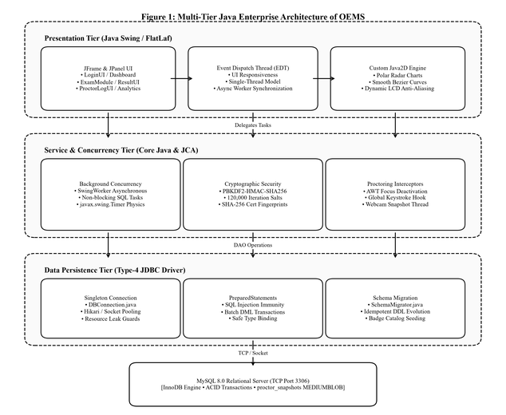

*Figure 1: Multi-Tier Java Enterprise Architecture of OEMS showing presentation, service, persistence, and storage tiers.*

#### Examination Lifecycle & State Machine
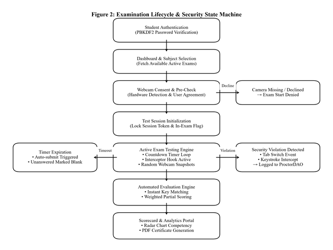

*Figure 2: Examination Lifecycle and Security State Machine showing student progression, hardware gating, countdown loop, and instant result evaluation.*

#### Proctoring & Academic Integrity Subsystem
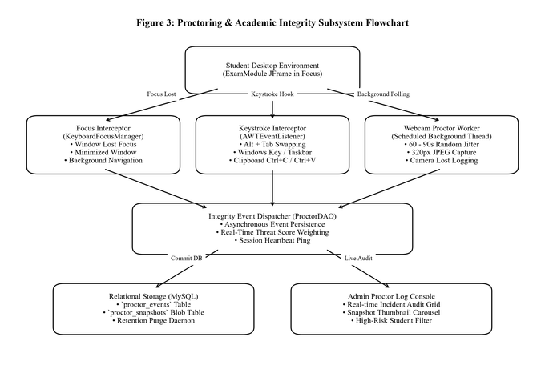

*Figure 3: Proctoring and Academic Integrity Subsystem Flowchart detailing focus listeners, keystroke hooks, webcam threads, and audit persistence.*

#### Object-Oriented Class Hierarchy
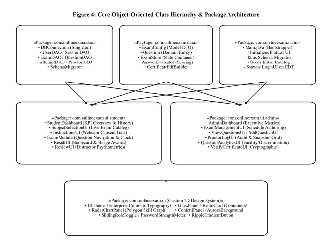

*Figure 4: Core Object-Oriented Class Hierarchy and Package Architecture illustrating modular separation between data access, business models, candidate views, and administration consoles.*

<!-- PAGE BREAK -->

### 4.2 Sequential End-to-End Application Screen Walkthrough

#### Step 1: Secure Split-Screen Authentication Gateway (`LoginUI.java`)
The entry gateway of the platform featuring role-based authentication (Student vs. Administrator), PBKDF2 hash verification, database connection health ping, and modern FlatLaf form inputs.

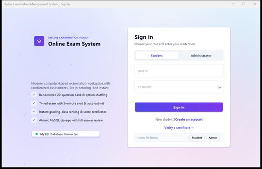

*Figure 5: Secure Authentication Gateway with PBKDF2 hash verification, sliding role selector, and live database connection health indicator.*

<!-- PAGE BREAK -->

#### Step 2: Student Registration with Shannon Entropy Password Meter (`SignupUI.java`)
New candidate registration form enforcing 128-bit CSPRNG salt generation, PBKDF2-HMAC-SHA256 password derivation, and real-time password complexity evaluation.


*Figure 6: Registration interface with real-time Shannon entropy password strength evaluation.*

<!-- PAGE BREAK -->

#### Step 3: Candidate Portal & Bento Grid Dashboard (`StudentDashboard.java`)
The candidate home portal rendering personalized greeting, overall performance KPI summary cards, historical examination attempts table, and upcoming scheduled exams.

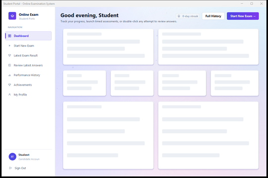

*Figure 7: Student Portal presenting cumulative KPI metrics, test history table, and upcoming scheduled examinations.*

<!-- PAGE BREAK -->

#### Step 4: Assessment Catalog & Availability Window Gates (`SubjectSelectionUI.java`)
Visual assessment catalog displaying subject cards with availability countdown timers, maximum attempt quotas, exam durations, and passing grade requirements.

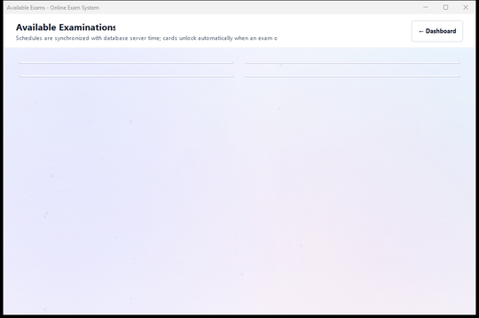

*Figure 8: Exam and Subject Selection Catalog with live countdown timers, attempt counters, and availability gates.*

<!-- PAGE BREAK -->

#### Step 5: Proctoring Consent & Academic Briefing (`InstructionsUI.java`)
Pre-exam instruction modal requiring candidate consent for webcam biometric auditing, explaining focus loss penalties (3 violations trigger auto-submission), and verifying hardware readiness.

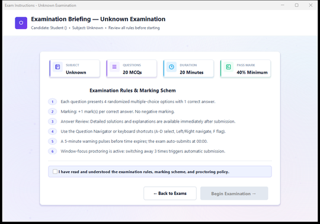

*Figure 9: Pre-Exam Instructions, academic integrity guidelines, and mandatory proctoring webcam hardware consent verification.*

<!-- PAGE BREAK -->

#### Step 6: Distraction-Free Proctored Exam Runner (`ExamModule.java`)
The active examination engine running in full-screen distraction-free mode. Displays question palette state buttons (Answered, Unanswered, Marked for Review), synchronized countdown clock, and proctoring status.

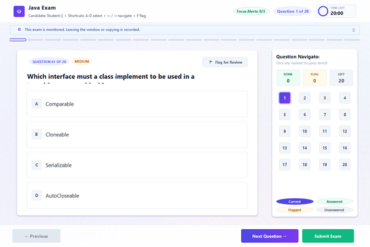

*Figure 10: Active examination testing engine featuring question palette, live countdown clock, option selection cards, and proctoring indicator.*

<!-- PAGE BREAK -->

#### Step 7: Executive Scorecard & Instant Result Evaluation (`ResultUI.java`)
Post-exam results dashboard displaying overall score, percentage accuracy, time elapsed, performance tier badge, and one-click action buttons to view review or download certificate.

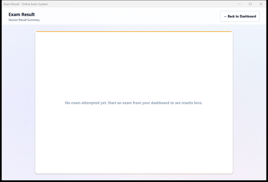

*Figure 11: Executive Result Scorecard presenting total score, accuracy percentage, time taken, and instant PDF certificate generation.*

<!-- PAGE BREAK -->

#### Step 8: Vector PDF Certificate Compilation (`CertificatePdfBuilder.java`)
Automated PDF certificate generation module embedding candidate bonafides, institutional seals, SHA-256 cryptographic verification digest, and a high-density 2D QR matrix.


*Figure 12: High-resolution PDF Certificate Generation module embedding student credentials and 2D QR matrix verification.*

<!-- PAGE BREAK -->

#### Step 9: Public & Admin Certificate Verification Portal (`VerifyCertificateUI.java`)
Tamper verification tool allowing recruiters and administrators to validate certificate authenticity by scanning QR codes or entering the certificate hash against database records.

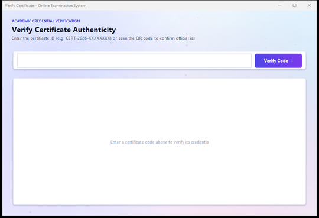

*Figure 13: Public and Administrative Certificate Verification Portal querying tamper-proof database records.*

<!-- PAGE BREAK -->

#### Step 10: Multi-Axis Competency Radar Chart (`StudentPerformanceUI.java`)
Candidate cognitive profile plotting performance across multiple subject competencies on a custom trigonometric Java2D polar radar chart.

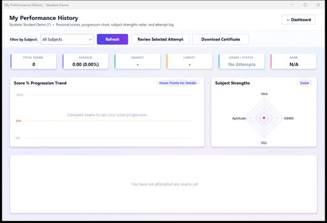

*Figure 14: Multi-Axis Competency Radar Chart plotting subject mastery across curriculum topics.*

<!-- PAGE BREAK -->

#### Step 11: Detailed Question Review & Distractor Rationale (`ReviewUI.java`)
Post-assessment review screen displaying every question, student chosen option, correct key, and distractor rationale for transparent learning feedback.

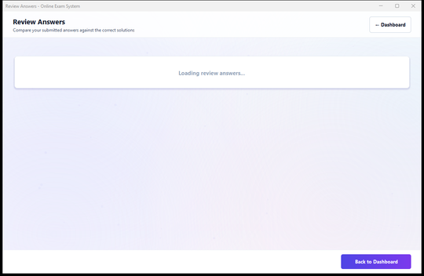

*Figure 15: Comprehensive Question Review interface displaying student answers, correct options, and item explanations.*

<!-- PAGE BREAK -->

#### Step 12: Administrative Command Center & Platform Overview (`AdminDashboard.java`)
Administrator executive portal displaying system-wide aggregate metrics (total candidates, tests completed, average score, security alerts) and quick management action tiles.

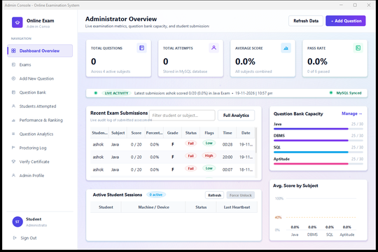

*Figure 16: Administrator Executive Dashboard summarizing platform metrics and quick operational shortcuts.*

<!-- PAGE BREAK -->

#### Step 13: Assessment Configuration & Schedule Authoring (`ExamManagementUI.java`)
Administrative exam configuration interface enabling creation and editing of scheduled examination windows, passing percentages, question counts, and duration parameters.

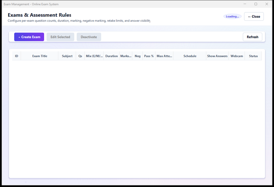

*Figure 17: Assessment Configuration interface for creating and managing scheduled exam parameters.*

<!-- PAGE BREAK -->

#### Step 14: Psychometric Item Analytics Workstation (`QuestionAnalyticsUI.java`)
Classical Test Theory evaluation console calculating Facility Index ($P$) and Discrimination Index ($D$) to flag ambiguous or flawed questions across the question bank.

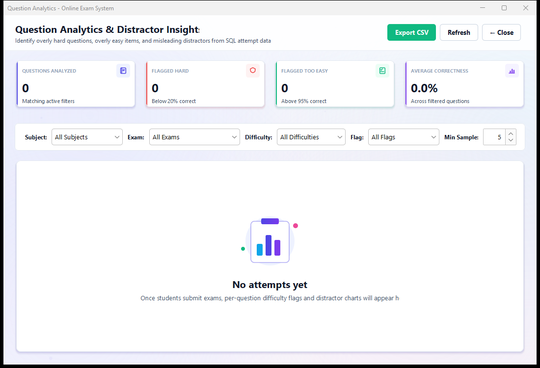

*Figure 18: Psychometric Item Analysis workstation flagging distractor bias and calculating P and D indices.*

<!-- PAGE BREAK -->

#### Step 15: Remote Proctoring Audit Log & Webcam Surveillance Gallery (`ProctorLogUI.java`)
Security investigation console presenting timestamped candidate violations (window focus lost, forbidden hotkey pressed), risk threat scores, and a grid gallery of captured webcam snapshots.

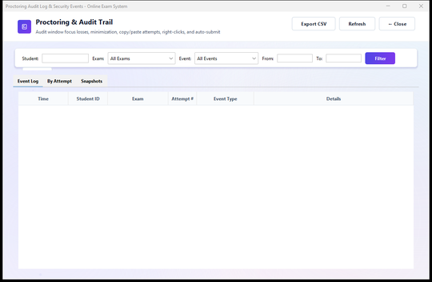

*Figure 19: Real-Time Proctoring Audit Log displaying timestamped security incidents, risk level classifications, and snapshot records.*

<!-- PAGE BREAK -->
