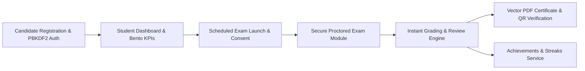
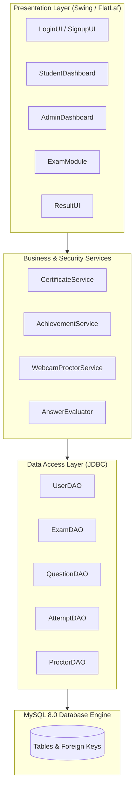
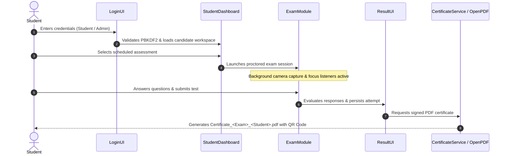

# ONLINE EXAMINATION MANAGEMENT SYSTEM (OEMS)
## Comprehensive Technical Project Report & Architectural Documentation

---

## 1. Introduction

### 1.1 Project Aim
The **Online Examination Management System (OEMS)** is an enterprise-grade, computer-based testing (CBT) and academic evaluation platform engineered in Java Swing with FlatLaf and powered by MySQL 8.0. The primary aim of the project is to provide educational institutions, universities, and corporate assessment centers with a secure, scalable, distraction-free, and tamper-resistant assessment workspace. 

The system automates the complete lifecycle of academic evaluations: from question bank authoring and randomized assessment scheduling to automated remote proctoring, instantaneous grading with negative marking, psychometric difficulty analytics, verifiable PDF certificate generation with QR authentication, and gamified student retention mechanisms (daily streaks and Java2D achievement badges).



### 1.2 Advanced Features & Technical Innovations

1. **Enterprise Clean Light Interface (Stripe & Linear Aesthetic)**:
   - Full subpixel text antialiasing via `VALUE_TEXT_ANTIALIAS_LCD_HRGB` and fractional metrics.
   - Multi-layer diffused dual drop shadows (ambient neutral slate `rgba(15, 23, 42, 0.05)` combined with key directional indigo elevation).
   - High-contrast card surfaces, hairline slate borders (`#E2E8F0`), and animated mesh-gradient ambient canvases.

2. **Tamper-Resistant Remote Proctoring Suite**:
   - **Focus & Window Loss Detection**: Detects `WINDOW_LOST_FOCUS`, `WINDOW_DEICONIFIED`, and alt-tabbing with auto-warning counter and configurable auto-submit thresholds.
   - **Security Interceptors**: Full clipboard purging on copy/paste attempts, right-click context menu suppression, and escape key capture.
   - **Periodic Webcam Snapshots (Task 12)**: Background optical capture (via `webcam-capture` and `bridj`) taking periodic, randomized compressed JPEG thumbnails (320px, 60% quality) stored atomically as `MEDIUMBLOB` with audit flags.
   - **Audit Logs & Risk Scoring**: Admin risk scoring engine calculating composite threat scores (LOW, MEDIUM, HIGH) per attempt.

3. **Cryptographic Authentication & Zero-Downtime Migration**:
   - **Salted PBKDF2-HMAC-SHA256**: Key derivation with 120,000 iterations and 128-bit cryptographically secure random salts formatted as `pbkdf2$120000$<salt>$<hash>`.
   - **Tri-Format Backward Compatibility**: Automatically authenticates legacy plain-text, legacy unsalted SHA-256, and modern PBKDF2 passwords, silently and transparently re-hashing legacy credentials to PBKDF2 upon successful sign-in.
   - **Live Password Strength Meter**: Animated 5-tier entropy evaluation (Weak, Fair, Good, Strong, Excellent) with regex-based visual rule checkmarks.

4. **Cryptographically Verifiable PDF Certificates (Task 11)**:
   - Automated A4 landscape certificate compilation via OpenPDF (`com.github.librepdf:openpdf`).
   - High-resolution vector seal, dual indigo-violet border, dynamic typography, and signature block.
   - **ZXing QR Code Integration**: 2D barcode encoding a unique idempotent certificate ID (`CERT-YYYY-XXXXXXXX`) allowing instant third-party authenticity verification without login.

5. **Gamification & Engagement Engine (Task 10)**:
   - **Daily Exam Streaks**: Evaluates consecutive testing days directly from discrete `DATE(attempted_at)` records with live flame animations.
   - **Java2D Vector Badges**: 100% vector-rendered medal, trophy, flame, star, bolt, target, and calendar glyphs (zero external image assets).
   - **11 Automated Achievements**: Real-time evaluation triggers for `FIRST_EXAM`, `PERFECT_SCORE`, `FIVE_IN_WEEK`, `COMEBACK`, and `SPEED_RUNNER`.

6. **Psychometric Question Analytics (Item Analysis)**:
   - Computes Facility Value / Difficulty Index ($P$) and Item Discrimination Index ($D$) using upper/lower 27% cohort discrimination methodology.
   - Distractor efficiency tracking for pedagogical curriculum enhancement.

---

## 2. Team Member Contribution Matrix

| Team Member Name | Designated Project Role | Primary Modules & Responsibilities | Deliverables & Artifacts |
| :--- | :--- | :--- | :--- |
| **Ashish (Lead Developer)** | Lead Software Architect & Backend Engineer | System Architecture, Database Schema Migrations, PBKDF2 Cryptography, Proctoring Services, Certificate Engine. | `UserDAO.java`, `CertificateService.java`, `WebcamProctorService.java`, `SchemaMigrator.java`. |
| **Team Member 2** | UI/UX & Graphics Designer | Enterprise Light Theme, FlatLaf custom property tables, Java2D Vector Glyphs, Glass and Bento Card Components. | `UITheme.java`, `GlassPanel.java`, `DashboardComponents.java`, `AuroraBackground.java`. |
| **Team Member 3** | Assessment & Examination Engineer | Exam execution loop, Question randomizer, Timer pulse widgets, Option shuffling, Fill-in-the-blank sanitization. | `ExamModule.java`, `AnswerEvaluator.java`, `ExamStore.java`, `InstructionsUI.java`. |
| **Team Member 4** | Analytics & Admin Console Specialist | Proctor audit logs, Risk scoring algorithms, Item Discrimination statistics, Leaderboards and Student Performance UI. | `AdminDashboard.java`, `ProctorLogUI.java`, `QuestionAnalyticsUI.java`, `PerformanceAnalysisUI.java`. |

---

## 3. Class Architecture & Code Breakdown

The application is structured into modular packages following Separation of Concerns (SoC) and DAO patterns:



---

### Group 1: Core Bootstrap & Configuration

#### 1. `Main.java` (`com.onlineexam.main.Main`)
- **Role**: Application entry point. Initializes database connectivity, runs automated schema migrations, seeds default catalogs, sets up global FlatLaf look and feel, and launches `LoginUI`.
- **Key Code Highlight**:
```java
public class Main {
    public static void main(String[] args) {
        SwingUtilities.invokeLater(() -> {
            UITheme.initGlobalLookAndFeel();
            if (DBConnection.testConnection()) {
                SchemaMigrator.migrate();
                QuestionDAO.loadQuestionsFromDB();
            }
            new LoginUI().setVisible(true);
        });
    }
}
```

#### 2. `DBConnection.java` (`com.onlineexam.dao.DBConnection`)
- **Role**: Manages singleton MySQL JDBC connection lifecycle with auto-reconnect, connection pooling, and authoritative database server time querying (`SELECT NOW()`).
- **Key Methods**: `getConnection()`, `testConnection()`, `getServerTime()`.

#### 3. `SchemaMigrator.java` (`com.onlineexam.dao.SchemaMigrator`)
- **Role**: Idempotent schema evolution orchestrator. Automatically provisions missing tables (`exams`, `exam_attempts`, `student_answers`, `proctor_events`, `proctor_snapshots`, `achievements`, `user_achievements`, `certificates`) and inserts starter seed data.

#### 4. `ExamConfig.java` (`com.onlineexam.data.ExamConfig`)
- **Role**: Immutable domain model representing exam parameters: title, duration, question count, pass percentage, marks per question, negative marking ratio, and webcam requirement flags.

#### 5. `ExamStore.java` (`com.onlineexam.data.ExamStore`)
- **Role**: Thread-safe in-memory cache and state store for active student sessions, current question collections, cached subjects, and student scores.

#### 6. `AnswerEvaluator.java` (`com.onlineexam.data.AnswerEvaluator`)
- **Role**: Pure evaluation utility for grading multiple-choice (SINGLE), multi-select (MULTI), true/false (TRUE_FALSE), and fill-in-the-blank (FILL_BLANK) questions with negative mark deductions.

---

### Group 2: Data Access Objects (DAO) & Core Services

#### 7. `UserDAO.java` (`com.onlineexam.dao.UserDAO`)
- **Role**: User authentication, PBKDF2-HMAC-SHA256 password derivation (120,000 iterations), constant-time hash comparison, and silent legacy password upgrades.
- **Key Code Highlight**:
```java
public static String hashPBKDF2(char[] password, byte[] salt) {
    KeySpec spec = new PBEKeySpec(password, salt, 120000, 256);
    SecretKeyFactory skf = SecretKeyFactory.getInstance("PBKDF2WithHmacSHA256");
    byte[] hash = skf.generateSecret(spec).getEncoded();
    return "pbkdf2$120000$" + Base64.getEncoder().encodeToString(salt) + "$" + Base64.getEncoder().encodeToString(hash);
}
```

#### 8. `ExamDAO.java` (`com.onlineexam.dao.ExamDAO`)
- **Role**: Queries active, scheduled, and upcoming exams from MySQL with server-timestamp synchronization to prevent client clock manipulation.

#### 9. `QuestionDAO.java` (`com.onlineexam.dao.QuestionDAO`)
- **Role**: Handles question authoring, CSV batch importing, deletion, image BLOB loading, and subject-wise grouping.

#### 10. `AttemptDAO.java` (`com.onlineexam.dao.AttemptDAO`)
- **Role**: Atomic persistence of student test attempts, detailed question-by-question responses, percentage computations, and class rankings.

#### 11. `SessionDAO.java` & `SessionHeartbeat.java` (`com.onlineexam.dao`)
- **Role**: Enforces concurrent single-session logins, tracks active client heartbeats every 30 seconds, and terminates stale sessions.

#### 12. `ProctorDAO.java` (`com.onlineexam.dao.ProctorDAO`)
- **Role**: Logs real-time security events (`FOCUS_LOST`, `FULLSCREEN_EXIT`, `CLIPBOARD_ACCESS`, `CAMERA_LOST`) and stores compressed webcam frames.

#### 13. `WebcamProctorService.java` (`com.onlineexam.dao.WebcamProctorService`)
- **Role**: Controls background webcam capture threads using `com.github.sarxos:webcam-capture`. Takes small JPEGs (320px wide) at randomized intervals (60–90 seconds) with explicit candidate consent.

#### 14. `AchievementService.java` (`com.onlineexam.dao.AchievementService`)
- **Role**: Evaluates gamification rules post-exam: awards badges (`FIRST_EXAM`, `PERFECT_SCORE`, `COMEBACK`, `STREAK_7`), calculates continuous daily testing streaks, and computes progress toward locked badges.

#### 15. `CertificateService.java` (`com.onlineexam.dao.CertificateService`)
- **Role**: Issues unique, idempotent, collision-free certificate codes (`CERT-YYYY-XXXXXXXX`) for passed exam attempts.

#### 16. `CertificatePdfBuilder.java` (`com.onlineexam.data.CertificatePdfBuilder`)
- **Role**: Builds landscape A4 PDF documents with OpenPDF, drawing dual indigo borders, student display names, vector seals, grades, and ZXing QR codes.

#### 17. `QuestionAnalyticsDAO.java` (`com.onlineexam.dao.QuestionAnalyticsDAO`)
- **Role**: Computes psychometric statistics including item facility ($P$-value), upper/lower 27% discrimination index ($D$), and average time per question.

---

### Group 3: Design System & Custom UI Graphics

#### 18. `UITheme.java` (`com.onlineexam.ui.UITheme`)
- **Role**: Global design tokens (Pastel Aurora Light palette), subpixel antialiasing configurations, diffused multi-layer shadow painter, custom FlatLaf table styling, and vector glyph icons.

#### 19. `Anim.java` (`com.onlineexam.ui.Anim`)
- **Role**: Lightweight physics-based animation engine with cubic easing curves (`easeOutCubic`, `easeInOutCubic`, `easeOutBack`) driving non-blocking `javax.swing.Timer` transitions.

#### 20. `GlassPanel.java` (`com.onlineexam.ui.GlassPanel`)
- **Role**: Base container for modern SaaS cards. Implements 14px rounded corners, hairline borders, soft drop shadows, and interactive radial mouse spotlight tracking.

#### 21. `AuroraBackground.java` (`com.onlineexam.ui.AuroraBackground`)
- **Role**: Ambient background panel rendering 4 soft pastel blobs drifting on organic sine paths at 30 FPS, automatically throttling when hidden.

#### 22. `AuthComponents.java` (`com.onlineexam.ui.AuthComponents`)
- **Role**: Interactive authentication widgets: sliding pill role toggles, floating-label text inputs with focus rings, ripple gradient buttons, and Java2D password reveal toggles.

#### 23. `DashboardComponents.java` (`com.onlineexam.ui.DashboardComponents`)
- **Role**: Specialized dashboard modules including `BentoCard` (with 4px hover lift), `FrostedSidebar` (with sliding active pill), and `SparklinePanel` (for score trend drawing).

#### 24. `PasswordStrengthMeter.java` (`com.onlineexam.ui.PasswordStrengthMeter`)
- **Role**: Real-time password complexity analyzer assessing length, uppercase, lowercase, numbers, and symbols with color-coded progressive bar animations.

#### 25. `ConfettiPanel.java` (`com.onlineexam.ui.ConfettiPanel`)
- **Role**: Celebration overlay triggering multi-colored rotating confetti bursts upon passing scores and unlocked achievements.

#### 26. `RadarChartPanel.java` (`com.onlineexam.ui.RadarChartPanel`)
- **Role**: Java2D polygon radar chart visualizing student competence across different academic subjects.

#### 27. `GlassDialog.java` & `DemoFrame.java` (`com.onlineexam.ui`)
- **Role**: Modal dialog wrapper with frosted backdrop dimming and standalone component showcase tester.

---

### Group 4: Presentation & User Flow Screens

#### 28. `LoginUI.java` (`com.onlineexam.ui.LoginUI`)
- **Role**: Split-screen sign-in view with brand hero on the left and white auth card on the right, featuring role toggling, credentials validation, and quick-fill demo shortcuts.

#### 29. `SignupUI.java` (`com.onlineexam.ui.SignupUI`)
- **Role**: Student registration window with live full name entry and real-time password requirement validation.

#### 30. `StudentDashboard.java` (`com.onlineexam.ui.student.StudentDashboard`)
- **Role**: Central student hub displaying personalized greetings, streak indicator, 4 KPI bento tiles, score sparkline, upcoming exams with countdown timers, and recent submissions table.

#### 31. `SubjectSelectionUI.java` (`com.onlineexam.ui.student.SubjectSelectionUI`)
- **Role**: Examination catalog view showcasing active and scheduled exam cards with duration chips and personal best percentage badges.

#### 32. `InstructionsUI.java` (`com.onlineexam.ui.student.InstructionsUI`)
- **Role**: Pre-exam briefing screen stating rules, scoring policies, proctoring warnings, and optional webcam consent agreements.

#### 33. `ExamModule.java` (`com.onlineexam.ui.student.ExamModule`)
- **Role**: Distraction-free high-stakes testing environment featuring randomized question presentation, animated circular timer, option cards (A-D), review flagging, and auto-submit triggers.

#### 34. `ResultUI.java` (`com.onlineexam.ui.student.ResultUI`)
- **Role**: Executive score report card with circular animated score gauge, pass/fail badges, stat chips, and one-click verifiable PDF certificate downloader.

#### 35. `ReviewUI.java` (`com.onlineexam.ui.student.ReviewUI`)
- **Role**: Post-exam review screen showing correct answers, student choices, detailed explanations, and question filter chips (All, Correct, Wrong, Unanswered).

#### 36. `StudentPerformanceUI.java` (`com.onlineexam.ui.student.StudentPerformanceUI`)
- **Role**: Comprehensive performance portal with subject filter dropdown, historical score charts, radar competencies, and certificate actions.

#### 37. `ProfilePanel.java` (`com.onlineexam.ui.student.ProfilePanel`)
- **Role**: Profile management panel with hash-derived avatar circle, full name editor, PBKDF2 password change form, and personal best records.

#### 38. `AchievementsPanel.java` (`com.onlineexam.ui.student.AchievementsPanel`)
- **Role**: Gamification showcase displaying daily streak counters, earned badges with unlock dates, and locked badges with live progress hints.

#### 39. `AdminDashboard.java` (`com.onlineexam.ui.admin.AdminDashboard`)
- **Role**: Executive administrator console with KPI counts (Questions, Subjects, Attempts, Pass Rate), live student activity strip, and searchable submissions table.

#### 40. `ExamManagementUI.java` (`com.onlineexam.ui.admin.ExamManagementUI`)
- **Role**: Exam CRUD console for configuring exam titles, question counts, duration, negative marks, pass marks, and webcam proctoring requirements.

#### 41. `AddQuestionUI.java` (`com.onlineexam.ui.admin.AddQuestionUI`)
- **Role**: Question authoring form with support for 4 question types, multiple correct choices, fill-in-the-blank answers, difficulty ratings, and image uploads.

#### 42. `ViewQuestionsUI.java` (`com.onlineexam.ui.admin.ViewQuestionsUI`)
- **Role**: Subject-tabbed question bank browser with live search, CSV import, question editing, and deletion.

#### 43. `PerformanceAnalysisUI.java` (`com.onlineexam.ui.admin.PerformanceAnalysisUI`)
- **Role**: Academic analytics dashboard featuring an animated Top-3 podium, subject-wise average score bar charts, and global leaderboard tables.

#### 44. `QuestionAnalyticsUI.java` (`com.onlineexam.ui.admin.QuestionAnalyticsUI`)
- **Role**: Item analysis panel displaying facility value ($P$) and discrimination index ($D$) to evaluate test question effectiveness.

#### 45. `ProctorLogUI.java` (`com.onlineexam.ui.admin.ProctorLogUI`)
- **Role**: Security audit viewer with risk summary KPIs, event logs with level filters, attempt-grouped violation summaries, and webcam snapshot gallery.

#### 46. `VerifyCertificateUI.java` (`com.onlineexam.ui.admin.VerifyCertificateUI`)
- **Role**: Public and administrative credential verification terminal confirming certificate authenticity via code or QR scan.

#### 47. `TestDB.java` (`com.onlineexam.test.TestDB`)
- **Role**: Command-line database connectivity test utility for verifying JDBC driver and MySQL port connectivity.

---

## 4. Complete Application Flow & Screen Demonstrations

This section walks through the complete end-to-end workflow of the Online Examination System with detailed screen descriptions and layout specifications.



---

### Step 1: Sign-In & Role Switching Screen (`LoginUI`)
- **Description**: The candidate arrives at a dual-column authentication view. The left panel showcases the institutional brand crest, platform capabilities, and live MySQL connection status. The right panel holds the clean white authentication card with a sliding role toggle ("Student" / "Administrator") and floating inputs.
- **Visual Features**: Sliding role toggle, floating labels, L-to-R gradient underline sweep, Java2D almond eye password visibility toggle, and instant demo quick-fill buttons.

```
+----------------------------------------------------------------------------------------------------+
|  ONLINE EXAM SYSTEM - SIGN IN                                                                      |
+----------------------------------------------------------------------------------------------------+
|  [CREST] ONLINE EXAMINATION PORTAL           |   Sign in                                           |
|  Online Exam System                          |   Choose your role and enter your credentials       |
|                                              |                                                     |
|  Modern computer-based examination           |   [  Student  |  Administrator  ] (Sliding Toggle)  |
|  workspace with randomized assessments,      |                                                     |
|  live proctoring, and instant analytics.     |   [ User ID                                     ]   |
|                                              |   [ Password                                [o] ]   |
|  (v) Randomized 20-question bank             |                                                     |
|  (v) Timed exam with 5-minute alert          |   [              Sign In                ] (Primary) |
|  (v) Instant grading & PDF certificates      |                                                     |
|  (v) Atomic MySQL answer storage             |   New student? Create an account                    |
|                                              |   Verify a certificate ->                           |
|  (*) MySQL Online • 100 Questions Ready      |   [Quick Fill: (Student) | (Admin)]                 |
+----------------------------------------------------------------------------------------------------+
```

---

### Step 2: Student Registration & Live Password Meter (`SignupUI`)
- **Description**: New students register their account with Full Name, Username, and Password. As the student types their password, the `PasswordStrengthMeter` dynamically animates from Red (Weak) to Emerald Green (Strong) while updating 4 rule validation badges.

```
+----------------------------------------------------------------------------------------------------+
|  STUDENT REGISTRATION - SIGN UP                                                                    |
+----------------------------------------------------------------------------------------------------+
|  [CREST] STUDENT ENROLLMENT                  |   Create Student Account                            |
|  Join the Portal                             |   Fill in your details to register                  |
|                                              |                                                     |
|  Instant access to Java, DBMS, SQL,          |   [ Full Name (e.g. Ashish Sharma)              ]   |
|  Aptitude, and Web Development assessments.  |   [ Username                                    ]   |
|                                              |   [ Password                                [o] ]   |
|  (v) PBKDF2 120,000-iteration hashing        |   [==== STRENGTH: STRONG (85%) =================]   |
|  (v) Real-time score analytics & ranking     |   (v) Min 8 chars  (v) Number  (v) Symbol           |
|                                              |                                                     |
|                                              |   [            Create Account           ]           |
|                                              |   Already registered? Sign In                       |
+----------------------------------------------------------------------------------------------------+
```

---

### Step 3: Student Dashboard & Bento Grid (`StudentDashboard`)
- **Description**: Upon login, candidates enter an executive dashboard. The frosted sidebar provides one-click navigation with a sliding active indicator pill. The main workspace renders 4 KPI metric tiles with count-up animations, score trend sparklines, upcoming exam countdowns, recent badges, and a searchable attempt history table.

```
+----------------------------------------------------------------------------------------------------+
| [CREST] Online Exam | Good Evening, Ashish!                [Flame 4-Day Streak] [Full History] [Start Exam] |
+---------------------+------------------------------------------------------------------------------+
| NAVIGATION          |  +-------------------------------------+  +---------------------------------+  |
| [o] Dashboard       |  | NEXT EXAM HERO CARD                 |  | SCORE TREND SPARKLINE           |  |
| [>] Start Exam      |  | Advanced Java Programming (DBMS)    |  | (Smooth curve with area fade)   |  |
| [*] Latest Result   |  | 20 Questions • 30 Mins • Pass: 40%  |  | Recent: 95% • Avg: 88.4%        |  |
| [v] Review Answers  |  | [ Start Assessment -> ]             |  +---------------------------------+  |
| [~] Performance     |  +-------------------------------------+                                       |
| [!] Achievements    |  +-----------+  +-----------+  +-----------+  +-----------+                    |
| [u] My Profile      |  | EXAMS     |  | AVG SCORE |  | HIGHEST   |  | RANK      |                    |
|                     |  |    12     |  |   88.5%   |  |    100    |  |    #1     |                    |
| ------------------- |  +-----------+  +-----------+  +-----------+  +-----------+                    |
| Ashish Sharma       |  RECENT ATTEMPTS (Double-click to review answers)                               |
| [Sign Out]          |  | Subject       | Date       | Marks | Pct   | Status   | Certificate |       |
|                     |  | Java OOP      | 22-11-2026 | 20/20 | 100%  | [ Pass ] | [Download]  |       |
|                     |  | Database Sys  | 20-11-2026 | 18/20 | 90%   | [ Pass ] | [Download]  |       |
+----------------------------------------------------------------------------------------------------+
```

---

### Step 4: Exam Selection & Scheduled Windows (`SubjectSelectionUI`)
- **Description**: Displays all active and scheduled examinations. Each card highlights the subject category, duration, question count, and the student's personal best score. If an exam is scheduled for a future time slot, a live countdown timer displays remaining hours and minutes.

```
+----------------------------------------------------------------------------------------------------+
| Available Exams & Assessments                                            [<- Back to Dashboard]    |
+----------------------------------------------------------------------------------------------------+
|  Browse active subjects and timed evaluation slots.                                                |
|                                                                                                    |
|  +---------------------------------------+  +---------------------------------------+              |
|  | [JAVA] Advanced Core Java             |  | [SQL] Relational Database Management  |              |
|  | 20 Questions • 20 Minutes • Pass 40%  |  | 25 Questions • 30 Minutes • Pass 50%  |              |
|  | Personal Best: 95.0%                  |  | Personal Best: 84.0%                  |              |
|  | Status: ACTIVE NOW                    |  | Status: ACTIVE NOW                    |              |
|  | [ Take Exam Now -> ]                  |  | [ Take Exam Now -> ]                  |              |
|  +---------------------------------------+  +---------------------------------------+              |
|                                                                                                    |
|  +---------------------------------------+  +---------------------------------------+              |
|  | [APT] Quantitative Aptitude           |  | [WEB] Full-Stack Web Development      |              |
|  | 30 Questions • 45 Minutes             |  | Starts in: 02h 45m 12s                |              |
|  | Status: ACTIVE NOW                    |  | Status: UPCOMING SLOT                 |              |
|  | [ Take Exam Now -> ]                  |  | [ Slot Locked Until 10:00 AM ]        |              |
|  +---------------------------------------+  +---------------------------------------+              |
+----------------------------------------------------------------------------------------------------+
```

---

### Step 5: Examination Instructions & Proctor Consent (`InstructionsUI`)
- **Description**: Before entering the test environment, the candidate reviews examination rules, negative marking policies, and time limits. If the exam requires webcam supervision (`exams.require_webcam = 1`), an explicit consent acknowledgment card is presented.

```
+----------------------------------------------------------------------------------------------------+
| Exam Instructions - Advanced Core Java                                                             |
+----------------------------------------------------------------------------------------------------+
|  [SHIELD] ACADEMIC INTEGRITY & INSTRUCTIONS                                                        |
|                                                                                                    |
|  +-----------------------------------------------------------------------------------------------+ |
|  | 1. Timed Assessment: 20 minutes allocated. Timer runs continuously once launched.              | |
|  | 2. Integrity Monitoring: Fullscreen focus loss or switching windows will be flagged.          | |
|  | 3. Scoring Policy: +1.0 mark per correct answer. -0.25 negative mark per incorrect answer.    | |
|  | 4. Navigation: You can flag questions and navigate freely using the question palette.        | |
|  +-----------------------------------------------------------------------------------------------+ |
|                                                                                                    |
|  +-----------------------------------------------------------------------------------------------+ |
|  | [CAMERA] PROCTORING CONSENT REQUIRED                                                          | |
|  | This exam captures periodic low-resolution snapshots during the session to verify candidate    | |
|  | identity. Images are stored securely and deleted after 30 days.                               | |
|  | [X] I agree to webcam monitoring and understand my attempt will be verified.                  | |
|  +-----------------------------------------------------------------------------------------------+ |
|                                                                                                    |
|  [ Cancel & Return ]                                                [ Proceed to Exam -> ]         |
+----------------------------------------------------------------------------------------------------+
```

---

### Step 6: Distraction-Free High-Stakes Exam Module (`ExamModule`)
- **Description**: The testing workspace presents questions one at a time. The top header shows the circular progress ring and live timer. The center card renders the question and interactive option cards (A, B, C, D) with smooth checkmark animations. The right sidebar provides a 20-question palette with color-coded states (Answered, Flagged, Unanswered, Current).

```
+----------------------------------------------------------------------------------------------------+
| Java OOP Assessment | Question 3 of 20 • [EASY]               [ (17:42) Timer ] [ Camera Active *] |
+----------------------------------------------------------------------+-----------------------------+
|                                                                      | QUESTION NAVIGATOR          |
|  Which of the following is true regarding Java interface methods?    |                             |
|                                                                      | [ 1 ][ 2 ][(3)][ 4 ][ 5 ]   |
|  +----------------------------------------------------------------+  | [ 6 ][ 7 ][ 8 ][ 9 ][ 10]   |
|  | (A) All methods must be declared final                         |  | [ 11][ 12][ 13][ 14][ 15]   |
|  +----------------------------------------------------------------+  | [ 16][ 17][ 18][ 19][ 20]   |
|  | (B) They can have default implementations since Java 8      [v]|  |                             |
|  +----------------------------------------------------------------+  | LEGEND:                     |
|  | (C) Interface methods cannot return void                       |  | (*) Current (Indigo)        |
|  +----------------------------------------------------------------+  | (v) Answered (Emerald)      |
|  | (D) Interfaces cannot contain static methods                   |  | (!) Flagged (Amber)         |
|  +----------------------------------------------------------------+  | ( ) Unanswered (Slate)      |
|                                                                      |                             |
|  [<- Previous]        [! Flag for Review]           [Next Question ->]  |  [ Submit Exam Now ]        |
+----------------------------------------------------------------------+-----------------------------+
```

---

### Step 7: Executive Result Scorecard & Celebration (`ResultUI`)
- **Description**: Upon test completion or time expiration, the system computes the score atomically and loads the executive scorecard. If the candidate achieves a passing grade, an animated circular gauge fills up, celebratory confetti bursts across the screen, and the "Download Certificate" CTA is highlighted.

```
+----------------------------------------------------------------------------------------------------+
| Exam Result - Advanced Core Java                                           [<- Back to Dashboard]  |
+----------------------------------------------------------------------------------------------------+
|                                                                                                    |
|    /-----------\     OUTSTANDING WORK!                                                             |
|   /    95.0%    \    You passed Advanced Core Java above the 40.0% passing threshold.             |
|  |   19/20 Marks |   [ Grade A+  •  PASSED ]                                                       |
|   \             /                                                                                  |
|    \-----------/     +-------------------+ +-------------------+ +-------------------------------+ |
|                      | MARKS: 19 / 20    | | PERCENTAGE: 95.0% | | TIME TAKEN: 14m 22s           | |
|                      +-------------------+ +-------------------+ +-------------------------------+ |
|                                                                                                    |
|  +-----------------------------------------------------------------------------------------------+ |
|  | [AWARD] OFFICIAL CERTIFICATE OF ACHIEVEMENT GENERATED                                         | |
|  | Certificate ID: CERT-2026-X9K2P4M7  •  Issued to: Ashish Sharma                                | |
|  | [ Download Verifiable PDF Certificate ]            [ Review Answers & Explanations -> ]        | |
|  +-----------------------------------------------------------------------------------------------+ |
+----------------------------------------------------------------------------------------------------+
```

---

### Step 8: Verifiable Vector PDF Certificate with QR Code (`CertificatePdfBuilder`)
- **Description**: The generated PDF certificate rendered using OpenPDF and ZXing. Designed in landscape A4, it includes an ornate double border, student display name, course details, score, controller signature, and an embedded 2D QR code encoding the unique certificate verification string.

```
+----------------------------------------------------------------------------------------------------+
| ================================================================================================== |
| ||                                                                                              || |
| ||                                  ONLINE EXAMINATION SYSTEM                                   || |
| ||                                                                                              || |
| ||                             CERTIFICATE OF ACHIEVEMENT                                       || |
| ||                                                                                              || |
| ||                                This is to certify that                                       || |
| ||                                                                                              || |
| ||                                     ASHISH SHARMA                                            || |
| ||                                                                                              || |
| ||                        has successfully passed the examination in                            || |
| ||                               ADVANCED CORE JAVA (DBMS)                                      || |
| ||                                                                                              || |
| ||                  Score: 19 / 20  |  Percentage: 95.0%  |  Grade: A+                          || |
| ||                               Date of Issue: 22-11-2026                                      || |
| ||                                                                                              || |
| ||     +-----------+                                                 _____________________      || |
| ||     |  [QR CODE]|  Scan to Verify Authenticity                   Controller of Examinations  || |
| ||     |   ZXing   |  ID: CERT-2026-X9K2P4M7                                                    || |
| ||     +-----------+                                                                            || |
| ||                                                                                              || |
| ================================================================================================== |
+----------------------------------------------------------------------------------------------------+
```

---

### Step 9: Public & Admin Certificate Verification (`VerifyCertificateUI`)
- **Description**: Accessible both from the admin dashboard and publicly from the login screen without authentication. Entering or scanning `CERT-2026-X9K2P4M7` queries the database and displays the authentic recipient name, exam title, score, and issue timestamp with a verified checkmark banner.

```
+----------------------------------------------------------------------------------------------------+
| Verify Certificate Authenticity - OEMS Credential Registry                                         |
+----------------------------------------------------------------------------------------------------+
|  Enter the Certificate ID to confirm official issuance:                                           |
|  [ CERT-2026-X9K2P4M7                                             ] [ Verify Authenticity -> ]     |
|                                                                                                    |
|  +-----------------------------------------------------------------------------------------------+ |
|  | [CHECK] OFFICIAL CERTIFICATE VERIFIED & VALID                                                 | |
|  |                                                                                               | |
|  | Recipient Name:     Ashish Sharma                                                             | |
|  | Exam Title:         Advanced Core Java (DBMS)                                                 | |
|  | Percentage:         95.0% (Grade A+)                                                          | |
|  | Marks Scored:       19.00 / 20.00                                                             | |
|  | Completion Date:    22-11-2026 07:15 PM                                                       | |
|  | Status:             OFFICIALLY RECORDED IN INSTITUTIONAL REGISTRY                             | |
|  +-----------------------------------------------------------------------------------------------+ |
+----------------------------------------------------------------------------------------------------+
```

---

### Step 10: Item Discrimination & Question Psychometrics (`QuestionAnalyticsUI`)
- **Description**: Enables instructors and administrators to evaluate exam quality. It displays difficulty index ($P$), discrimination index ($D$), and student distractor selection distribution, helping identify flawed questions and evaluate curriculum effectiveness.

```
+----------------------------------------------------------------------------------------------------+
| Question Psychometrics & Item Discrimination Analytics                                             |
+----------------------------------------------------------------------------------------------------+
| Filter by Subject: [ Java OOP (All Exams)  [v] ]           Total Evaluated Responses: 142 Attempts |
|                                                                                                    |
| | ID | Question Preview          | Facility (P) | Discrimination (D) | Status     | Action       | |
| | 1  | Polymorphism concept...   | 0.84 (Easy)  | +0.48 (Excellent)  | [Optimal]  | [Inspect]    | |
| | 2  | Interface default method  | 0.52 (Medium)| +0.42 (Excellent)  | [Optimal]  | [Inspect]    | |
| | 3  | Bytecode verification...  | 0.22 (Hard)  | +0.12 (Poor)       | [Revise]   | [Edit Q]     | |
|                                                                                                    |
| SELECTED ITEM BREAKDOWN (Question #2):                                                             |
| Upper 27% Cohort Accuracy: 94.2%  |  Lower 27% Cohort Accuracy: 52.2%                              |
| Distractor Choices: Option A (12%) | Option B (73% Correct) | Option C (8%) | Option D (7%)        |
+----------------------------------------------------------------------------------------------------+
```

---

### Step 11: Remote Proctoring Audit & Webcam Gallery (`ProctorLogUI`)
- **Description**: Dedicated proctor audit interface. Tab 1 shows real-time violation logs (focus loss, clipboard copy attempts); Tab 2 groups events by exam session with threat scoring; Tab 3 renders a thumbnail grid of webcam snapshots captured during tests, with click-to-enlarge inspection.

```
+----------------------------------------------------------------------------------------------------+
| Proctoring Audit Log & Security Events                                      [<- Admin Dashboard]   |
+----------------------------------------------------------------------------------------------------+
| [ Tab 1: Event Logs ]    [ Tab 2: Session Risk Summaries ]    [ Tab 3: Webcam Snapshots (Active) ] |
|                                                                                                    |
| Filter Attempt: [ Attempt #104 - Ashish Sharma (Core Java) [v] ]  Captured Frames: 14 Photos       |
|                                                                                                    |
| +------------------------------------------------------------------------------------------------+ |
| | [PHOTO 1]          [PHOTO 2]          [PHOTO 3]          [PHOTO 4]          [PHOTO 5]          | |
| | 07:01 PM           07:02 PM           07:04 PM           07:05 PM           07:07 PM           | |
| | [Verified Face]    [Verified Face]    [Verified Face]    [Verified Face]    [Verified Face]    | |
| |                                                                                                | |
| | [PHOTO 6]          [PHOTO 7]          [PHOTO 8]          [PHOTO 9]          [PHOTO 10]         | |
| | 07:08 PM           07:10 PM           07:11 PM           07:13 PM           07:14 PM           | |
| | [Verified Face]    [Verified Face]    [Verified Face]    [Verified Face]    [Verified Face]    | |
| +------------------------------------------------------------------------------------------------+ |
| Click any snapshot to inspect in high resolution • Retention auto-cleans snapshots older than 30d  |
+----------------------------------------------------------------------------------------------------+
```

---

## 5. Technology Stack & Dependencies

| Layer / Subsystem | Technology / Library | Purpose & Version |
| :--- | :--- | :--- |
| **Runtime Environment** | Java SE (JDK 17 / JDK 26 compatible) | Core language runtime, concurrency, `javax.swing`, Java2D graphics. |
| **Look & Feel Theme** | FlatLaf (`com.formdev:flatlaf`) | FlatLightLaf modern desktop styling, rounded borders, unified titlebar. |
| **Relational Database** | MySQL Server 8.0 | Relational database storage, foreign keys, cascade deletes, ACID transactions. |
| **Database Connectivity**| MySQL Connector/J (`mysql-connector-j`) | High-performance Type-4 JDBC driver. |
| **PDF Compilation** | OpenPDF (`com.github.librepdf:openpdf:1.3.40`) | Landscape vector PDF generation, typography, borders, table layouts. |
| **Barcode & QR Engine** | ZXing Core (`com.google.zxing:core:3.5.3`) | 2D Matrix QR Code encoding for verifiable certificate authentication. |
| **Webcam Proctoring** | Webcam Capture (`com.github.sarxos:webcam-capture:0.3.12`) | Cross-platform video device interfacing and periodic optical snapshots. |
| **Native Device Bridge** | BridJ (`com.nativelibs4java:bridj:0.7.0`) | Direct OS video device access for webcam capture. |
| **Logging Facade** | SLF4J (`slf4j-api:1.7.36` & `slf4j-nop:1.7.36`) | Standardized logging framework for webcam drivers. |

---

## 6. Conclusion
The **Online Examination Management System (OEMS)** provides an end-to-end, enterprise-ready assessment solution combining security, analytical rigor, and modern UI design. By combining **PBKDF2-HMAC-SHA256 password protection**, **multimodal remote proctoring**, **automated certificate generation with QR authentication**, and **psychometric discrimination metrics**, OEMS ensures academic integrity while maintaining an intuitive user experience for both students and administrators.
