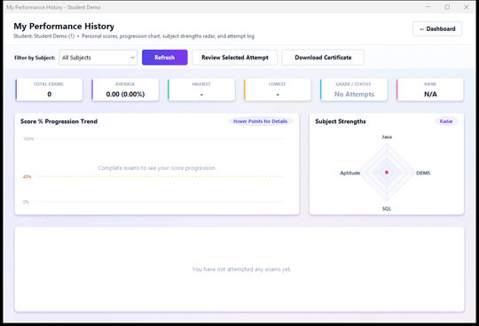
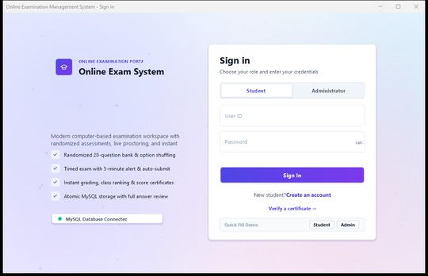
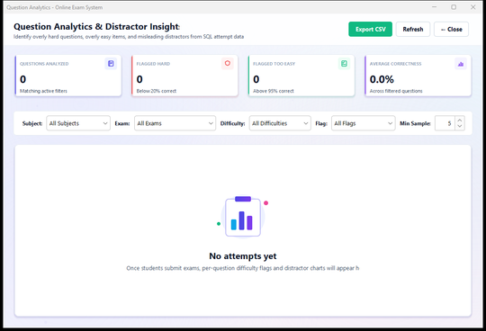

<div align="center">

<!-- ANIMATED 3D HERO BANNER -->


<!-- ANIMATED DYNAMIC TYPING SVG -->
<a href="https://github.com/ash3422w/Online-Exam-System">
  
</a>

<br/><br/>

<!-- MODERN PILL BADGES ROW -->
<p align="center">
  
  
  
  
  
  
</p>

<!-- GRADIENT SEPARATOR -->


</div>

<br/>

<!-- ============================================================ -->
<!-- HERO PREVIEW SHOWCASE -->
<!-- ============================================================ -->

<div align="center">

<table>
<tr>
  <td align="center" width="50%">
    <b>⚡ Distraction-Free Proctored Exam Engine</b><br/>
    <sub>Real-time countdown physics, question palette, and instant answer auto-save</sub><br/><br/>
    
  </td>
  <td align="center" width="50%">
    <b>📊 Multi-Axis Competency Radar Projection</b><br/>
    <sub>Custom Java2D polar trigonometric plot of candidate curriculum mastery</sub><br/><br/>
    
  </td>
</tr>
</table>

</div>

<br/>

<!-- ============================================================ -->
<!-- BENTO-STYLE INNOVATION CARDS -->
<!-- ============================================================ -->

<div align="center">
  <h2>🌟 Architectural Superpowers</h2>
  <p><i>Engineered to eliminate the tab-switching, inspect-element, and network dropout vulnerabilities of web testing.</i></p>
</div>

<table width="100%" style="border-collapse: separate; border-spacing: 12px;">
<tr>
<td width="50%" valign="top" style="padding: 16px; border: 1px solid #E2E8F0; border-radius: 10px; background-color: #FAFAFA;">

### 🛡️ Hardware & Focus Proctoring
- **JVM Window Focus Interceptor**: Detects OS-level focus loss instantly (`Alt+Tab`, Windows key, notifications) via `WindowFocusListener`.
- **Global Key Hook Filtering**: Blocks cheating shortcuts (`Ctrl+C`, `Ctrl+V`, `Alt+F4`, function keys) using `KeyboardFocusManager`.
- **Webcam Surveillance Daemon**: Asynchronous background capture thread persisting candidate facial snapshots with cumulative threat scoring.
- **3-Strike Emergency Submission**: Automatically terminates testing session and executes atomic submission upon exceeding violation limits.

<div align="center">
  
</div>

</td>
<td width="50%" valign="top" style="padding: 16px; border: 1px solid #E2E8F0; border-radius: 10px; background-color: #FAFAFA;">

### 🔐 Cryptographic Defense & Sessions
- **PBKDF2-HMAC-SHA256**: 120,000 iterative key-stretching rounds via `javax.crypto.SecretKeyFactory` to defeat GPU/ASIC brute-force cracking.
- **128-Bit CSPRNG Salts**: Cryptographically secure salts generated per account via `java.security.SecureRandom`.
- **Automated Legacy Migration**: Transparently upgrades legacy credentials to PBKDF2 upon successful candidate sign-in.
- **Session Locking & Heartbeat Ping**: Active UUID tokens and 30-second background daemon pings eliminate simultaneous proxy logins.

<div align="center">
  
</div>

</td>
</tr>
<tr>
<td width="50%" valign="top" style="padding: 16px; border: 1px solid #E2E8F0; border-radius: 10px; background-color: #FAFAFA;">

### 📊 Psychometric Item Analytics (CTT)
- **Facility Value (Item Difficulty)**: 
  $$\mathbf{P = \frac{R}{N}}$$
  *Automatically audits question rigor and flags ambiguous, excessively hard, or trivial questions.*
- **Discrimination Index ($\mathbf{D}$)**:
  $$\mathbf{D = \frac{U - L}{N_G}}$$
  *Kelley's 27% upper/lower cohort rule measuring discrimination power between top and bottom students.*
- **Distractor Efficiency Audit**: Flags non-functional answer alternatives chosen by <5% of students.

<div align="center">
  
</div>

</td>
<td width="50%" valign="top" style="padding: 16px; border: 1px solid #E2E8F0; border-radius: 10px; background-color: #FAFAFA;">

### 📜 Tamper-Proof Vector Certification
- **Dynamic Archival PDF**: High-resolution vector PDF generator embedding candidate marks, grades, and institutional bonafides.
- **SHA-256 Digital Fingerprint**: Computes unique cryptographic integrity checksum across student ID, exam ID, and score.
- **2D QR Matrix Verification**: High-density QR matrix verifiable against official database records via `VerifyCertificateUI.java`.
- **Public & Admin Ledger**: Real-time authenticity lookup eliminating fraudulent academic credentials.

<div align="center">
  
</div>

</td>
</tr>
</table>

<br/>

<!-- ============================================================ -->
<!-- DIRECTORY & PACKAGE ARCHITECTURE -->
<!-- ============================================================ -->

<div align="center">
  <h2>📂 Enterprise Directory Architecture</h2>
  <p><i>Strict separation of concerns across 49 production classes and organized asset modules.</i></p>
</div>

```
Online-Exam-System/
├── java files/                           # All 49 Java source files organized into canonical packages
│   ├── com/onlineexam/
│   │   ├── main/                         # Bootstrap & Application Lifecycle (Main.java)
│   │   ├── dao/                          # Database Access, PBKDF2 Hashing, Sessions, & CTT (12 classes)
│   │   ├── data/                         # Domain Models, In-Memory State & PDF Builder (4 classes)
│   │   └── ui/                           # Design Tokens, Glassmorphism & Animations (13 classes)
│   │       ├── student/                  # Candidate Dashboard, Proctored Runner & Scorecards (9 classes)
│   │       └── admin/                    # Admin Command Center, Proctor Logs & Analytics (8 classes)
│   └── TestDB.java                       # Database Diagnostic Utility (1 class)
│
├── sql/                                  # Relational Database Migration & Seed Scripts
│   ├── database_setup.sql                # 8 Normalized InnoDB Tables & Foreign Keys
│   └── sample_data.sql                   # Default Admin/Student Accounts & 100 Sample MCQs
│
├── docs/                                 # Project Documentation & Formal Reports
│   ├── Online_Exam_System_Java_Project_Report.docx # Word Report (1.50 MB, Times New Roman, Pure Black)
│   ├── Java_Project_Report_Pagewise.md   # Complete Academic Markdown Report
│   └── archive/                          # Historical Revisions & Drafts Archive
│
├── lib/                                  # Pre-Packaged Runtime Dependencies (FlatLaf, MySQL, OpenPDF, Webcam)
├── reportimages/                         # High-Resolution Architectural Flowcharts & UI Screen Captures
├── tools/                                # Offscreen Screenshot Capture & Rendering Utilities
├── run.bat                               # Windows Command Prompt One-Click Launcher
├── run.ps1                               # Native PowerShell One-Click Launcher
├── README.md                             # Project Showcase Documentation
└── LICENSE                               # MIT Open Source License
```

<br/>

<!-- ============================================================ -->
<!-- PACKAGE ARCHITECTURE MATRIX -->
<!-- ============================================================ -->

### 📦 Modular Package Breakdown

| Package | Classes | Architectural Role & Implementation Responsibility | Key Design Patterns |
|:---|:---:|:---|:---|
| **`com.onlineexam.main`** | `1` | Bootstrap coordinator, FlatLaf styling, LCD rendering hints, and EDT scheduling. | *Bootstrap Coordinator* |
| **`com.onlineexam.dao`** | `12` | Thread-safe JDBC persistence, PBKDF2 stretching, session locking, and CTT psychometrics. | *DAO, Singleton, Factory* |
| **`com.onlineexam.data`** | `4` | Immutable domain models, synchronized in-memory state repository, and vector PDF compilation. | *DTO, Builder, State* |
| **`com.onlineexam.ui`** | `13` | Reusable design tokens, glassmorphic containers, physics animations, and authentication views. | *Composite, Component* |
| **`com.onlineexam.ui.student`** | `9` | Candidate portal, assessment catalog, webcam consent, distraction-free kiosk runner, scorecards. | *MVC View, State Machine* |
| **`com.onlineexam.ui.admin`** | `8` | Administrator command center, exam authoring, question bank, item analytics, and proctor audit. | *Dashboard, TableRenderer* |
| **`com.onlineexam.test`** | `1` | Database network socket handshake and credential verification CLI utility. | *Diagnostic Tool* |

<br/>

<!-- ============================================================ -->
<!-- TECH STACK & ECOSYSTEM -->
<!-- ============================================================ -->

<div align="center">
  <h2>🛠️ Technology Ecosystem</h2>
  <br/>
  
  <br/><br/>
</div>

| Layer | Technology | Version | Purpose |
|:---|:---|:---:|:---|
| **Language Runtime** | **Java SE (OpenJDK)** | `17+ / 21 LTS` | Object-oriented business logic, multithreaded concurrency |
| **Presentation Tier** | **Java Swing & Java2D** | Built-in | 60 FPS Event Dispatch Thread (EDT) execution, vector graphics |
| **Modern Design System** | **FlatLaf** | `3.5.x` | Modern light design tokens, rounded borders, glassmorphic cards |
| **Relational Storage** | **MySQL Server (InnoDB)** | `8.0+` | Normalized tables, foreign keys, ACID transactional integrity |
| **Connectivity** | **MySQL Connector/J** | `9.x` | High-performance Type-4 JDBC driver with batch execution |
| **Cryptography** | **Java Security / Crypto** | Built-in | PBKDF2WithHmacSHA256 stretching, 128-bit CSPRNG salts |
| **Document Compiler** | **OpenPDF** | `1.3.40` | Archival vector PDF certificate generation |
| **Matrix Code Engine** | **ZXing Core** | `3.5.3` | High-density 2D QR matrix generation and validation |
| **Hardware Video** | **Webcam-Capture & BridJ** | `0.3.12` | Asynchronous webcam frame surveillance daemon |

<br/>

<!-- ============================================================ -->
<!-- QUICK START & RUN GUIDE -->
<!-- ============================================================ -->

<div align="center">
  <h2>⚡ Quick Start & Run Guide</h2>
  <p><i>Get the Online Examination Management System running locally in under 60 seconds.</i></p>
</div>

### 1. Prerequisites
- **Java SE Development Kit**: JDK 17 or higher (`java -version`).
- **MySQL Database Server**: MySQL 8.0 running on `localhost:3306`.

### 2. Database Setup
Initialize the schema and seed sample question banks:
```bash
mysql -u root -p < sql/database_setup.sql
mysql -u root -p < sql/sample_data.sql
```

### 3. One-Click Launch

<table>
<tr>
  <td width="50%" align="center">
    <b>Windows PowerShell</b><br/><br/>
    <code>.\run.ps1</code>
  </td>
  <td width="50%" align="center">
    <b>Windows Command Prompt</b><br/><br/>
    <code>run.bat</code>
  </td>
</tr>
</table>

#### Manual Compilation & Execution:
```powershell
# Compile all source files into out/ directory
javac -cp "lib/*" -d out (Get-ChildItem -Path "java files" -Filter *.java -Recurse | Select-Object -ExpandProperty FullName)

# Test database connection
java -cp "out;lib/*" TestDB

# Launch the Application
java -cp "out;lib/*" com.onlineexam.main.Main
```

<br/>

<!-- ============================================================ -->
<!-- ANIMATED FOOTER -->
<!-- ============================================================ -->

<div align="center">


<p align="center">
  <sub>Engineered with ❤️ in Core Java & MySQL • Released under the MIT Open Source License</sub>
</p>

</div>
