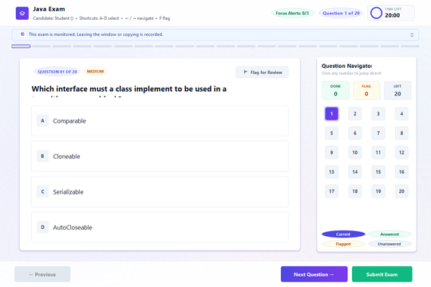
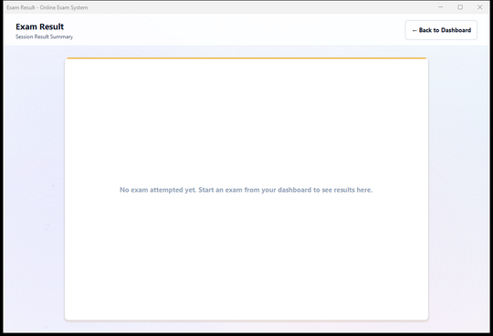
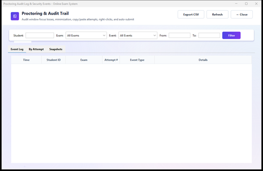
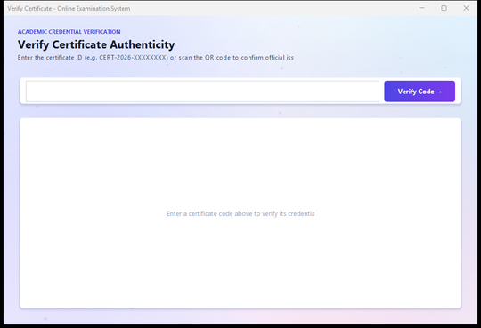
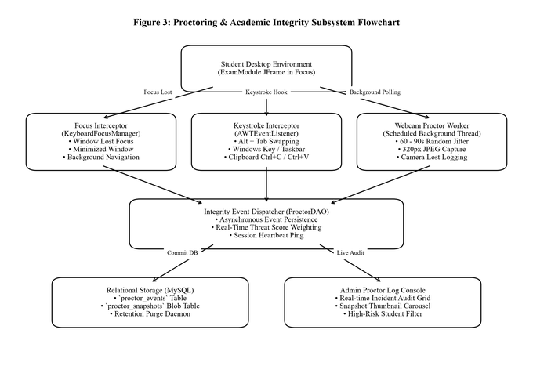

<!-- ============================================================ -->
<!-- ONLINE EXAMINATION MANAGEMENT SYSTEM (OEMS) - GITHUB SHOWCASE -->
<!-- ============================================================ -->

<div align="center">

<!-- ANIMATED 3D GRADIENT WAVING BANNER -->


<!-- ANIMATED TYPING SVG -->
<a href="https://github.com/ash3422w/Online-Exam-System">
  
</a>

<br/><br/>

<!-- SHIELD BADGES ROW -->
<p align="center">
  
  
  
  
  
</p>

<p align="center">
  <a href="#-key-features">Key Features</a> •
  <a href="#-system-architecture">Architecture</a> •
  <a href="#-application-screens">Live Screens</a> •
  <a href="#-quick-start">Quick Start</a> •
  <a href="#-project-report">Project Report</a>
</p>

</div>

---

## 🌟 Executive Overview

**Online Examination Management System (OEMS)** is a next-generation desktop Computer-Based Testing (CBT) platform engineered in **Core Java (Swing, Java2D)** and **MySQL 8.0**. 

Unlike conventional browser-based portals that are vulnerable to inspect-element tampering, unmonitored window switching, and network disconnect dropouts, OEMS runs as an isolated, hardware-accelerated desktop application that enforces JVM-level event interception, cryptographic credential protection, automated remote proctoring, and sub-millisecond execution response.

<div align="center">
  
</div>

---

## 🚀 Key Architectural Innovations

<table width="100%">
<tr>
<td width="50%" valign="top">

### 🛡️ Multi-Channel Proctoring
- **JVM Focus Loss Interceptor**: Listens to OS-level window focus deactivations (`Alt+Tab`, `Win` key, push notifications).
- **Global Key Hook Filtering**: Blocks cheating shortcuts (`Ctrl+C`, `Ctrl+V`, `Alt+F4`, function keys).
- **Webcam Surveillance Daemon**: Captures candidate snapshots at randomized intervals with cumulative threat scoring.
- **3-Strike Termination**: Automatically triggers emergency test submission upon exceeding violation limits.

</td>
<td width="50%" valign="top">

### 🔐 Military-Grade Cryptography
- **PBKDF2-HMAC-SHA256**: 120,000 iterative key-stretching rounds via `javax.crypto.SecretKeyFactory`.
- **128-Bit CSPRNG Salts**: Cryptographically secure salts generated per user via `SecureRandom`.
- **Automatic Legacy Migration**: Seamlessly upgrades legacy plaintext/SHA-256 hashes to PBKDF2 upon login.
- **Session Locking**: Prevents concurrent logins across multiple devices using active UUID session tokens.

</td>
</tr>
<tr>
<td width="50%" valign="top">

### 📊 Psychometric Item Analytics
- **Classical Test Theory (CTT)**:
  $$\text{Facility Index (Difficulty) } P = \frac{R}{N}$$
  $$\text{Discrimination Index } D = \frac{U - L}{N_G}$$
- **Kelley 27% Cohort Rule**: Computes discrimination power between top and bottom student quartiles.
- **Distractor Efficiency Audit**: Flags non-functional choices and identifies ambiguous question stems.

</td>
<td width="50%" valign="top">

### 📜 Tamper-Proof Certification
- **High-Density Vector PDF**: Generates archival certificates embedding candidate bonafides and institutional seals.
- **SHA-256 Cryptographic Signature**: Calculates unique digital checksum across candidate score and timestamp.
- **2D QR Matrix Verification**: Instant public and administrative verification via `VerifyCertificateUI.java`.

</td>
</tr>
</table>

---

## 📸 Complete Application Flow & Screen Demonstrations

<div align="center">

### 🎮 Candidate Assessment Experience

<table>
<tr>
  <td align="center" width="50%">
    <b>Split-Screen Authentication Gateway (<code>LoginUI</code>)</b><br/>
    <br/>
    <sub>PBKDF2-HMAC-SHA256 password derivation with database ping indicator</sub>
  </td>
  <td align="center" width="50%">
    <b>Candidate Portal & Bento Dashboard (<code>StudentDashboard</code>)</b><br/>
    <br/>
    <sub>KPI summary cards, test attempt history, and quick launch tiles</sub>
  </td>
</tr>
<tr>
  <td align="center" width="50%">
    <b>Assessment Catalog & Availability Gates (<code>SubjectSelectionUI</code>)</b><br/>
    <br/>
    <sub>Countdown schedule gates, attempt limit counters, and subject cards</sub>
  </td>
  <td align="center" width="50%">
    <b>Proctoring Consent & Hardware Briefing (<code>InstructionsUI</code>)</b><br/>
    <br/>
    <sub>Mandatory webcam permission, exam rules, and integrity policies</sub>
  </td>
</tr>
<tr>
  <td align="center" width="50%">
    <b>Distraction-Free Proctored Exam Runner (<code>ExamModule</code>)</b><br/>
    <br/>
    <sub>Live countdown timer, question palette navigation, and instant auto-save</sub>
  </td>
  <td align="center" width="50%">
    <b>Executive Result Scorecard (<code>ResultUI</code>)</b><br/>
    <br/>
    <sub>Score breakdown, percentage accuracy, and one-click PDF generation</sub>
  </td>
</tr>
</table>

<br/>

### 🛡️ Security, Proctoring & Administration Command Center

<table>
<tr>
  <td align="center" width="50%">
    <b>Remote Proctoring Audit Log (<code>ProctorLogUI</code>)</b><br/>
    <br/>
    <sub>Timestamped violation records, threat index scoring, and snapshot gallery</sub>
  </td>
  <td align="center" width="50%">
    <b>Psychometric Item Analytics (<code>QuestionAnalyticsUI</code>)</b><br/>
    <br/>
    <sub>Facility Index (P) & Discrimination (D) metrics flagging flawed questions</sub>
  </td>
</tr>
<tr>
  <td align="center" width="50%">
    <b>Multi-Axis Competency Radar Chart (<code>StudentPerformanceUI</code>)</b><br/>
    <br/>
    <sub>Custom Java2D trigonometric polar projection of subject masteries</sub>
  </td>
  <td align="center" width="50%">
    <b>Tamper-Proof Certificate Verification (<code>VerifyCertificateUI</code>)</b><br/>
    <br/>
    <sub>Public SHA-256 digital signature validation against MySQL ledger</sub>
  </td>
</tr>
</table>

</div>

---

## 🏗️ System Architecture & Visual Process Models

<details>
<summary><b>🔍 Click to Expand Architectural Models & State Machines</b></summary>
<br/>

### 1. Examination Lifecycle State Machine
Candidate progress is guarded by strict state machine transitions from identity verification to automated timeout submission:
<div align="center">
  
</div>

### 2. Proctoring & Academic Integrity Subsystem
Layered interceptor model auditing OS focus loss, keyboard scan codes, and webcam surveillance:
<div align="center">
  
</div>

### 3. Object-Oriented Class Hierarchy & Package Decoupling
Enterprise separation of concerns across 49 classes and 7 packages:
<div align="center">
  
</div>

</details>

---

## 📂 Package Architecture (49 Java Classes)

```
com.onlineexam
├── main          # [1 Class] Application bootstrap, FlatLaf initialization, & schema checks
│   └── Main.java
├── dao           # [12 Classes] Thread-safe Type-4 JDBC, PBKDF2 hashing, sessions, & CTT analytics
│   ├── DBConnection.java       ├── SchemaMigrator.java     ├── UserDAO.java
│   ├── ExamDAO.java            ├── QuestionDAO.java        ├── AttemptDAO.java
│   ├── SessionDAO.java         ├── SessionHeartbeat.java   ├── ProctorDAO.java
│   ├── WebcamProctorService.java├── AchievementService.java ├── QuestionAnalyticsDAO.java
│   └── CertificateService.java
├── data          # [4 Classes] Domain models, in-memory state, scoring, & vector PDF builder
│   ├── ExamConfig.java         ├── ExamStore.java
│   ├── AnswerEvaluator.java    └── CertificatePdfBuilder.java
├── ui            # [13 Classes] Reusable design tokens, glassmorphism, animations, & auth views
│   ├── UITheme.java            ├── Anim.java               ├── GlassPanel.java
│   ├── AuroraBackground.java   ├── AuthComponents.java     ├── DashboardComponents.java
│   ├── PasswordStrengthMeter.java├── ConfettiPanel.java    ├── RadarChartPanel.java
│   ├── GlassDialog.java        ├── DemoFrame.java          ├── LoginUI.java
│   └── SignupUI.java
├── ui.student    # [9 Classes] Candidate testing portal, proctored runner, results, & review
│   ├── StudentDashboard.java   ├── SubjectSelectionUI.java ├── InstructionsUI.java
│   ├── ExamModule.java         ├── ResultUI.java           ├── ReviewUI.java
│   ├── StudentPerformanceUI.java├── ProfilePanel.java     └── AchievementsPanel.java
├── ui.admin      # [8 Classes] Administration console, proctoring gallery, & question bank
│   ├── AdminDashboard.java     ├── ExamManagementUI.java   ├── AddQuestionUI.java
│   ├── ViewQuestionsUI.java    ├── PerformanceAnalysisUI.java├── QuestionAnalyticsUI.java
│   ├── ProctorLogUI.java       └── VerifyCertificateUI.java
└── test          # [1 Class] Database socket & driver diagnostic tool
    └── TestDB.java
```

---

## 🛠️ Tech Stack & Dependencies

<div align="center">
  
</div>

| Layer | Technology | Purpose |
|:---|:---|:---|
| **Language** | **Java SE 17+ / 21 LTS** | Core object-oriented runtime, multithreaded concurrency |
| **Presentation** | **Java Swing & Java2D** | Desktop window management, LCD anti-aliasing, vector graphics |
| **Theme & UX** | **FlatLaf 3.5.x** | Modern light SaaS design system, glassmorphism, and rounded cards |
| **Relational Database** | **MySQL 8.0 (InnoDB)** | ACID compliant transactions, referential foreign key integrity |
| **Connectivity** | **MySQL Connector/J 9.x** | High-performance Type-4 JDBC driver with statement batching |
| **Cryptography** | **Java Cryptography Architecture** | PBKDF2WithHmacSHA256 key stretching, CSPRNG salts |
| **PDF & QR Engine** | **OpenPDF 1.3.40 & ZXing 3.5.3** | Dynamic vector certificate rendering, 2D QR matrix generation |
| **Surveillance** | **Webcam-Capture 0.3.12 & BridJ** | Hardware video capture daemon for proctoring snapshots |

---

## ⚡ Quick Start & Run Guide

### 1. Prerequisites
- **JDK**: Java Development Kit 17 or higher (`java -version`).
- **MySQL**: MySQL Server 8.0 running on localhost port 3306.

### 2. Database Initialization
Execute the setup scripts in MySQL Workbench or via CLI:
```bash
mysql -u root -p < database_setup.sql
mysql -u root -p < sample_data.sql
```

### 3. One-Click Launch (Windows)

#### Native PowerShell:
```powershell
.\run.ps1
```

#### Windows Command Prompt:
```cmd
run.bat
```

#### Manual Compilation & Launch:
```powershell
# Compile all classes into out/ directory
javac -cp "lib/*" -d out *.java

# Run database diagnostic check
java -cp "out;lib/*" TestDB

# Launch the Application
java -cp "out;lib/*" com.onlineexam.main.Main
```

### 4. Default Seed Credentials

| Role | Username | Password | Access Level |
|:---|:---|:---|:---|
| **Administrator** | `admin` | `admin123` | Full admin console, question management, proctor logs, analytics |
| **Student Candidate** | `student1` | `pass123` | Student dashboard, exam catalog, test runner, certificates |
| **Student Candidate** | `student2` | `pass123` | Student dashboard, exam catalog, test runner, certificates |

---

## 📑 Formal Academic Project Report

The repository includes the complete, formal academic project documentation adhering to standard university submission rubrics:

- 📄 **Word Document**: [`Online_Exam_System_Java_Project_Report.docx`](Online_Exam_System_Java_Project_Report.docx) *(1.50 MB, Times New Roman, pure black styling, native Word page breaks, and embedded high-res diagrams)*
- 📝 **Markdown Report**: [`Java_Project_Report_Pagewise.md`](Java_Project_Report_Pagewise.md)
- 🌐 **Live Google Doc**: [Google Doc Project Report](https://docs.google.com/document/d/1wLFKMi-yDf_eAy1hBuASCnsFNO_sUGTMHFJLKsiCr-4/edit)

---

## 👤 Author & Maintainer

<table align="center">
  <tr>
    <td align="center">
      <a href="https://github.com/ash3422w">
        <br />
        <sub><b>Ashok Reddy (ash3422w)</b></sub>
      </a><br />
      <sub>Lead Software Architect & Security Engineer</sub>
    </td>
  </tr>
</table>

<div align="center">

<!-- ANIMATED FOOTER WAVE -->


<p align="center">
  <sub>Engineered with ❤️ in Core Java & MySQL • Released under the MIT License</sub>
</p>

</div>
